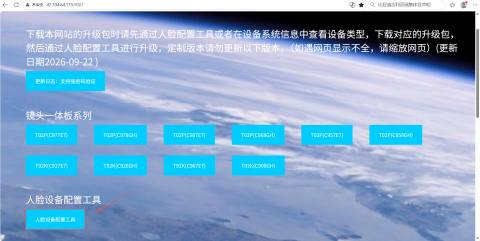
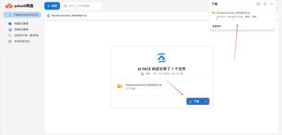
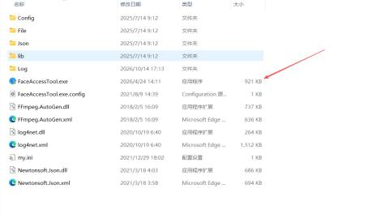
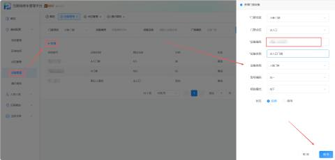
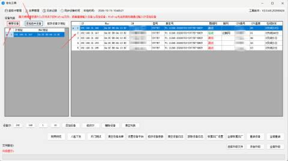
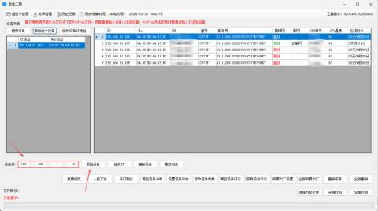
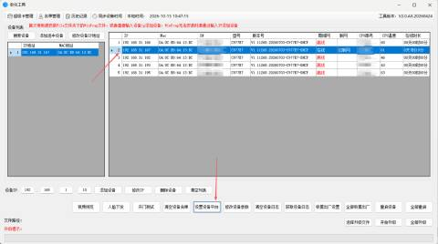
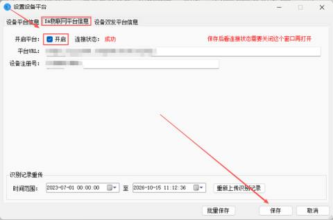
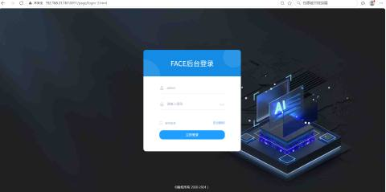
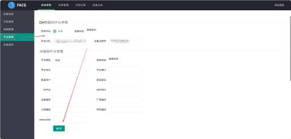

#### 1.人脸设备配置工具上云
+ 在网站下载人脸设备配置工具：[http://47.104.64.115:9001/](http://47.104.64.115:9001/)

+ 下载完成后，打开文件保存位置，找到解压后的文件夹

+ 登录门禁管理平台，进入"设备管理"模块，在对应点位下配置门禁设备信息

+ 开启门禁设备电源，等待设备启动完成并接入局域网。在配置工具中点击"搜索设备"按钮，工具将自动扫描局域网中在线的人脸门禁设备。在设备列表中找到目标设备，勾选该设备后点击"添加选中设备"，将其加入工具管理列表

+ 自动搜索未能发现设备，可尝试手动添加方式。在工具界面中找到"添加设备"入口，直接输入设备的IP地址进行添加。

+ 选择设备后，点击设备配置平台，填写平台URL和设备SN后保存

#### 2.设备后台上云
+ 设备开机时，屏幕会显示设备IP，在浏览器地址栏中输入设备IP地址，访问设备后台管理页面。
+ 账号：admin ；密码：123456

+ 填写平台URL和设备SN后保存

