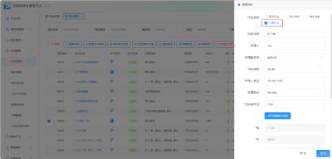
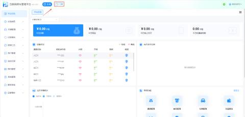
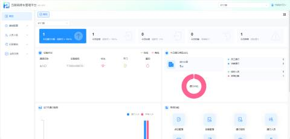
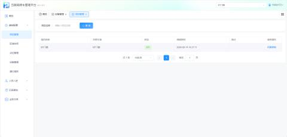

#### 1.功能概述
门禁项目新增与跳转功能是项目管理模块的核心入口，支持管理员在统一平台中快速创建门禁项目并无缝跳转至对应门禁管理后台。系统根据项目所勾选的平台类型数量，智能区分跳转逻辑——多平台类型时提供选择入口，纯门禁系统则直接跳转，确保操作路径最短、体验一致。

#### 2.新增项目
勾选对应的平台类型，保存成功后点击可跳转至平台

+ 操作路径：登录系统 ➔ 进入【项目管理】列表页 ➔ 点击【新增】按钮

#### 3.页面跳转
+ 多个平台类型：选择门禁跳转

+ 纯门禁系统：直接跳转

+ 跳转后可以看到新创建的门禁项目

