#### 1.功能概述
区域空间管理是门禁项目中楼栋、楼层、房间三级空间结构的统一维护模块。支持批量新增、手动新增、编辑修改、级联删除四大核心操作，满足项目初始化批量建模与日常运维精细调整的双重需求。系统通过【上级节点】自动构建完整空间路径，通过【排序】字段控制显示顺序，确保空间树结构清晰、数据一致。

#### 2.新增
+ 批量新增

适用于新建楼栋时一次性生成全部楼层与房间。按提示规则输入，系统将自动创建对应数量的楼层和房间。若取消勾选，则仅创建当前单个区域节点。

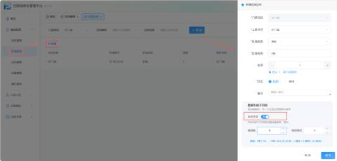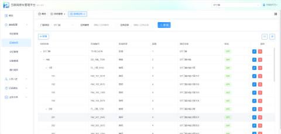

参数说明

| 上级节点 | 选择该空间所属的父级区域（如“BT门禁”），系统自动生成完整路径全称。 |
| --- | --- |
| 区域类型 | 下拉选择对应的空间层级类型 |
| 区域名称 | 自定义 |
| 排序 | 默认为1，数值越小显示越靠前（用于控制楼栋、楼层、房间的排列顺序） |
| 状态 | 启用/停用 |
| 批量生成子空间 | 新建楼栋时，一次性生成全部楼层与房间 |

+ 新增区域空间

创建一个全新的区域空间，作为后续楼栋、楼层、房间的根容器，后续可在此区域内创建楼层和房间

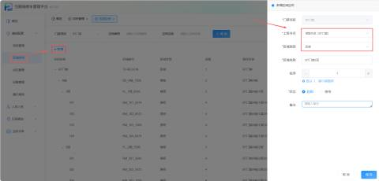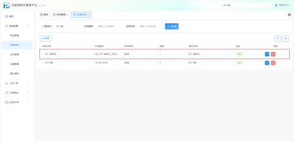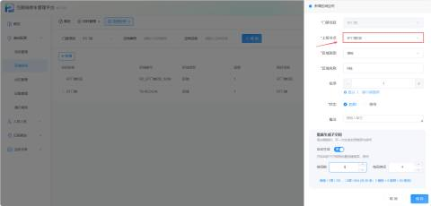

+ 手动新增

先选中目标楼栋，排序越小越靠前，排序值设为“当前最大楼层数+1”（如原有5层，新增第6层则填6）

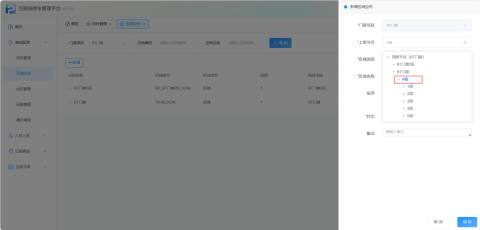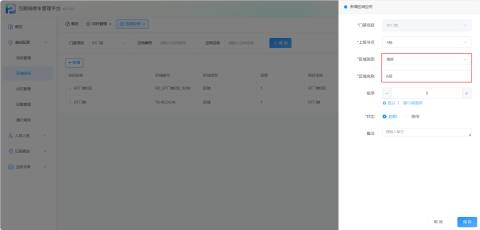

在新增的楼层上添加房间，上级节点选择对应楼层，排序值从1开始递增

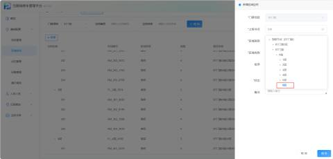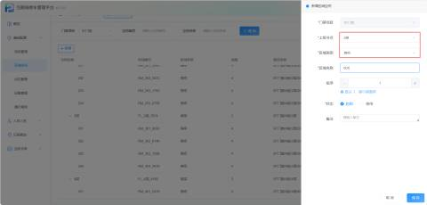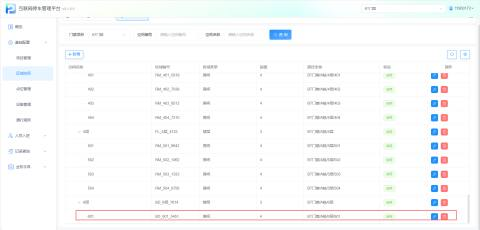

#### 3.修改
+ 在列表中点击对应空间的【编辑】按钮。
+ 支持修改区域名称、类型、排序及状态等基础信息

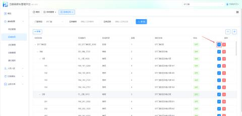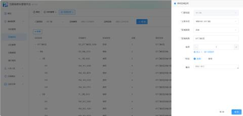

#### 4.删除
删除楼层时，其下所有房间都会同步删除；删除区域空间时，其下所有楼栋、楼层、房间都会同步删除

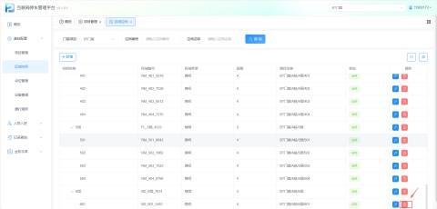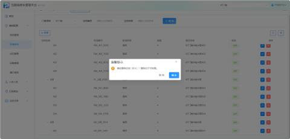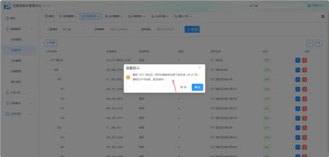

