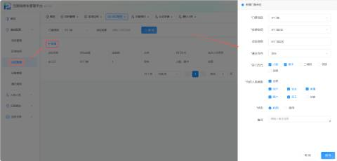
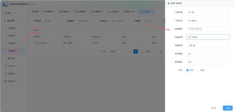
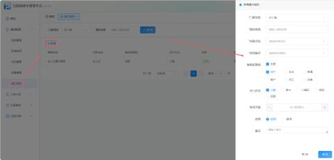

#### 1.功能概述
门禁系统的基础配置模块，由「点位管理」「设备管理」「通行规则」三个子功能组成，共同构建“空间位置 → 硬件设备 → 权限策略”的完整管控链路。管理员通过该模块定义门禁安装位置、绑定物理设备、配置通行权限，实现从硬件接入到权限下发的全流程闭环管理

#### 2.点位管理
定义门禁的物理安装位置与基础通行属性，是设备绑定和权限配置的载体

+ 参数说明

| 安装空间 | 选择该点位具体安装的物理位置（数据来源于“区域空间”中已建好的房间/楼层等节点） |
| --- | --- |
| 点位名称 | 自定义 |
| 通行方向 | 选择该门禁的通行方向（如：单向进、单向出、双向等） |
| 开门方式 | 勾选支持的开门验证方式。可选项包括：人脸、刷卡、二维码、密码、远程。至少需勾选一项。 |
| 允许人员类型 | 勾选允许通过该点位的人员身份类型。可选项包括：全部、住户、业主、家属、租户、员工、访客。若勾选“全部”，则默认包含所有类型。 |
| 状态 | 选择 启用 或 停用。默认为“启用” |

#### 3.设备管理
将物理硬件与逻辑点位进行绑定，完成设备注册与接入配置。

+ 参数说明

| 门禁点位 | 选择该设备绑定的具体门禁点位（如：BT门禁2区）。数据来源于“点位管理”中已建好的点位。 |
| --- | --- |
| 设备编号 | 输入设备的唯一序列号/SN码。校验规则：需保持全局唯一，不可与系统中已存在的设备编号重复。 |
| 设备名称 | 输入设备的自定义名称，便于日常识别与管理 |
| 设备类型 | 选择设备的硬件类型 |
| 型号编码 | 选择设备的具体型号 |
| 核验模式 | 选择设备的身份核验模式（线下/线上） |
| 状态 | 选择 启用 或 停用。默认为“启用”。 |

#### 4.通行规则
通行规则中的「角色权限组」和「开门方式」不能超出对应点位的配置范围。例如点位仅允许"人脸+刷卡"，则规则中不可勾选"二维码"。

+ 参数说明

| 规则名称 | 自定义 |
| --- | --- |
| 关联点位 | 选择该规则应用的具体门禁点位（数据来源于“点位管理”） |
| 空间锚点 | 选择该规则关联的空间节点（通常用于限定特定区域或楼层的权限） |
| 角色权限组 | 勾选允许通过该点位的人员身份。（与点位管理中选择一致） |
| 开门方式 | 勾选该规则下允许的通行方式。（与点位管理中选择一致） |
| 有效天数 | 设置规则的有效期时长，默认为空 |

