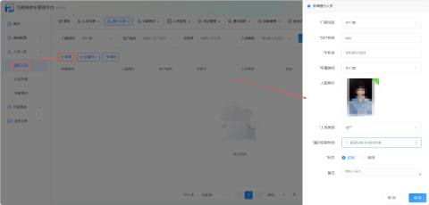
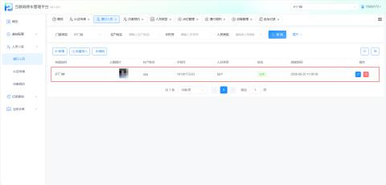
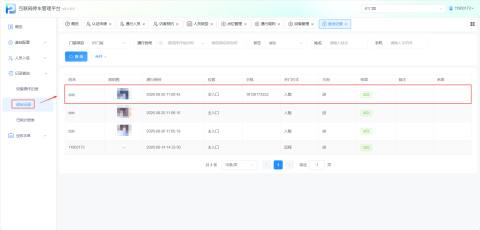
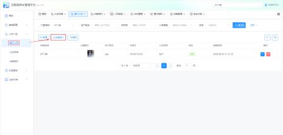
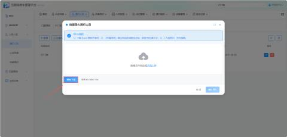
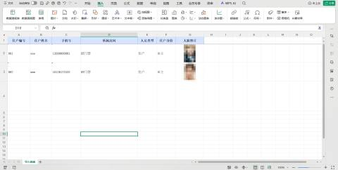
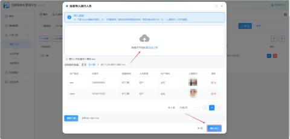
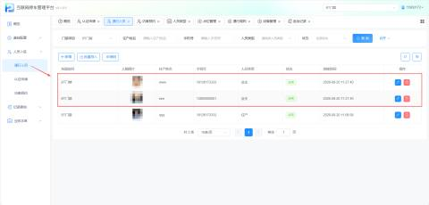
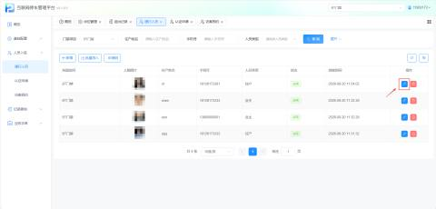
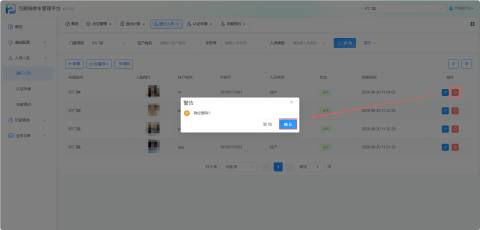

#### **1.功能概述**
通行人员模块用于在平台上录入和管理拥有门禁通行权限的人员信息，并支持为其绑定人脸、设置通行有效期。通过该功能，管理员可实现对住户/员工等人员通行权限的全生命周期管理（新增、批量导入、修改、删除），确保门禁权限的准确性与安全性。

+ 路径：【人员入驻】->【通行人员】

#### 2.新增
+ 参数说明

| 住户姓名 | 输入人员的真实姓名。 |
| --- | --- |
| 手机号 | 输入人员的手机号码 |
| 所属房间 | 下拉选择该人员绑定的具体房间/空间节点 |
| 人员类型 | 下拉选择该人员的身份属性（如：业主、租户、家属、员工、访客等，与“通行规则”中的角色权限组对应）。 |
| 通行结束时间 | 设定该人员通行权限的失效时间。若为长期住户，可选择较远的未来时间或根据系统默认规则设置。 |
| 状态 | 选择 启用 或 停用。新增时默认为“启用”。 |

+ 新增通行人员并绑定人脸后，该人员即可使用人脸通行方式通过门禁。

人员通行后，可在【记录查询】→【进出记录】中查看到对应的通行记录（含抓拍图、通行时间、开门方式、结果等信息）。

#### 3.批量导入
针对大量人员录入场景，系统提供批量导入功能，提升录入效率。

+ 路径：【人员入驻】->【通行人员】->【批量导入】

+ 点击批量导入，下载系统提供的通行人员导入模板。

+ 按照模板格式填写人员信息

+ 在上传界面拖拽文件或点击上传填写好的模板文件，执行导入

+ 在通行人员中可以看到新导入的人员记录

#### 4.修改
在通行人员列表中，点击对应人员记录的【编辑】按钮，可对住户的基本信息（如姓名、手机号、所属房间、人员类型、通行有效期、状态等）进行修改。修改完成后点击【保存】即可生效。

#### 5.删除
删除通行人员信息后，录入的住户信息将会被删除，该人员将无法通过该门禁点位，即同步取消其门禁通行权限。

