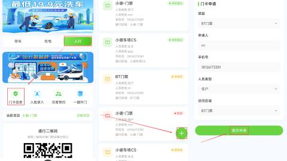
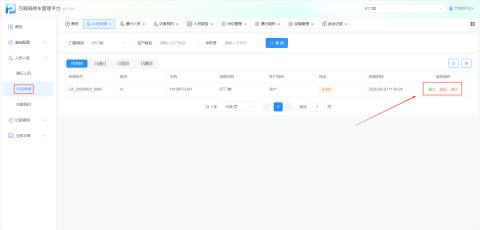
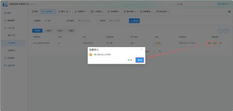
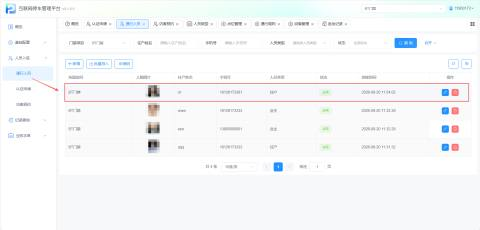
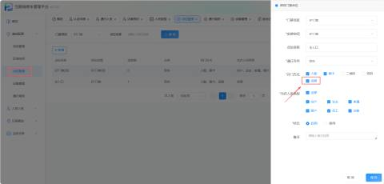
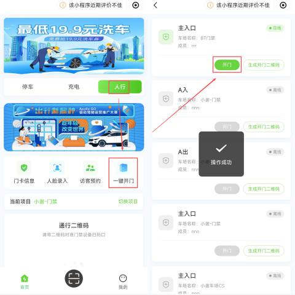
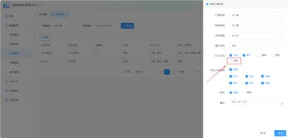
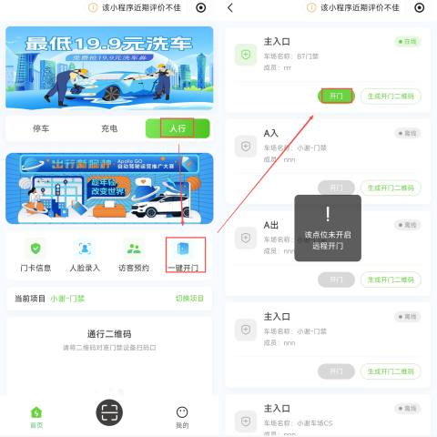

#### 1.功能概述
认证申请是连接“壹家社区小程序”与“互联网停车管理平台”的门禁权限申请与审核功能。用户在小程序端提交门卡信息（含住户信息、人脸照片）后，由管理员在平台端进行审核；审核通过后，该人员将同步至【通行人员】列表，并可根据点位管理中所允许的通行权限通过门禁。

+ 小程序端路径：壹家社区小程序 →【门卡信息】/【人脸录入】
+ 平台端路径：【人员入驻】→【认证申请】

#### 2.申请
a.录入门卡信息

+ 进入壹家社区小程序后，点击门卡信息，填写住户信息

b.人脸录入

+ 可以拍摄人脸录入和直接上传照片

#### 3.审核
填写完住户信息，上传人脸后，需要管理员在平台进行审核，通过后可在通行人员中看到新增的人员记录

#### 4.门卡权限
a.点位开启远程权限

+ 若点位开门方式有开启远程，则可在小程序中一键开门

+ 远程开门成功后，平台【进出记录】中会产生一条远程开门成功的记录，同时伴随一条失败的记录（如人脸通道未识别到人员的伴随记录），属正常业务现象。

b.点位无远程权限

+ 该点位无远程的开门权限时，会提示该点位未开启远程开门

c.门禁二维码

+ 点位允许二维码开门时，门卡页面同时展示通行二维码，可将二维码对准门禁设备扫码通行。

