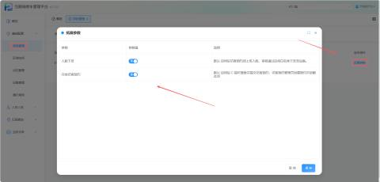
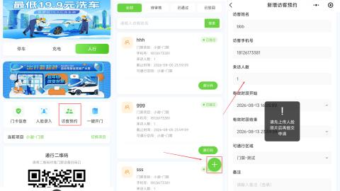
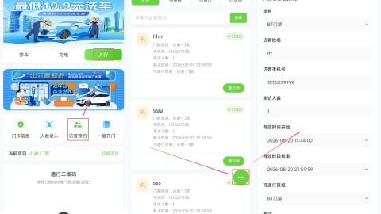
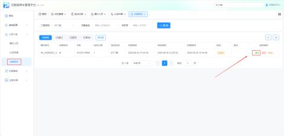
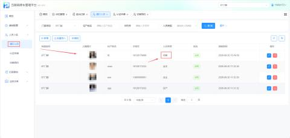
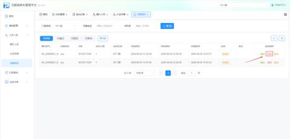
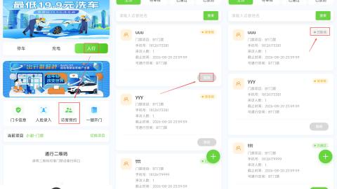

#### 1.功能概述
访客预约是面向临时来访人员的门禁权限申请与审核功能。住户通过“壹家社区小程序”为访客提交预约信息（含人脸照片），管理员在平台端审核通过后，系统自动在【通行人员】中生成访客记录，访客即可凭预约码或已录入人脸通行门禁。该功能支持参数化配置、线上自助预约、审核流转及撤回机制，实现访客权限的精细化管控。

#### 2.参数配置
可根据项目需求勾选参数

+ 路径：【项目管理】->【拓展参数】

+ 参数说明

| 人脸下发 | 启用后访客预约须上传人脸，审核通过后将白名单下发至设备 |
| --- | --- |
| 开启访客预约 | 启用后 C 端可搜索并提交访客预约；访客预约管理页创建预约亦依赖此项 |
| 当【开启访客预约】与【人脸下发】两项均启用时，访客预约流程中将强制校验人脸照片，未上传人脸将无法完成预约提交。 | |

#### 3.预约
a.进入壹家社区小程序，上传人脸后，点击进入访客预约，填写完访客信息后提交预约

#### 4.审核
a.审核通过

+ 管理员点击通过，在通行人员列表中新增一条访客记录。若启用人脸下发，同步将人脸白名单下发至对应门禁设备。

b.驳回

+ 管理员点击驳回后，预约申请失效。访客需重新发起预约，修改信息后再次提交审核。

c.撤销

+ 访客行程变更、信息填写错误等，可在审核前或审核通过后主动撤回预约，撤回后通行权限即时失效。

#### 5.通行方式
a.人脸识别

+ 若已录入人脸且设备支持，直接刷脸通行

b.访客通行码

+ 路径：【壹家小程序】->【人行】->【访客预约】->【通行码】

