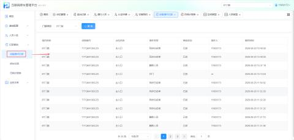
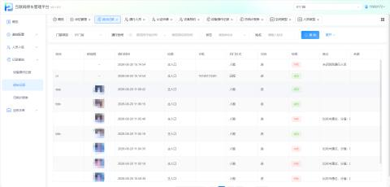
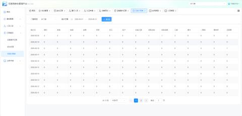

#### 1.设备操作记录
设备操作记录是互联网停车管理平台中用于追踪、查询门禁设备操作历史的核心功能模块。通过该功能，管理员可查看设备操作的全流程日志（含操作类型、响应状态、操作人、时间等），实现对设备操作的追溯、审计与异常排查，保障停车管理系统的安全性与可管理性。

+ 路径：【记录查询】->【设备操作记录】

#### 2.进出记录
进出记录是互联网停车管理平台中用于实时监控和追溯人员通行情况的核心功能模块。该功能详细记录了所有通过门禁设备的人员通行日志，包括抓拍图像、通行时间、开门方式及验证结果等。管理员可通过此功能核查人员出入情况、分析通行失败原因（如人脸比对未通过），并对异常通行事件进行审计与处理，保障区域安全与管理秩序。

#### 3.日统计报表
日统计报表是互联网停车管理平台中用于汇总和分析每日通行数据的核心报表模块。该功能以天为维度，对指定时间段内的门禁通行数据进行多维度统计（如进出场人数、人员类型、验证方式、异常情况等）。管理员可通过此报表快速掌握项目通行流量趋势、设备使用率及人员构成，为运营决策、安保排班及设备维护提供数据支撑。

