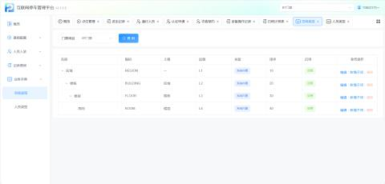
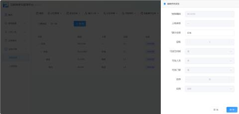
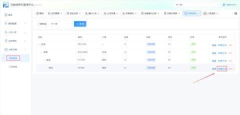
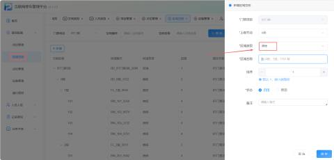
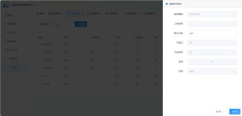
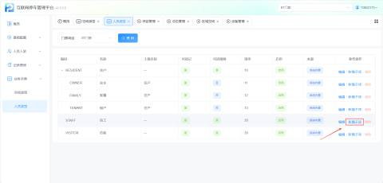
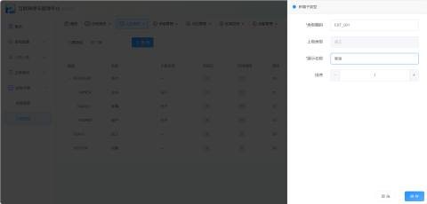
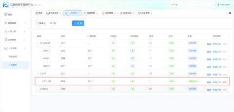
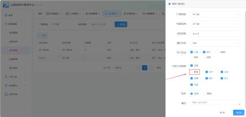

#### 1.功能概述
业务字典是门禁项目的基础数据底座，由空间类型和人员类型两大模块组成。系统预置了标准的空间层级与人员分类；同时支持管理员根据实际业务场景自定义扩展子项。所有字典项均通过树状结构组织，支撑上层空间管理、点位配置、权限规则的数据引用。

#### 2.空间类型
a.系统默认空间类型

+ 初始配置不可更改，仅可修改展示名称，不可删除

b.新增子项

+ 可以选择原有空间类型新增下级分支

+ 创建新的区域空间时可选择新增的区域类型

#### 2.人员类型
a.系统默认人员类型

+ 初始配置不可更改，仅可修改展示名称，不可删除

b.新增子项

+ 可以选择原有空间类型新增下级分支

+ 新增的人员类型会自动出现在【点位管理】的"允许人员类型"和【通行规则】的"角色权限组"选项中

