二维码中查看开票码，或使用公众号公共入口

+ 平台二维码

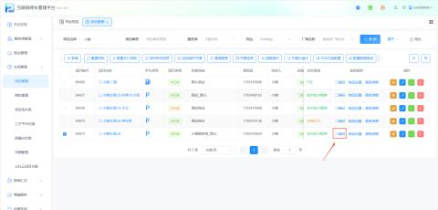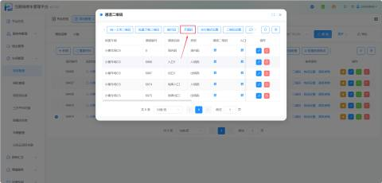

+ 公众号公共入口

关注壹家社区公众号，进入我的车辆

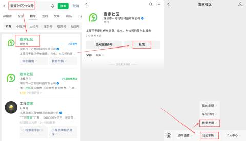

#### 1.配置发票信息
在平台配置车场开票信息

+ 路径：【项目管理】->【开票信息】

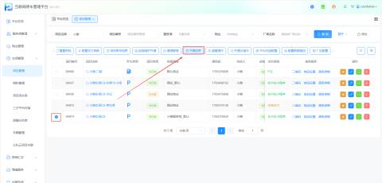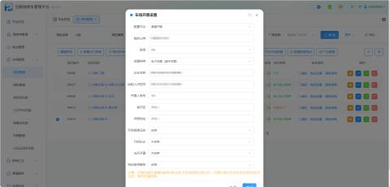

#### 2.个人开票
+ 进入开票页面 ->勾选需要开票的订单->抬头类型选择个人->填写开票信息

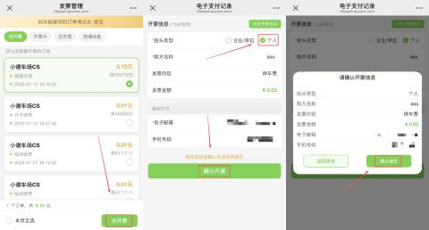

+ 开票成功后可查看发票

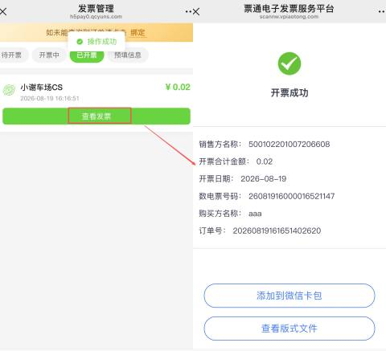

+ 发票添加到微信卡包

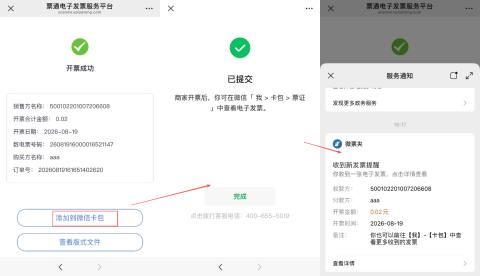

+ 查看版式文件

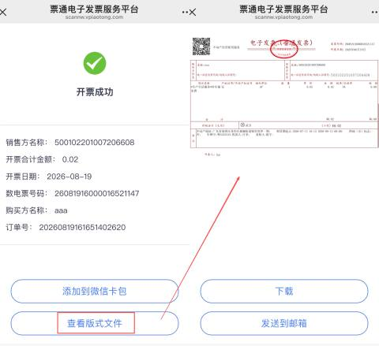

#### 3.企业/单位开票
抬头类型选择企业/单位，根据实际填写开票信息

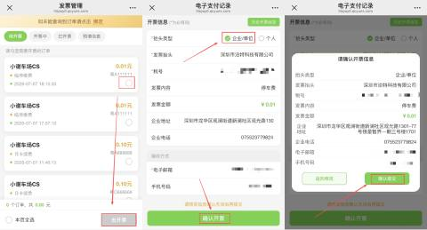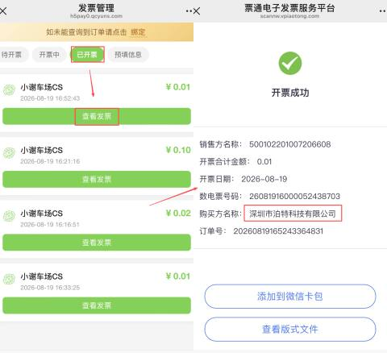

#### 4.绑定车牌
+ 绑定车牌后仅可看到自己绑定的车牌订单

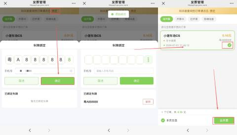

+ 解绑车牌

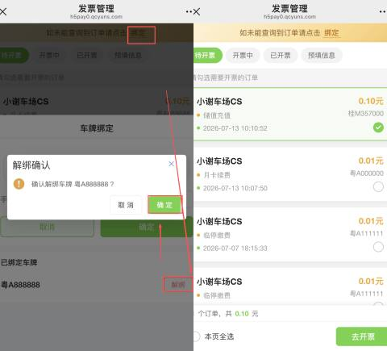

#### 5.预填信息
+ 用户可预先填写开票信息并保存，下次开票时可直接从历史开票信息中选择，无需重复填写

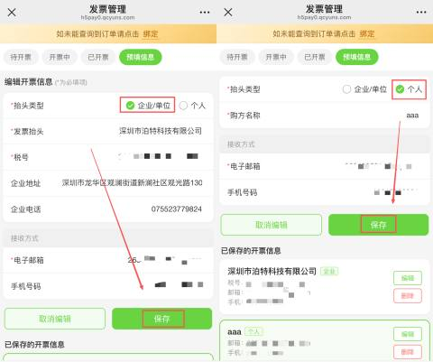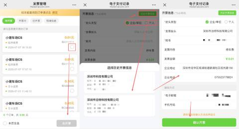

