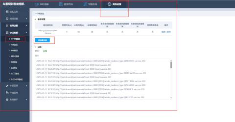
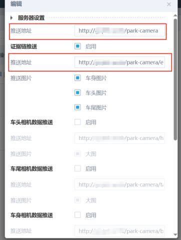
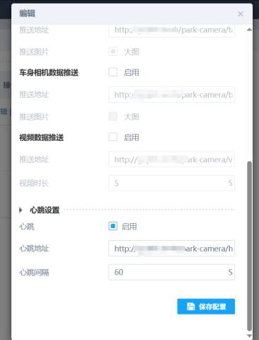
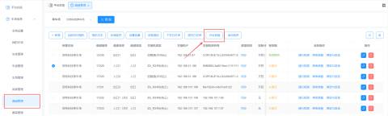
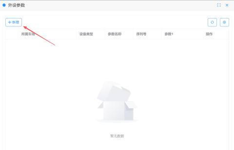
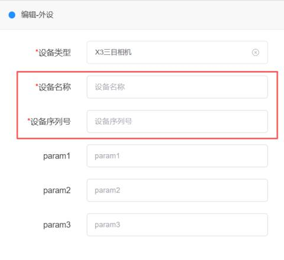
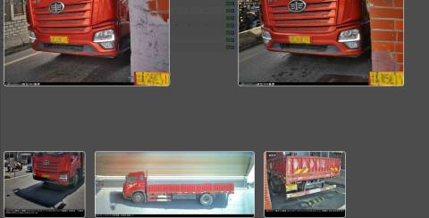

#### 第一步：准备工作
1. 升级固件：
+ 登录X3相机后台，务必先将相机升级至最新版本，避免因协议老旧导致功能异常
2. 网络连通性：
+ 确保相机与操作电脑处于同一局域网
+ 关键检查：Ping一下你的服务器或域名，确保网络通畅

#### 第二步：配置相机后台（核心步骤）
路径：`高级设置` > `协议配置` > `Http推送`

请根据项目类型（纯云/半云）填写以下参数：

| 配置项 | 纯云 模式 | 半云 模式 |
| --- | --- | --- |
| 推送地址 | http : // [域名] / park-camera | http : // [本地服务器IP] / park-camera |
| 证据链推送 | http : // [域名] / park-camera / evidence | http : // [本地服务器IP] / park-camera / evidence |
| 心跳设置 | http : // [域名] / park-camera / heart | http : // [本地服务器IP] / park-camera / heart |

  
**参数填写说明：**

+ 纯云模式：文档中的“域名”需替换为实际的云平台域名（例如：`park.域名.com`）
+ 半云模式：IP地址需填写车场本地服务器的内网IP（如 `192.168.1.100`）
+ 通用规则：所有地址末尾不要带多余的空格或特殊字符

#### 第三步：平台通道绑定
配置完相机后，必须在管理平台中将相机与通道进行绑定

路径：`通道管理` > `外设参数` > `新增外设`

1. 选择设备类型：在下拉框中选择 “X3三目相机”
2. 填写设备信息：填写设备名称和设备的 SN码（序列号格式请确保无空格）
3. 保存生效：点击确定，将该外设关联到对应的入口或出口通道

#### 第四步：验证与调试
1. 查看日志：
+ 在相机后台或平台日志中，查看是否有 `200 Success` 或 `Heart Success` 的返回码
+ _注：原文档中的乱码（如“SUCESSCU”）实际上是“SUCCESS”的识别错误，代表成功_
2. 过车测试：
+ 驶入一辆测试车，检查平台是否能同时收到车头、车身、车尾三张图片

+ 如果只有图没有车牌，通常是推送地址填写错误或网络不通

| 问题现象 | 可能原因 | 解决方案 |
| --- | --- | --- |
| 心跳失败 | 地址填写错误或端口被拦截 | 检查防火墙设置，确保服务器80端口开放；核对URL是否拼写错误 |
| 有图无牌 | 证据链推送未生效 | 确认“证据链推送”地址是否正确；检查网络延迟是否过高 |
| 图片缺失 | 相机未绑定通道或序列号错误 | 重新进入“通道管理”核对序列号，确保相机类型选为“X3三目” |

