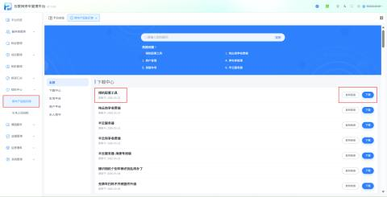
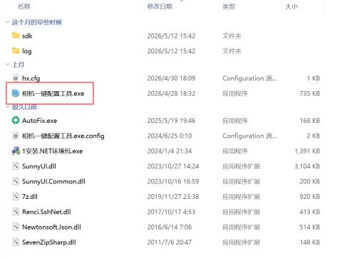
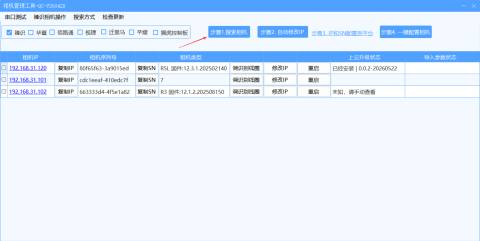
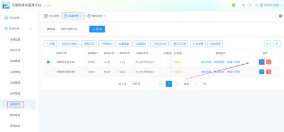
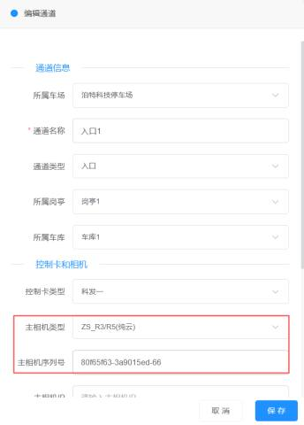
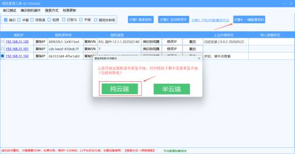
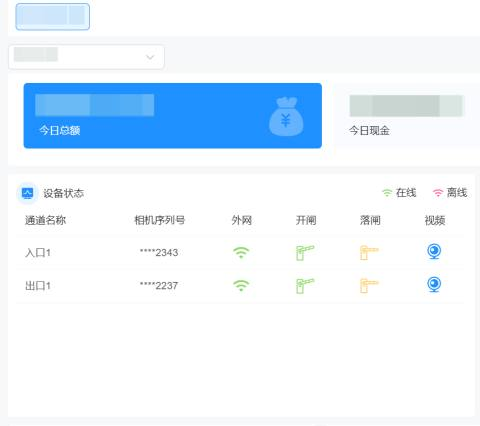

#### 第一步：环境准备
+ 工具下载：前往【帮助中心】->【停车产品知识库】下载“相机一键配置工具”
+ 网络连接：确保操作电脑与相机通过网线连接在同一个局域网内（电脑能Ping通相机IP）

#### 第二步：搜索与修改IP
1. 打开“相机一键配置工具”
2. 点击【搜索相机】按钮，工具将自动列出当前局域网内的所有相机设备
+ 若无设备显示：请检查网线连接，或尝试点击“高级搜索”

3. 勾选需要配置的相机，点击【自动修改IP】
+ 作用：工具会自动给相机分配一个与电脑同网段且不冲突的IP地址，避免因IP冲突导致设备频繁掉线

#### 第三步：平台参数录入（关键步骤）
登录互联网停车管理平台

1. 路径：我的车场 -> 通道管理 -> 编辑通道

2. 填写信息：
+ 将工具中显示的相机 IP地址 和 序列号 (SN) 填入通道信息中
+ 选择相机类型（非常重要，请对照下表选择）

| 相机品牌 | 支持型号 | 平台/工具选择项 |
| --- | --- | --- |
| 臻识 (ZS) | C3, C5，C5H | `ZS_C3/C5`(纯云) |
| 臻识 (ZS) | R系列新型号 | `ZS-PLUS`（纯云） |
| 华夏 (HX) | V85及以上 | 华夏相机 (需使用高级搜索) |
| 芊熠 (QY) | S8及以上 | 需使用芊熠专用工具配置 |
| 信路通 | 1D，1B | 信路通（半/纯云） |

####   
第四步：一键上云
1. 返回配置工具界面，勾选已填参的相机
2. 点击【一键配置相机】按钮
3. 选择模式：在弹窗中务必选择 “纯云端” 模式

4. 等待进度条走完，相机将自动重启（约需2分钟）

#### 第五步：状态验证
1. 登录云平台：进入【相机管理】或【通道管理】页面。
2. 查看状态：
+ 成功：外网状态栏显示绿色“在线”
+ 失败：
1. 若显示“离线”，外网状态栏显示红色，请检查相机是否连通外网
2. 再次核对“相机类型”是否选择正确
3. 检查序列号是否有空格（文中强调：序列号不可有空格）

#### 常见问题与注意事项
1. **禁止重复操作：**
+ 警告：任何情况下都不需要重复点击【一键配置相机】或进行“初始化/升级”操作。如果配置失败，请等待1-2分钟，以平台状态为准。
2. **芊熠相机特殊配置：**
+ 芊熠相机（S8以上）不可使用通用工具。
+ 操作路径：需使用芊熠专用工具 -> 专家模式 -> MQTT -> 选择平台8 -> 重启。
3. **华夏相机搜索不到：**
+ 必须在工具中使用 “高级搜索” 功能才能发现设备。
4. **IP冲突预防：**
+ 务必使用工具的【自动修改IP】功能，建议非必要手动输入IP，以免造成网络风暴。

#### 其他说明：
| 相机工具 | 可在下载中心下载工具，打开相机工具按步骤操作；1、搜索相机（电脑和相机一定要在一个局域网内），2、自动修改IP（勾选需要修改IP的相机，工具会自动给相机分配当前电脑获取的网络IP段给相机分配且不冲突的IP），3、将相机IP和序列号填入对应的通道，4、勾选需要配置的相机一键配置（配置时会让选择配置类型，根据车场创建时选择的系统类型选择：纯云端或者半云端） |
| --- | --- |
| 注：一定按照步骤操作，纯云类型任何情况下都不可重复配置相机   如一键配置后平台查看设备没有上线请检查以下几种情况：   1. 相机是否连通外网   2. 检查相机类型是否正确（臻识相机C系列选择C3/C5，R系列的选择ZS-PLUS（纯云）；华夏相机需V85以上型号可上云，工具使用高级搜索→一键配置之后在相机平台里的网络参数→云平台中修改车场ID；千熠相机需S8以上型号，需要用千熠的相机工具进行配置，专家模式--MQTT--选择平台8，重启设备即可） | |

