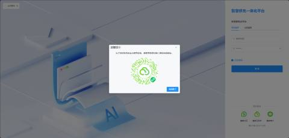
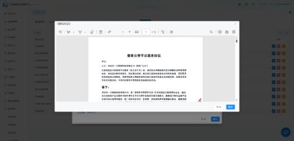
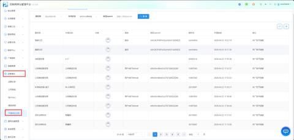
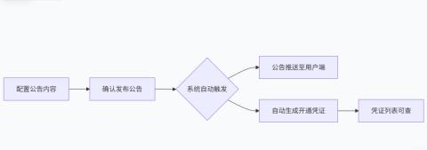
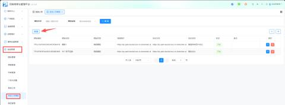
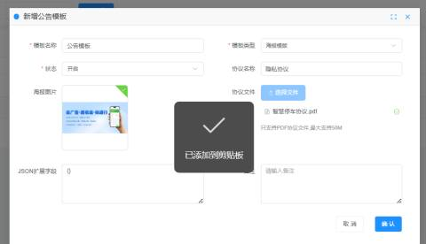
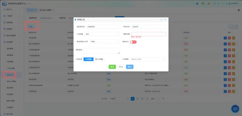
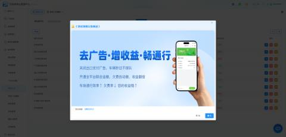
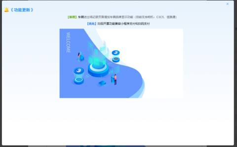

1、为了提升平台账号的安全性，并优化多端登录体验，本次新增“扫码登录 + 微信账号绑定”功能。用户除了使用传统的“账号密码”登录外，还可以通过微信扫码的方式快速登录云平台，同时完成账号与微信的强绑定，增强账号安全防护。

**注意：服务商或者车场方首次登录会弹框，用户应当扫码绑定：系统会将当前登录的账号与微信OpenID进行绑定，建立一一对应关系。（只会弹窗一次，绑定过的账号不会再次弹窗）**

****

2、为了提升停车场运营效率，我们对“系统公告”模版进行了全面升级，支持按“单个车场”、“服务商”或“全部”精准推送公告。

当用户忘记阅读左下方的“隐私协议“直接点【确定】时，会直接弹窗给予用户查看协议，点击【确定】即可。

**注意：确定完公告之后，会自动生成一个开通凭证记录。**

整个操作与记录流程如下图所示：

**A、入口路径：登录平台 → 左侧菜单【系统管理】→ 点击【系统公告模版】**

**B、创建公告模版操作步骤**

**注意：公告模板是预存的内容样式，可在发布公告时快速调用。目前支持“海报模板”类型。**

（1）、内容配置

| 字段名称 | 说明 | 是否必填 | 示例 |
| --- | --- | --- | --- |
| 模板名称 | 输入模板名称 | 是 | 公告模板 |
| 模板类型 | 选择海报模板 | 是 |  |
| **海报图片** | 上传活动宣传图或公告配图 | 否 | 支持jpg/png格式，建议尺寸750*500px |
| **协议文件** | 上传PDF格式的协议文件 | 条件必填 | 仅支持PDF，最大50M |
| **JSON扩展字段** | 用于个性化配置，如自定义样式、跳转链接等 | 否 | `{"bg_color":"#ffffff","jump_url":"https://..."}` |
| **备注** | 补充说明信息，仅后台可见 | 否 | “专用模板” |

（2）、填写基础信息

| 操作项 | 操作说明 |
| --- | --- |
| 模板名称 | 输入便于识别的名称， |
| 模板类型 | 本功能只有一个模板“海报模板” |
| 状态 | 默认为“开启”，若暂不使用可选择“关闭” |

（3）、配置协议内容

**协议名称**：输入用户端显示的协议标题

协议文件：点击【选择文件】，上传PDF格式的协议文件

支持格式：仅PDF

文件大小：最大50M

（4）、配置海报图片

点击【选择文件】按钮（位于“海报图片”字段）

从本地选择图片文件（建议使用jpg/png格式）

上传成功后，系统会显示图片缩略图

**用途：** 海报图片可用于活动公告的封面图、节日问候卡片等，在推送时展示给用户。

**C、****创建好模板后，即可在【系统公告】中发布一则新公告。**

（1）、新增或编辑公告模版时，您需要配置以下选项：

| 字段名称 | 说明 | 可选值/示例 |
| --- | --- | --- |
| **服务商名称** | 选择公告适用的服务商范围 | • 单个服务商（如“M-国际-前端-服务商”）   • 所有服务商   • 禁止所有服务商 |
| **项目名称** | 选择公告适用的具体停车场项目 | • 单个项目（如“M-国际-纯云项目”）   • 所有项目   • 禁止所有项目 |
| **公告类型** | 标识公告的类别 | • 系统（系统维护、版本更新）   • 功能（新功能发布）   • 营销（营销推广） |
| **通知标题** | 公告的标题，将显示在列表和推送消息中 | 示例：“功能更新（2025年09月22日）” |
| **推送状态** | 控制公告是否生效推送 | • 开启（立即生效/进入推送队列）   • 关闭（仅保存为草稿，不推送） |
| **内容来源** | 公告正文的编辑方式 | • 富文本编辑（推荐）   • 公告模板 |
| **公告模板** | 上述创建好的模板，选择即可 |  |

（2）、配置投放范围：

| 操作项 | 操作说明 |
| --- | --- |
| 选择服务商 | 点击【服务商名称】下拉框，选择目标服务商。如需全选，选择“所有服务商”；如需禁用，选择“禁止所有服务商”。 |
| 选择项目 | 点击【项目名称】下拉框，系统会根据所选服务商自动过滤项目列表。选择具体项目或“所有项目”。 |

**注意： 若选择“禁止所有服务商”，则项目名称自动变为“禁止所有项目”，该模版不会向任何车场推送。**

（3）、填写公告基本信息

| 操作项 | 操作说明 |
| --- | --- |
| 公告类型 | 从下拉框中选择：系统 / 功能 / 活动 等 |
| 通知标题 | 输入公告标题（建议不超过30字，简明扼要） |
| 推送状态 | 默认为“关闭”（草稿状态）。确认内容无误后，再切换为“开启” |

（4）、内容来源：选择“**公告模板**”，然后在下拉菜单中选择您已创建好的模板。也可选择“富文本编辑”进行自定义排版。

（5）、预览公告效果

在点击“保存”之前，请务必使用预览功能进行最终检查：

1. 点击编辑器上方的 **【预览】** 按钮。
2. 系统会弹出窗口，模拟公告在微信公众号或小程序中的最终显示效果。
3. 仔细检查标题、正文、图片、协议链接等是否显示正常。
4. 若发现问题，关闭预览窗口，返回修改；确认无误后，再保存并开启推送。

**公告模板预览效果：**

**富文本编辑预览效果：**

