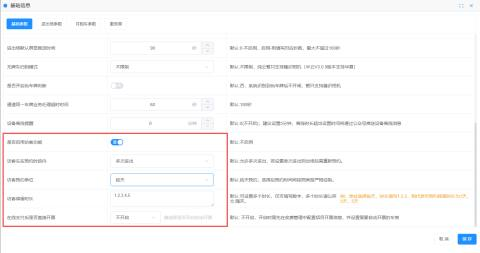
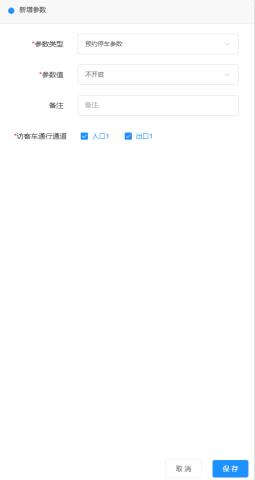
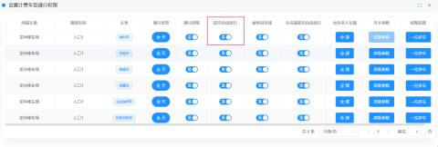
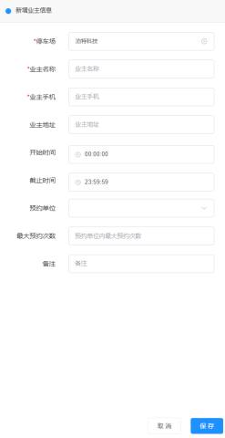
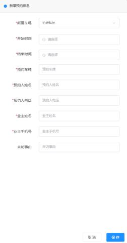
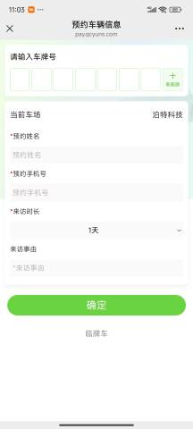
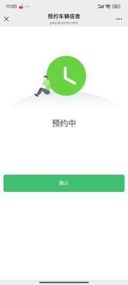
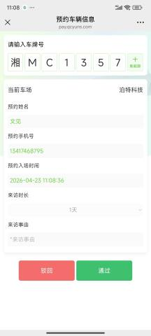

#### 1. 功能概述
访客预约功能旨在解决停车场外来车辆的进出管理问题。支持**管理员后台代预约**和**车主小程序自助预约**两种模式，并提供灵活的审核机制与通行权限控制。

#### 2. 核心配置流程 (管理员端)
在使用该功能前，需完成基础参数设置与业主信息录入  
**2.1 开启访客预约功能**

#### 1.功能概述
访客预约功能旨在解决停车场外来车辆的进出管理问题。支持管理员后台代预约和车主小程序自助预约两种模式，并提供灵活的审核机制与通行权限控制。

#### 2.核心配置流程（管理员端）
在使用该功能前需要完成基础参数设置与业主信息录入。

**2.1开启访客预约功能**

+ **路径：**【全局设置】->【基本参数】

+ **关键参数说明：**

| 参数名称 | 说明 | 建议设置 |
| --- | --- | --- |
| 是否启用访客功能 | 开启后方可使用此功能 | 开启 |
| 访客车在预约时间段 | 控制进出次数 | 默认允许多次进出（若选单次，出场后需重新预约） |
| 访客预约单位 | 预约时长的计算单位 | 按天/按小时/按分钟 |
| 访客停留时长 | 可预约的时长选项 | 填写数字，英文用逗号隔开（例：1,2,3） |

**2.2高级参数设置（审核与通道）**

+ **路径：**【我的车场】->【更多】->【高级参数】->【新增】->选择**预约车参数**

+ **参数值选择：**
    - **扫码登记预约免审核**：车主预约后直接生效，自动抬杆。
    - **扫码登记预约需审核**：车主预约后，需管理员在微信/后台审核通过方可入场。
+ **访客车通行通道：**
    - 建议同时勾选**入口**和**出口**。若只选入口，出场时需人工放行。

**2.3通道权限联动（重要）**

为了确保预约功能生效，需关闭临时车的自动放行权限：

+ **路径：**【通道管理】->选择通道入口->【通行权限】
+ **操作：**关闭临时车的【是否自动放行】权限。

**2.4新增业主信息**

访客通常是拜访业主的，因此必须先录入业主信息（业主信息可只新增一个）。

+ **路径：**【预约管理】->【业主管理】->【新增】

+ **必填项**：业主姓名、业主电话、开始/截止时间、最大预约次数。
+ **快捷方式**：支持通过【业主信息导入】模板批量上传。

#### 3预约操作指南
**3.1模式一：管理员代预约**

适用于管理员已知访客信息，直接录入系统的情况。

+ **路径：**【预约管理】->【预约记录】->【新增】

+ **流程**：填写开始时间/结束时间、预约车牌、预约人信息、关联业主 -> 点击保存。
+ **特点**：管理员直接预约的记录默认**审核通过**，无需二次确认。

3.2模式二：车主自助预约

适用于访客自行扫码或通过小程序申请。

+ **入口：**
    - 微信搜索小程序【壹家社区】 -> 【预约停车】。
    - 扫描车场入口处的【预约二维码】（路径：【我的车场】->【通道二维码】下载）。
+ 
+ **流程：**
    1. 输入车牌、姓名、手机号。
    2. 选择来访时长（受后台“访客停留时长”参数限制）。
    3. 填写来访事由并提交。
+ **审核通知**：若设置为“需审核”，管理员微信将收到审批提醒，点击“通过”后访客方可入场。

#### 4. 业务场景配置举例
为了帮助您更好地理解，以下提供两种典型场景的配置方案：

**场景 A：开放式园区（免审核、限时进出）**

+ **需求**：访客扫码预约后直接进场，限制每次最多停3小时。
+ **配置**：
    1. **基本参数**：启用功能，单位选“按小时”，时长填 `1,2,3`。
    2. **高级参数**：参数值选 `扫码登记预约免审核`，通道选“出入口”。
    3. **结果**：车主扫码选2小时 -> 提交 -> 直接生成权限 -> 进场自动抬杆。

**场景 B：封闭小区（需审核、按天预约）**

+ **需求**：访客探亲需停多天，必须经业主或管理员确认。
+ **配置**：
    1. **基本参数**：启用功能，单位选“按天”，时长填 `1,2,3,4,5`。
    2. **高级参数**：参数值选 `扫码登记预约需审核`。
    3. **结果**：车主扫码选3天 -> 提交 -> 管理员微信收到提醒 -> 点击“通过” -> 车主收到通知 -> 进场。

#### 5. 记录与导出
+ **查询**：【预约管理】 -> 【预约记录】，支持按车牌、车场搜索。
+ **导出**：点击【预约记录导出】可下载Excel表格，包含预约人、车牌、时段等详细信息。

  

