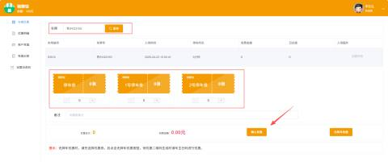
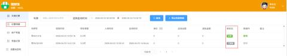
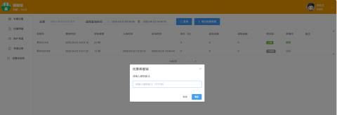
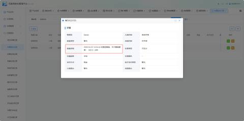
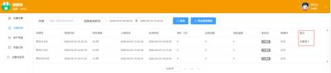
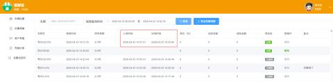
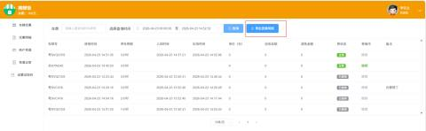
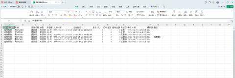
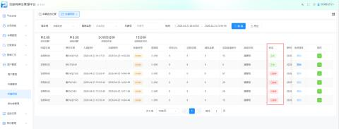

#### 一、功能简介
为方便商家对已发放的优惠券进行灵活管理，平台新增**优惠券撤销**功能。当优惠券发放错误或需要调整时，商家可以在“优惠明细”中对已使用的优惠券进行撤销操作。撤销后，对应的优惠金额将不再生效，系统会自动重新计算订单金额。

#### 二、操作入口
1. 登录互联网停车管理平台
2. 进入左侧导航栏 → **车辆优惠**→ **输入车牌进行优惠**

#### 三、操作步骤
**步骤1：查找需要撤销的优惠记录，点击【撤销】**

**步骤2：确认记录状态**

在列表中，找到需要撤销的优惠记录，确认其 **“状态”** 为 **“正常”**（只有状态为“正常”的记录才可撤销）。

**步骤3：执行撤销操作**

1. 在目标记录的右侧，点击 **“撤销”** 按钮
2. 系统弹出确认提示框：“确认撤销该优惠记录？撤销后优惠将不再生效”
3. 点击 **“确认”** 完成撤销

4. 商家可在弹窗输入撤销的原因

**注意：点击撤销之后，商户余额增加（优惠时扣减的单价，比如单价20，优惠后余额80，撤销后，余额变成100）**

当您对某条优惠记录执行撤销操作后，该车辆对应的**车辆进出记录**会自动更新，确保订单金额与实际优惠情况一致。优惠详情会在进出记录进行说明。

**步骤4：确认撤销结果**

撤销成功后，您将看到以下变化：

+ 该记录的状态变为 **“已撤销”**
+ 减免金额变为 **0.00**
+ 关联订单的应收金额自动恢复为原价
+ 撤销按钮变为不可点击状态

#### 四、注意事项
| 场景 | 说明 |
| --- | --- |
| 仅可撤销“正常”状态的记录 | 已撤销的记录不可重复撤销 |
| 撤销后不可恢复 | 撤销操作不可逆，请谨慎操作 |
| 撤销后订单金额自动调整 | 系统会自动重新计算该车辆的停车费用 |
| 当车辆已经出场（有完整的进出场记录） | 优惠是不可以撤销的 |
| 优惠券可支持多次减免的 | 若撤销其中某一次，优惠券的剩余额度需要**恢复** |

#### 五、导出明细
“优惠明细导出”功能用于将查询到的优惠记录导出为Excel文件，方便商家进行线下对账、数据统计和存档管理。本次优化提升了导出的数据完整性和用户体验。

#### 六、车场平台也可进行撤销操作
**操作入口**

1. 登录互联网停车管理平台
2. 进进入左侧导航栏 → **商户管理** → **优惠明细**
3. **操作逻辑与商家一样**

