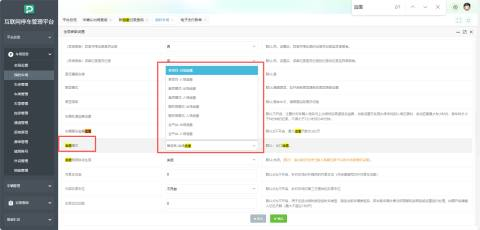
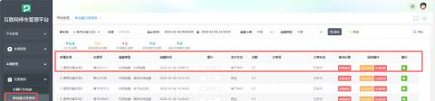
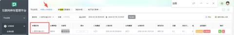
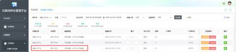
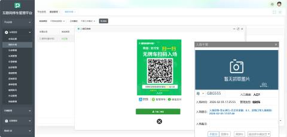
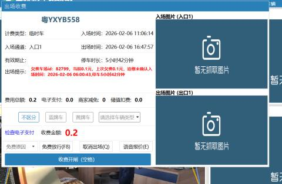
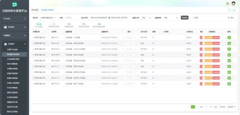

# 一、功能设置
用户根据现场要求进行设置，打开【我的车场】、【基本参数】选择【追缴模式】，然后根据所需进行选择模式

# 二、追缴类型
## 1、入场追缴
### （1）、单项目-入场追缴---单个停车场入场欠费触发追缴
          举例说明：车辆在某停车场1有历史欠费，车辆进入停车场1，车辆入场时系统识别车牌，系统自动计算欠费金额并生成入场追缴单。

         生成的记录可在【新追缴记录查询】进行查看

### （2）、集团模式-入场追缴-----集团内跨停车场欠费触发追缴
           举例说明：车辆在集团内停车场1有欠费，车辆进入集团内另一停车场2，车辆进入停车场2，系统识别集团内欠费，生成入场追缴单，系统识别集团1欠费，生成入场追缴单。

           如：此车牌在车场1有一条待支付订单，那么当此车辆进去车场2，车场2开启了集团模式-入场追缴，系统识别车场1欠费，生成入场追缴单，车主电子支付之后会在车场2生成记录

### （3）、服务商模式-入场追缴----同一服务商下跨项目欠费触发追缴
           举例说明：车辆在服务商XXX 的项目1有欠费，车辆进入服务商XXX的项目2，车辆进入项目2，系统识别服务商内欠费，生成入场追缴单，入场记录中标记“待追缴”。

### （4）、全平台-入场追缴----全平台任意欠费触发入场追缴
           举例说明：车辆在平台内任意停车场有历史欠费，车辆进入任意接入平台的停车场2，系统识别全平台欠费，生成追缴单。

## 2、出场追缴
### （1）、单项目-出场追缴----本次停车费用+历史欠费一并追缴
           举例说明：本次停车费用+历史欠费一并追缴，车辆在本次停车产生费用，车辆在本次停车产生费用，车辆驶出停车场，发起出场缴费。支付页面显示总追缴金额，支付成功后，欠费记录清零，道闸放行。

### （2）、集团模式-出场追缴----出场时合并集团内其他项目欠费
           举例说明：出场时合并集团内其他项目欠费，车辆本次停车产生费用加上车辆在集团内其他项目有欠费，车辆出场时发起缴费，支付金额 = 本次费用 + 集团内跨项目欠费。

### （3）、服务商模式-出场追缴---出场时合并服务商下所有欠费
           举例说明：出场时合并服务商下所有欠费，车辆在服务商下属多个项目有欠费，系统汇总服务商下所有欠费，生成合并追缴账单，支持一键支付全部欠费。

### （4）、全平台-出场追缴---出场时追缴全平台所有欠费
           举例说明：车辆在平台内多个停车场有分散欠费，车辆出场时发起缴费，系统拉取全平台未结清欠费记录，生成总追缴订单，支付后，全平台欠费记录同步核销。

