# 一、功能设置
## 1、首先需要增加一个车类为专属车类，如超位绑定车类，且在配置此车类时，**必须绑定一个收费规则**（此规则将作为车辆“超位”后的计费依据。）
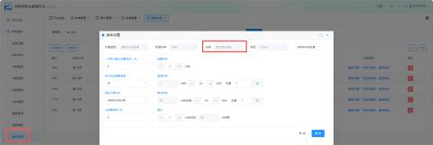

## 2、点击【新增商户】，创建一个新商户或选择已有商户。
+ **关键配置**：务必开启该商户的 **“全免”** 权限。

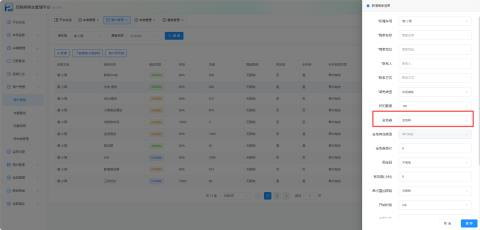

         创建一张专属优惠券，停车类型需要选择【特定收费券】，收费类型需要选择上图创建的车类【超位绑定车类】

## 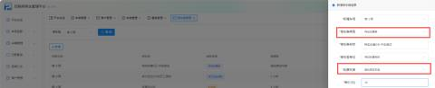3 、增加商户完毕之后，点击-【充值】进行设置
免费时间：设置该商户车辆可享受的免费停车时长，例如 15分钟

专属车位：设置为该商户预留的免费车位总数，例如 3个。

超位绑定车类：选择第一步创建的 “超位绑定车类”。此设置将特定收费券与车位限制逻辑关联（特定收费5元-中安测试）

# 二、优惠示例
## 1、如图以设置免费时间为 15 分钟，专属车位为  3 个   进行举例：
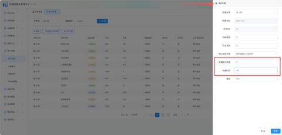

### （1）、停车时长在15分钟内（免费时间内）
####    A、**有可用专属车位**
可发放一张全免券（当商户优惠车辆时，页面将提示：当前车辆满足要求，是否全免？）

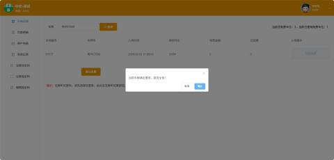

小程序

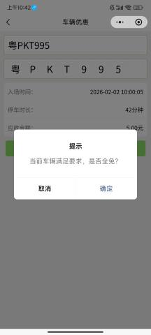

####  B、**无可用专属车位**(已达3辆)
当专属车位超过设置的车位数时候，按特定优惠券收费，绑定到另外的收费规则（当商户优惠车辆时，页面将提示：专属车位不足，是否将该车辆绑定到XX券收费？）

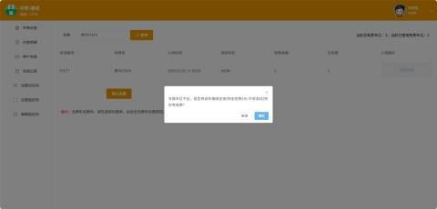

小程序：

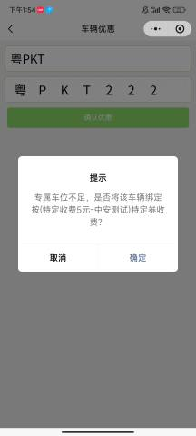

### （2）、停车时长在15分钟外（免费时间外）
#### A、**有可用专属车位**
按临时车收费（扣减商户余额），再全免（当商户优惠车辆时，页面将提示：当前车辆已停车XX分钟，需要收费XX元，是否商户余额抵扣后全免？）

小程序：

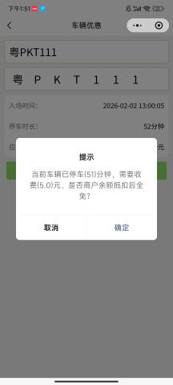

#### B、**无可用专属车位**(已达3辆)
按临时车收费（扣减商户余额），再后续按特定规则收费（当商户优惠车辆时，页面将提示：专属车位不足，当前车辆已停车(xx)分钟，需要收费(xx)元，是否商户余额抵扣后按(xx券)特定券收费？）

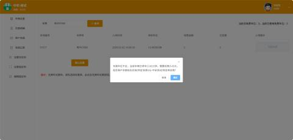

小程序：

# 三、特殊情况
      当车位满位时入场并已按“特定收费车类”计费的车辆，其状态并非固定不变。系统支持**动态的车位资源再分配**。

**      场景**：车辆A因车位已满，入场时被绑定为“特定收费车类”。在车辆A出场前，**如有其他车辆（如车辆B）离场，空出一个专属车位**，则车辆A的计费状态可以更新。

+ **若车辆A的停车时长仍在免费时间内**：操作员可再次尝试优惠，系统将重新识别到有空余车位，**允许发放全免券**，车辆A可免费离场。
+ **若车辆A的停车时长已超过免费时间**：操作员再次优惠时，系统将执行“**先按临时车收费并从商户余额抵扣，再全免**”的流程。

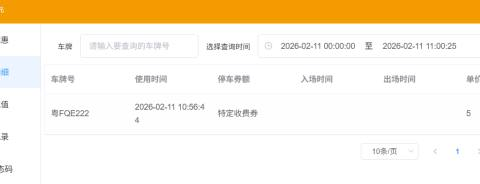

**15分钟内：**

**15分钟外：**

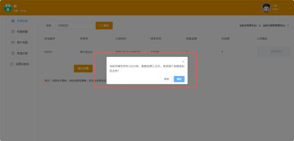

