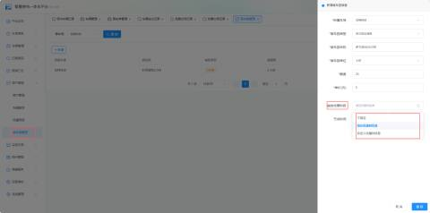
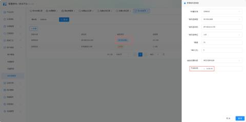
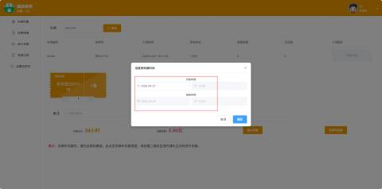

1、在车场平台--商户管理-停车券管理中，添加优惠券，然后绑定到需要使用的商家。

A、不指定：无限制

B、限定优惠时间券：有固定的使用时间限制；如特定的日期的某段时段

C、自定义优惠时间券：允许用户或商家灵活设置使用时间

2、如图所示，优惠时段：2026-04-27 14:00 - 2026-04-28 14:00（共24小时）多次进出减免券，在优惠券的有效期间内享受免费停车

举例说明：车场收费规则是 免费30分钟，超过30分钟就收费1元，每一个小时1元，优惠券的有效时间是2026-04-27 14:00 - 2026-04-28 14:00，优惠减免的时长为24个小时（注意时间节点的收费情况）

A、入场时间：2026-04-27 15:00---出场时间：2026-04-27 15:15 停车时长15分钟，免费时间内所以收费0

B、入场时间：2026-04-27 15:00---出场时间：2026-04-27 15:45 停车时长45分钟，第1次超过30分钟但在优惠时段内，免费

C、入场时间：2026-04-27 13:30---出场时间：2026-04-27 14:15 停车时长45分钟，13:30-14:00(30分免费)，14:00-14:15(15分优惠)

D、入场时间：2026-04-27 13:00---出场时间：2026-04-27 13:31 停车时长31分钟，不在优惠时间内也不在免费时间内，所以需要收费1元

E、入场时间：2026-04-27 13:00---出场时间：2026-04-27 14:40 停车时长40分钟，13:00-14:00(30分免费，30分没有在优惠时间段所以收费1元)，14:00-14:30(30分优惠)

F、入场时间：2026-04-28 13:50---出场时间：2026-04-028 14:40 停车时长50分钟，13:50-14:00(10分优惠)，14:00-14:40(40分收费1元)

  
 

