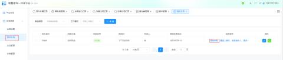
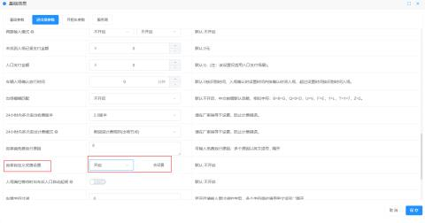
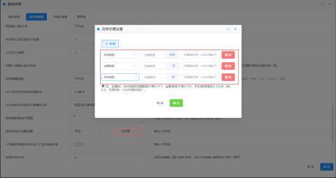
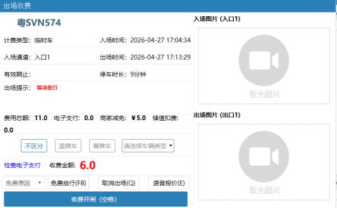
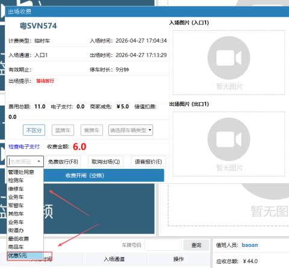
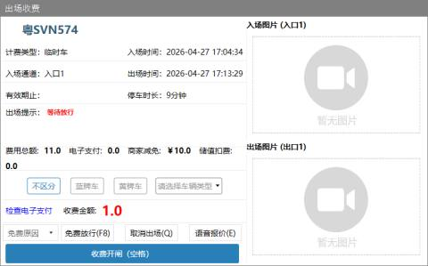
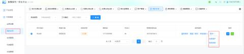
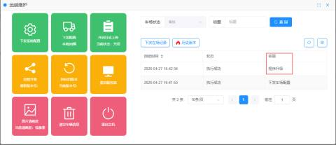
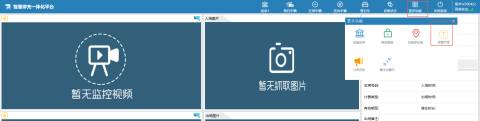

适用场景：车场管理人员在平台预先设置好固定的减免金额/折扣，岗亭收费员在遇到特定车辆（如维修车、内部车）时，无需手动计算，直接下拉选择即可减免

#### 第一部分：平台配置（管理员操作）
**操作路径**：`我的车场` > `基础参数` > `进出场参数` > `岗亭自定义优惠设置`

**详细步骤**：

1. **开启功能**：
    - 找到【岗亭自定义优惠设置】开关，选择**“开启”**，并点击右侧的**【去设置】**按钮。  
**新增优惠规则**：
    - 点击**【+ 新增】**按钮，弹出设置窗口。
    - **选择优惠类型**：根据需求选择“金额类型”、“时间类型”或“折扣类型”。
    - **填写参数与描述**：  

        * 根据下方表格填写对应的额度和描述（描述将显示在岗亭下拉列表中）。

| 优惠类型 | 额度填写规则 | 示例 | 优惠描述建议 |
| --- | --- | --- | --- |
| 金额类型 | 不得小于 0 | `5`(代表减免5元) | 优惠5元/维修车减免 |
| 时间类型 | 不得小于 1 | `30`(代表减免30分钟) | 免费30分钟 |
| 折扣类型 | 需在 0-1 之间 | `0.5` (代表5折) | 5折优惠/内部员工 |

+ 填写完毕后点击确定，列表会新增一条记录。若不再需要某条记录，点击**【删除】**即可。
+ 最后点击页面底部的**【保存】**按钮。

  

#### 第二部分：岗亭操作（收费员操作）
**操作场景**：车辆出场时，系统计算出应收金额，收费员根据车辆性质选择减免。

**操作流程**：

1. **识别车辆**：车辆入场/出场识别，系统计算出应收总额（例如：11.0元）。
2. **选择减免原因**：
    - 在收费界面的**【免费原因】**下拉框中，你会看到刚才平台设置好的描述（如“优惠5元”）。
    - 点击选中该选项。
3. **确认放行**：
    - 系统自动计算实收金额（例如：应收11元 - 减免5元 = 实收6元）。
    - 点击**【收费开闸】**完成操作。

半云的车场需要下载最新的岗亭包，然后升级程序。升级操作如下：

点击【远程维护】-【远程升级】

也可以在岗亭升级：点击【更多功能】--【检查升级】

