1、在平台进行车场开票信息配置

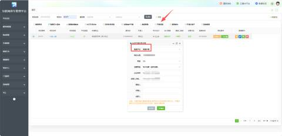

2、扫开票码进行开票，点击“待开票订单”，选择需要开票的订单，可支持多车场同时开票

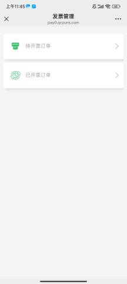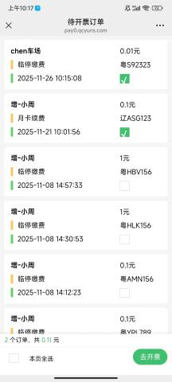

3、根据所需，选择填写资料，若是企业开票选择“企业单位”，若是个人，既选择“个人”即可

填写完毕之后，点击“确认提交”进行开票

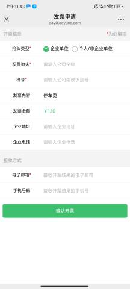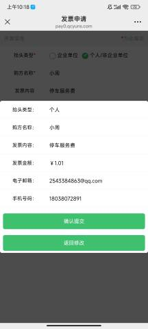

4、开票成功之后，可进行查看版式文件

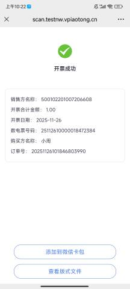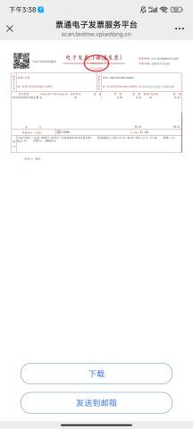

5、开票成功同时也发送到填写的邮箱通知

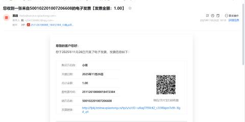

6、已开票的订单，可以进行查看

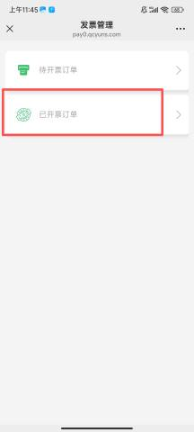 

当开票信息填写有误时候，会有异常提示，便于客户重新检查填写正确的开票信息。

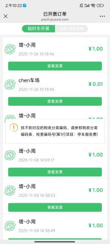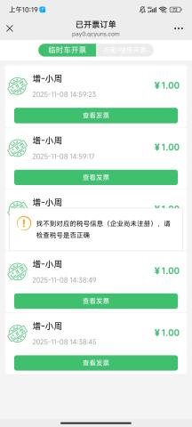

