## 乐企联用使用流程
提前说明：开通乐企有一定难度，但是开通乐企可以实现免短信认证和免风险认证，也不影响登录电子税务局使用。

如果继续使用原来方式，有3个方式可以手机认证：  
微信小程序（票通云）、  
公众号：票通云服务、  
app(微票通)

第一步：用户登录票通企业版，“我的账户”模块下，可看到“乐企接入申请”菜单，在此处完成乐企开通流程。

1. 点击开通联用，如下图：

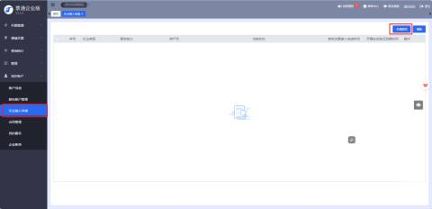

2. 扫描弹框中的授权二维码，完成微信商户授权。

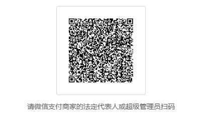

**注意：①当前企业必须是已经开通微信支付的商家，且需要商家的法定代表人或超级管理员扫码完成商户授权。**

**②扫码前需提前查找商户的“商户号”或“交易单号”，扫码后需要填入，以确认商户身份。**

建议填写10位数字的“商户号”，容易查找，查找步骤如下：

方法一：登录网页端微信支付后台，顶部右上角“我的账号”，点击后下拉框第一行显示的10位数字，复制粘贴记录，如下图：

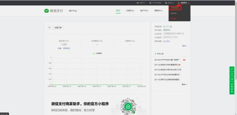

方法二：通过移动端微信支付商家助手，进行查找。如下图：

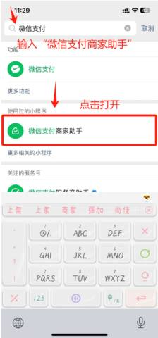     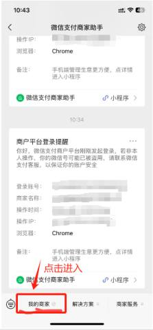

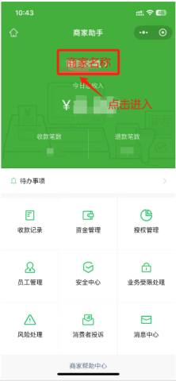     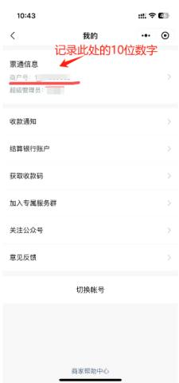

3. 待上一步完成后，点击授权开通乐企，继续进行授权。

注意：需要企业的法定代表人或财务负责人扫码授权开通乐企。

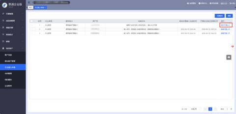

点击“授权开通乐企”，如下图：

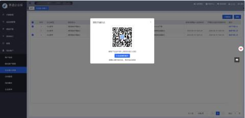

4. 待上一步完成后，显示接入成功。如下图：

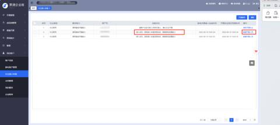

操作列，可点击查看开票人员。如下图：

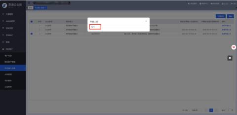

第二步：用户登录企业版，我的账户-乐企接入申请，点击开通联用，乐企类型选择“支付宝乐企联用”，点击确定

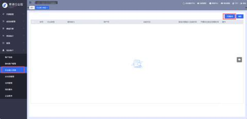

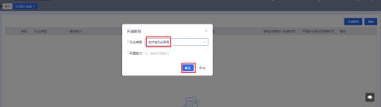

点击下方链接，登录支付宝，授权委托票通开发；

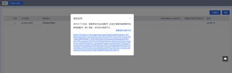

点击链接后，示例如下：

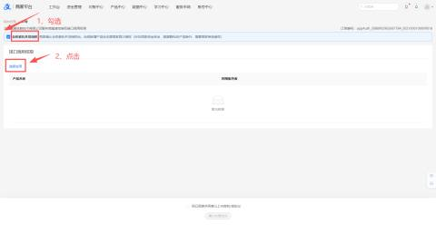

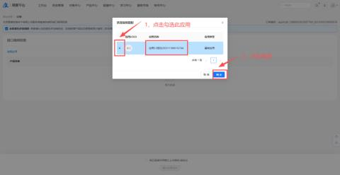

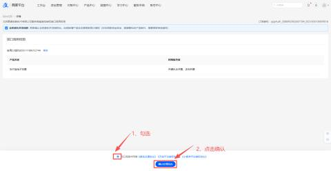

1. 企业版，我的账户-乐企接入申请，将支付宝商户号与当前企业关联绑定。

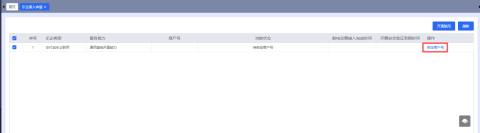

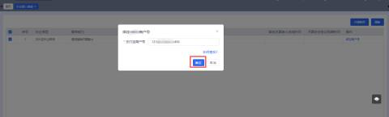

2. 点击授权开通乐企，进行授权操作。

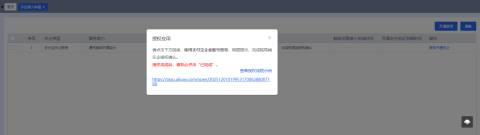

点击链接，再次登录支付宝，根据提示，完成税局端乐企授权确认。

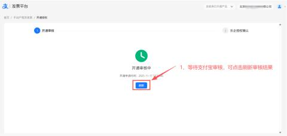

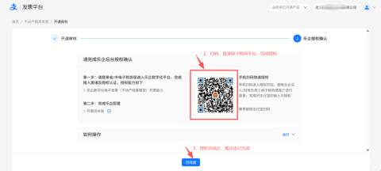

授权完成后，请务必点击“已完成”。

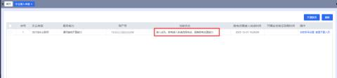

状态显示“接入成功”，可进行下一步操作。

3. 完成授权后，继续在支付宝，配置收款账号信息。

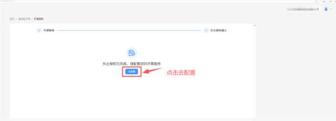

维护收款账号信息，保存提交；

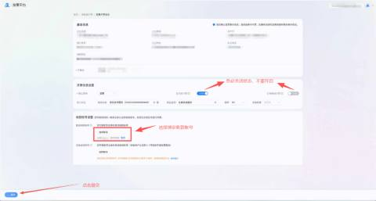

4. 企业版，我的账户-乐企接入申请，点击查看开票人员，补全开票人身份证号；

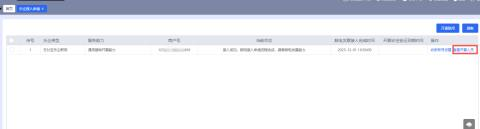

点击完善信息：

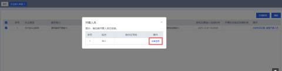

输入开票人对应的身份证号码后，点击确定：

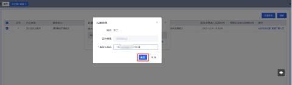

点击查看开票人员，后续可修改开票人信息：

最后：如何知道开成功乐企发票呢

答案就是：发票记录看到的数电票号码的第五位号码是数字7，就是乐企发票。如果是数字2，那就是原来数电非乐企发票。

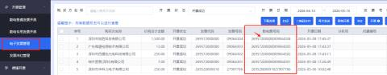

