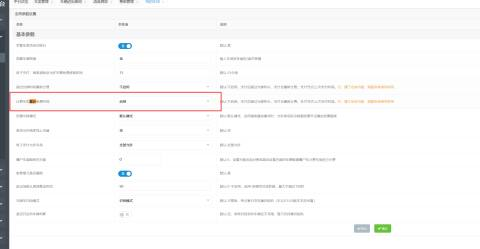
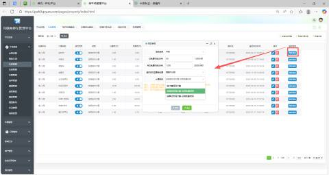
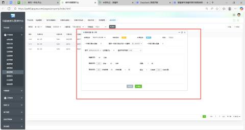

1、车场参数--计费车型累计免费时间  需要开启

2、车类添加高级参数

注：若需要添加车类，点击右上角【申请车类设置】添加即可

注：设置时请先设置对应车类费率，若未设置对应车类费率，本设置无效。

注：设置后默认每月1日对免费时间进行重置，恢复初始值。

注：若日免费时间设置为0时，直接从月总免费时间中扣减。

计费规则：

（1）按计费规则计费--按照设置好对应的计费费率规则

（2）按首段时间计费-没有免费时间

（3）按单位时间计费--没有免费时间

**跨月期间免费时间扣减规则：**

若“亲情车”设置了每日的免费时长（例如：每日60分钟），每月免费时长为1200分钟。若当月未用完1200分钟，如果一次停车行为从本月末开始并持续到下个月（跨月），系统优先从上一个月的月免费时间总额中扣减本次停车已发生的免费时长，也就是直接抵扣上个月，然后当月就算当月月的。  
若本月免费时间（1200分钟）额度用尽后，若停车仍在继续，则将开始正常计费。

注：若当停车行为在日免费时长内，但月免费已经用完的情况下，停车仍需要正常计费。

