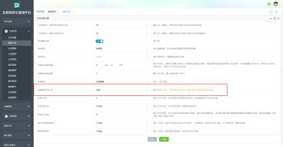
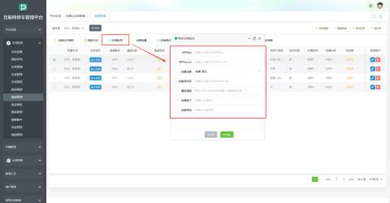
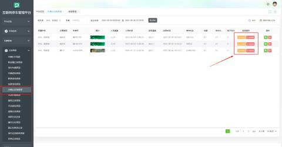
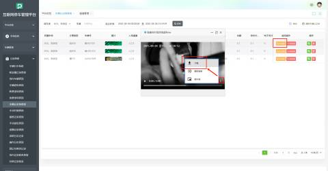
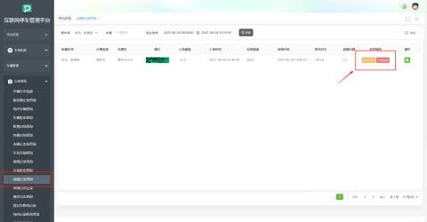

**视频默认生成40秒，即出场时间前10秒+出场后30秒**

1、首先在【我的车场】--【基本参数】启用【追缴视频自动生成】

2、在【通道管理】--【环境监控】填入对应的环境监控相机参数

3、当车辆产生未确认出场纪录时，即可在【记录查询】--【未确认出场查询】查看监控记录回放

**监控回放：**后台默认生成记录；

**生成回放：**当后台生成记录失败或因其他原因生成失败时可手动生成记录；

监控记录视频支持下载：

3、当产生未确认出场的车辆追缴成功后会在【记录查询】--【追缴记录查询】产生追缴成功记录，该条记录也可查看监控视频回放；

