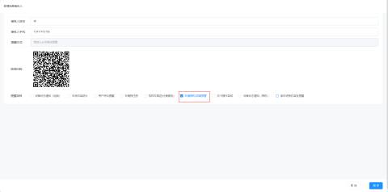
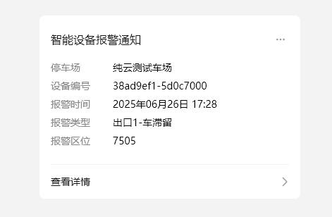
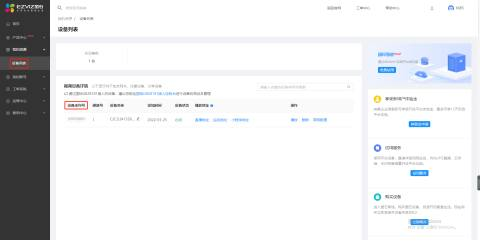
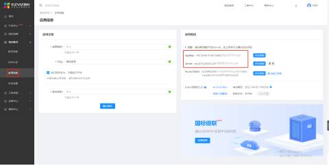
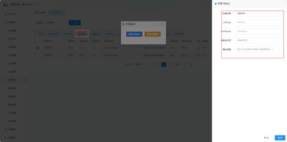
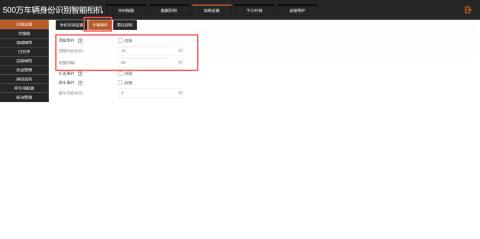
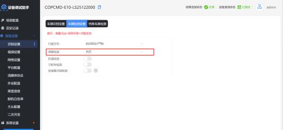

**当车辆滞留超过设置的时间，则会产生一条记录，该记录会通过公众号推送给管理员**

1、在【我的车场】--【消息接收人】新增消息接收人过编辑消息接收人勾选【环境相机/滞留预警】

2、当相机检测到有车辆滞留时，会产生一条记录推送至公众号

#### 环境相机配置
首先从海康的萤石云平获取该参数（[https://open.ys7.com/consoleCN/home.html](https://open.ys7.com/consoleCN/home.html)）

然后将该参数填入平台对应通道的环境监控里，即可联动环境监控

#### 相机后台勾选滞留预警的功能
进入相机后台，点击【高级设置】->【识别设置】->【车辆事件】->【勾选启用】

信路通相机：点击【高级设置】->【识别设置】->【车辆检测设置】开启【滞留检测】

