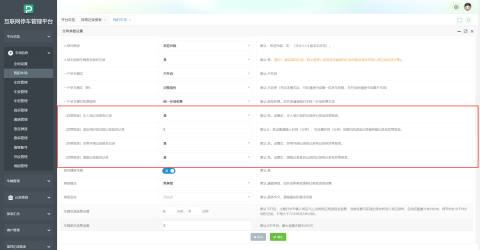
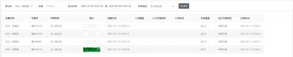
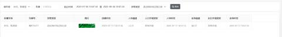
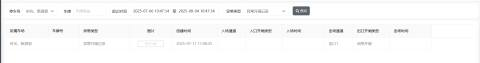
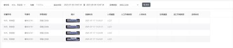

**该报表合并了无入场记录、异常开闸记录、进出场时间过短记录、滞留记录、遥控或岗亭开闸记录等汇总为一个报表，方便用户进行查看异常记录**

**在【我的车场】--【基本参数】--【全局参数设置】开启对应的参数记录  
****  
**例：

1、当车辆出场未匹配到入场记录时，将会在异常记录表报里产生一条无入场记录；  

2、当车辆在设置时间范围内进出场，该条记录将会被记录至异常报表（时间范围根据需求设置，目前未限制时间范围）；

3、当车辆通过遥控开闸或岗亭开闸出场后将会记录为异常开闸记录，该记录将记录至异常报表；

4、当车辆在入口或出口滞留产生滞留记录时，该条记录将记录至异常报表；

