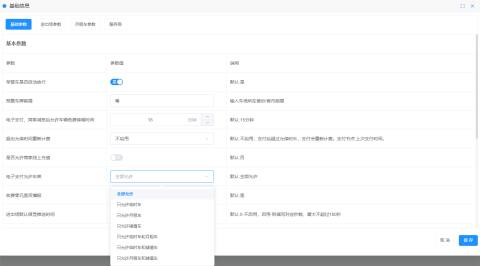
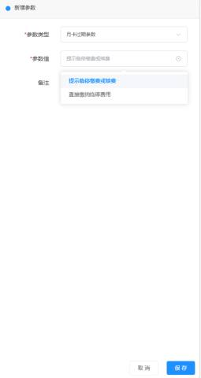
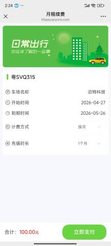
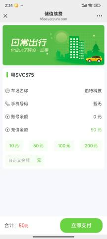

#### 1、月租车
（1）、点击车场平台里的【我的车场】->【基础参数】->【电子支付允许车类】，之后在【高级参数】->【新增】选择 【月卡过期参数】可选择【提示临停缴费或续费】或者【直接缴纳临停费用】

（2）、车辆不在场内：扫码是续费页面

#### 2、储值车
点击平台里的【我的车场】->【高级参数】->【新增】，选择【储值车余额不足参数】可选择【直接进入充值】或【提示临停缴费或充值】

无余额扫码续费页面。

