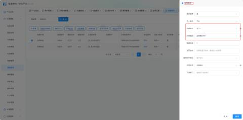

1、通道管理--设置好通道绑定和单通道模式

A、单通道绑定--入口绑定出口，出口绑定入口

B、单通道模式--超时模式XX秒，现场根据所需选择好秒数

三种模式：

不开启：出口有车，入口识别到车辆道闸开闸

地感模式：出口有车压着地感，入口识别到车辆，道闸不开闸并且入口屏显显示“出口有车，请暂时退出识别区域”

超时模式：出口有车，在设置的时间内，入口识别到车辆，道闸不开闸并且入口屏显显示“出口有车，请暂时退出识别区域”

2、入场时判断是否软处理模式，先判断是否有车，再判断是否软处理模式，超时多少秒后自动释放，车辆可以继续入场注意：设罟软外理模式时，出口有车正在缴费时，入口识别到车辆时判断超时时间(从出口识别到车辆开始计算)若在设罟时间内，则不进行开闸，超过设置时间时，车辆可入场； 

若即设置了通道管理的处理模式，又设置了系统参数的输入模式，以通道管理设置优先;若通道管理未设置，系统参数有设置，以系统参数设置为主。

  
 

