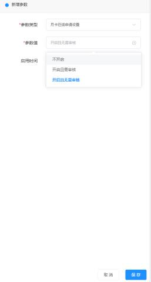
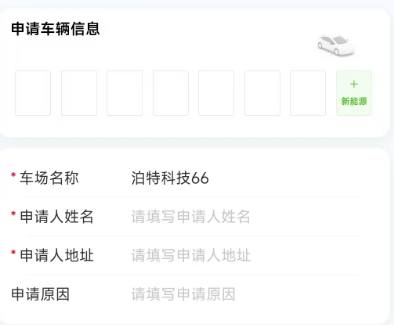
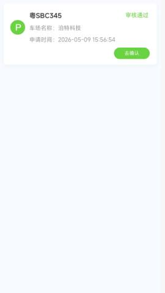
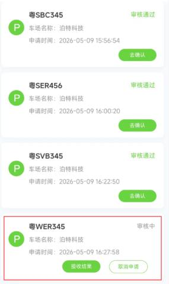
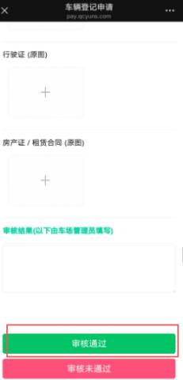
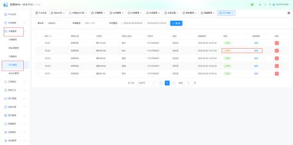

进入【我的车场】->【更多】->【高级参数】，新增高级参数【月卡在线申请设置】，根据自身需求可选参数值【开启且需审核】或【开启且无需审核】，选择【启用时间】。

进入壹家社区小程序，点击【申请月卡】，选择需要申请的车场，进入填写车辆信息、个人信息，点击确认办理。

#### 无需审核车主操作

点击【去确认】，支付。

#### 需审核车主操作

等待审核通过后点击【去确认】，支付。

**操作员通过绑定的消息接收人账号去审核**

**通过车场平台的【车辆管理】->【月卡审核】去审核。**

