**1、交易记录可以查看每一笔交易详情**

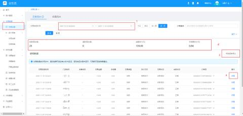

| 标记 1 | 可自定义查询交易记录时间范围 |
| --- | --- |
| 标记 2 | 统计当前筛选时间内的交易记录的交易笔数，退款金额，交易金额，收手续费 |
| 标记 3 | 可导出当前显示的交易记录 |
| 标记 4 | 可查看每笔交易记录的详情和退款 |

**2、结算记录可查看每天的结算打款记录**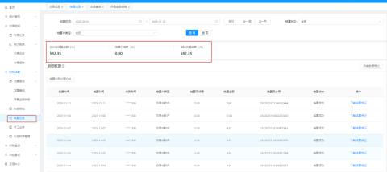

**3、账单明细页面可以每天的收入统计**

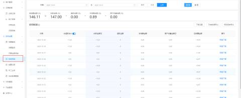

**4、关于会生活交易记录页面统计金额和停车平台电子支付账单统计金额不一致问题**

+ 如果有车主在支付时使用平台的优惠劵，就会导致两者不一致，支付平台统计的是车主实际支付金额，停车平台统计的是没使用优惠劵之前的金额。如下图所示

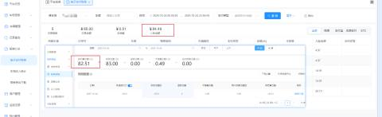

+ 车主使用优惠劵减免的1元是另外补贴回去，并不收取手续费，故而手续费也会有偏差，如下图所示。而且是每天都补贴打款到结算账户。
+ 注：如需提供优惠劵补贴打款明细，需要联系项目负责人跟系统厂家反馈

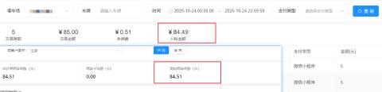

#### 退款
**根据支付时间和支付金额可查询到交易订单后点击交易记录页面详情有一个退款按钮，点击退款即可，可退全款和自定义退部分金额**

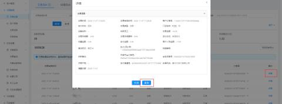

#### 开手续费发票
**开票明细页面可查询到当前可开票手续费金额**

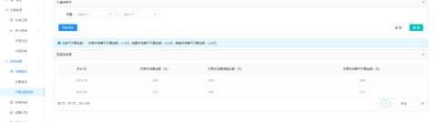

**发票查询页面可看到发票申请记录，点击申请发票可以跳转到发票申请页面**

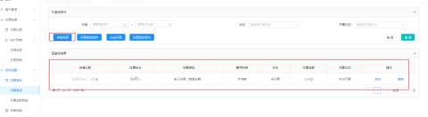

**发票申请页面如下图所示，**

开票金额可自定义，最大开票金额只统计到上个月，当月的开票金额要到下个月的 2 号之后才能申请开票。

手续费发票按周处理，开具时间是从每周一开始陆续开出并且发送到商户邮箱中 。

不能撤回发票，但是可以在发票开出前修改发票开票金额。

开票次数：支持商户提交多张手续费发票申请工单，可满足商户自行分配

对私账户只能申请普票，对公账户才可以申请普票和专票

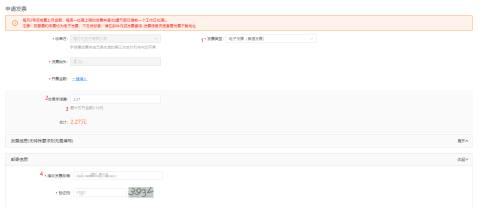

#### 账号管理
**1、关于 一个手机号码管理多个账号**

只需要点击要上角账号管理即可切换另一个账号

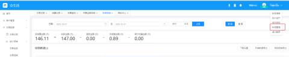

**2、多个账号管理一个车场**

员工管理页面可以创建账号，也可以删除原有创建好的账号

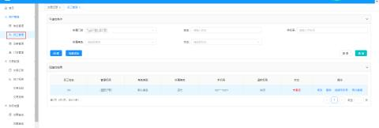

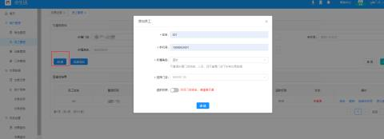

创建好了之后，对应手机号码会收到短信

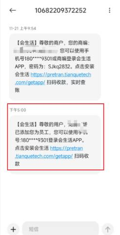

#### 更换结算打款账户
**在不变更收款主体的前提，车场方可登录会生活 APP 自行更改收款账户，操作如下图**

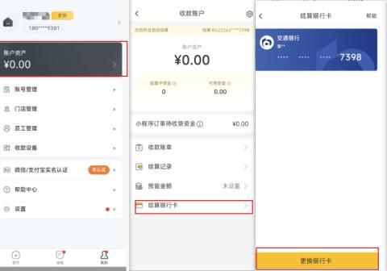

#### 更多操作可参考如下两个文档
[会生活-商户端-APP平台产品操作手册.pdf](https://www.yuque.com/attachments/yuque/0/2026/pdf/67715238/1778220819738-4c820c09-b354-47b6-9891-5fb2f9022063.pdf)

[会生活-商户端-网页端产品操作手册.pdf](https://www.yuque.com/attachments/yuque/0/2026/pdf/67715238/1778220819820-5e9830b0-e5db-47de-b0bd-d60b554e07d1.pdf)

