#### 一、对公申请
**（1）选择新增商户(对公选择普通商户)**

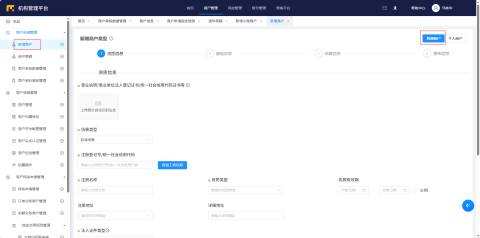

**步骤一、资质信息**

1、对公的收款账户需要上传营业执照和法人身份证，开户证明

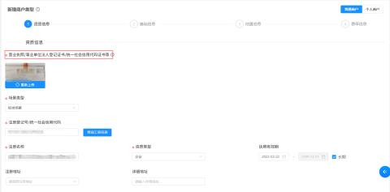

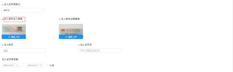

2、税务登记证、组织机构代码证——不需要填

**步骤二、基础信息**

3、商户简称——车场名称

4、联系人手机号——对公填签约人，对私填收款人

5、商户类别(MCC)——车主生活/停车缴费服务（3008）

6、经营地址——车场地址

7、经营地址街道——车场详细地址

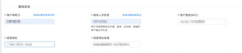

8、内景照片——停车场内部的照片（可以参照下面的照片）

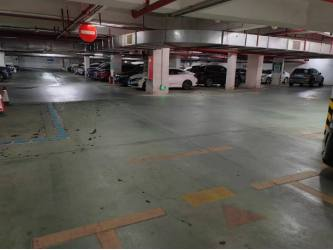

9、门头照片——停车场入口或是出口的照片（可以参照下面的照片）

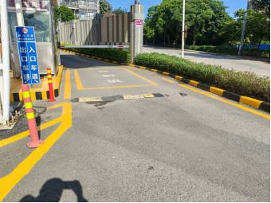

只需要填内景照片、门头照片即可

**步骤三、结算信息（账户信息要与开户证明一致）**

10、结算类型——对公账户

11、对公账户名——营业执照和开户证明上面的名字

12、对公账户号——收款账户

13、结算时间——默认次自然日结算（认次工作日结算）

14、对公账户开户行信息——支行信息

**步骤四、费率信息（不需要改后续会要挂靠就变成0.6了）**

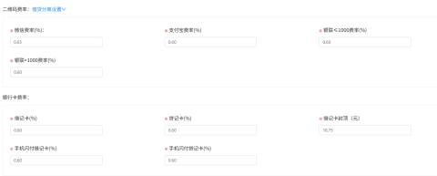

#### 二、对私申请
（1）选择个人商户

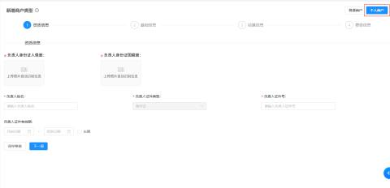

**步骤一、资质信息**

1、对私的收款账户需要上传收款人身份证，银行卡照片

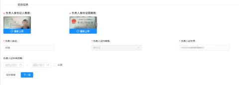

**步骤二、基础信息**

2、商户简称——车场名称

3、联系人手机号——对公填签约人，对私填收款人

4、商户类别(MCC)——车主生活/停车服务（7523）

5、经营地址——车场地址

6、经营地址街道——车场详细地址

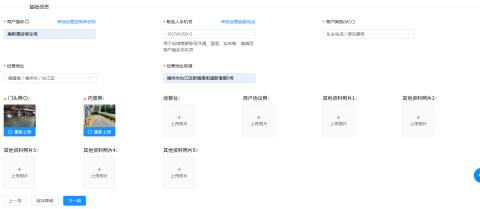

**步骤三、结算信息**

7、银行卡——带有银行卡卡号面

8、账户名——收款人姓名

9、结算账号——收款账户

10、结算时间——默认次自然日结算（认次工作日结算）

11、开户行城市——支行地址

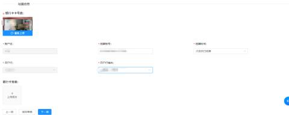

**步骤四、费率信息（需要改成0.65后续挂靠就变成0.6了）**

#### 三、申请通过后需要挂靠
申请通过后的商户号要群里的技术人员反馈，需要挂靠，挂靠完成后才可以配置到车场

#### 四、配置支付参数
选择一方聚合支付，收单渠道选择随行付

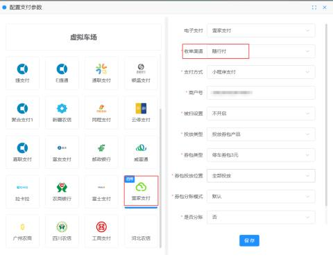

1、只需要填商户号

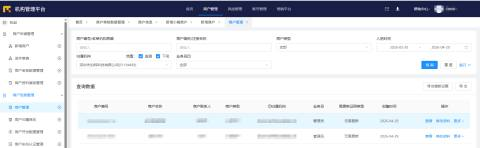

2、二维码链接改成小程序

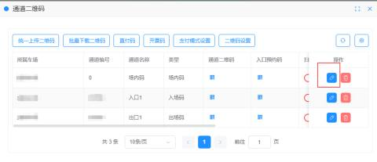

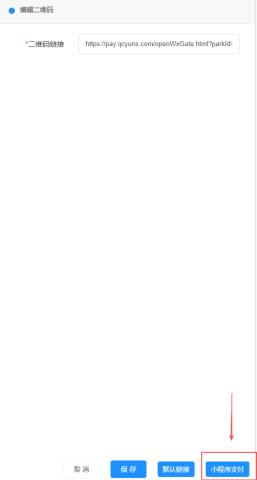

