#### 获取账号
**注册：**

打开技术人员提供的链接后注册。

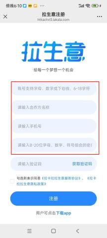

| 参数 | 说明 |
| --- | --- |
| 账号 | 字母、数字或下划线，6-18字符 |
| 合作方名称 | 填写公司名称 |
| 手机号 | 用于获取注册验证码，忘记密码后重置密码 |
| 密码 | 8-20位字母、数字、符号组合的密码 |

**登录**

注册后可打开下面链接登录也可以在应用市场下载“拉生意”APP

登录地址：[https://tkfront.lakala.com/tk-ui/index.html](https://tkfront.lakala.com/tk-ui/index.html)

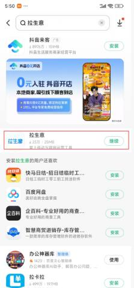

**实名认证**

登录后会需要实名认证才能正常使用，如图

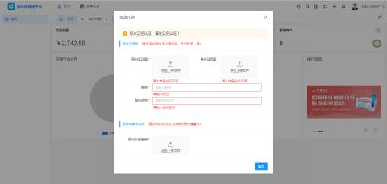

点击收单业务可进入此页面

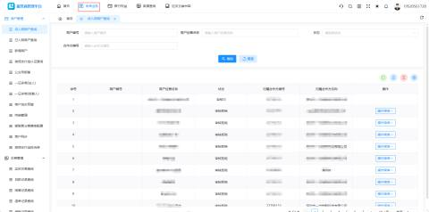

#### 新增商户
1、商户类别：小微（对私）企业（对公）

2、结算类型：自动结算     结算周期：D1 （默认不修改）

3、政策：选择  拉生意扫码自投政策；	

4、费率模板：选择  拉生意扫码自投入网；

5、商户类型：选择  生活服务---未列入其他代码的其他个人服务；（对私）

6、生活服务---物业管理；（对公）

7、产品：选择专业化扫码

8、产品费率全部统一设置为0.600，除最后一个为 0.610

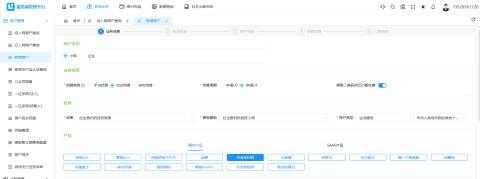

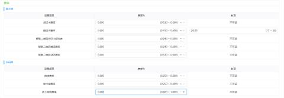

9、外卡费率：叠加外卡---不勾选

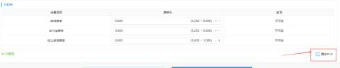

10、销售信息配置：领用方式--选择--赠送，通讯费--输入--0元

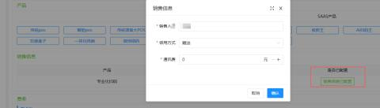

11、对公的收款账户需要上传营业执照和法人身份证，开户证明

注：上传营业执照后需要核对一下营业执照名称和证件代码是否有误

12、对私的收款账户需要上传收款人身份证，银行卡照片

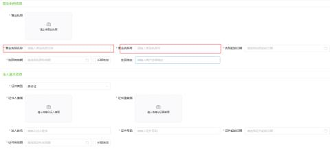

13、商户经营名称--填写车场名称（所有名称不要加入“停车场”三个字）

14、商户经营地址：填写停车场地址

15、联系人姓名：对公填签约人，对私填收款人

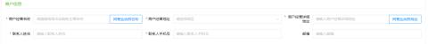

门头照需要现场提供，或者在百度搜索

以上所有信息填完完成后需要点击“生成电子协议”进行签署

16、对公签法人，对私签收款人，然后点击提交。至此完成商户申请。

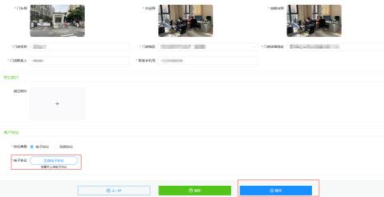

#### 扫码认证
商户申请完成后，可在微信支付宝认证查询页面查看到刚刚申请的商户，如果没有，那就在“待入网商户查询”页面看看，是否是显示审核拒绝，如果显示审核拒绝，就需要点击“操作菜单”查看原因，按照提示进行修改

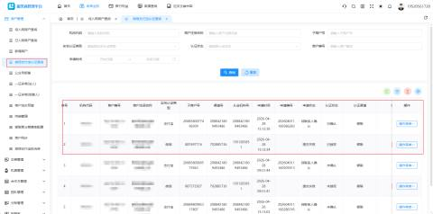

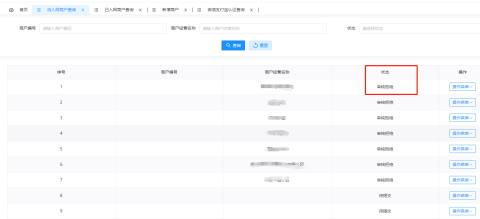

审核通过后可发二维码给客户进行认证，认证参考一下两个文档

[微信认证流程.doc](https://www.yuque.com/attachments/yuque/0/2026/doc/67715238/1778221035167-be842220-9cff-4a3b-8144-9c8ff4809ab0.doc)

[支付宝认证.doc](https://www.yuque.com/attachments/yuque/0/2026/doc/67715238/1778221035287-81c3c8fc-d44f-46b7-a55e-a42d8559dc44.doc)

#### 配置支付参数
**1、查看认证状态**

微信认证：客户认证完成后，可在后台查看渠道号为“702885736”认证状态，点击刷新后显示“已授权”就是完成认证了

支付宝认证：客户认证完成后，也是在后台查看

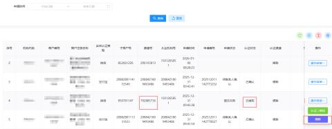

**2****、配置支付参数**

目前配置投放有两种产品：劵包产品和保险产品

注：配置劵包产品需要多填一个微信商户号

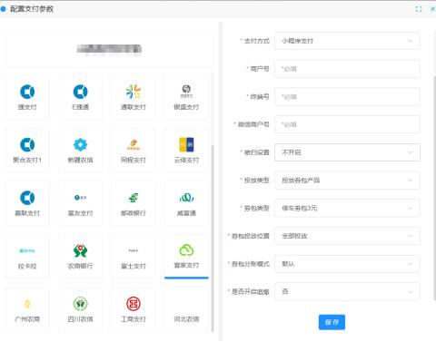

商户号：

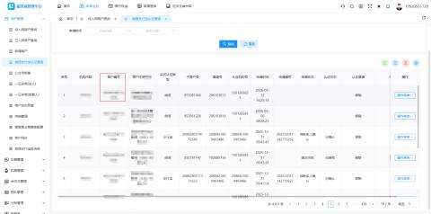

终端号：已认证商户查询--激活码--终端号

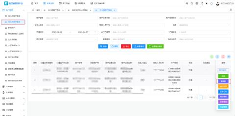

微信商户号：选择渠道号为“702885736”的子商户号

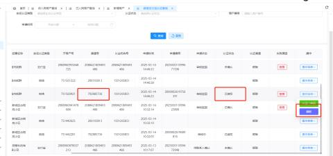

**3、更改支付链接**

配置完成之后，需要更改支付链接

注：如果配置支付后，车场有增加新的通道，也需要告知服务商们，更改支付链接

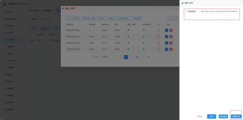

#### 常见问题解答：
**1、需要认证的商户与当期商家主体不一致，**

答：需要核实当前商家的身份是否与提交收款资料里收款主体是否一致。

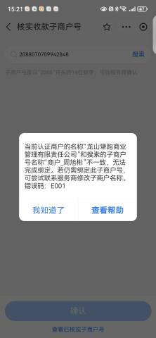

**2、法人身份证校验不通过**

答：目前拉卡拉支付平台只支持大陆身份证无论是小微还是企业，不支持港澳居民居住，台湾居民居住证等其他证件

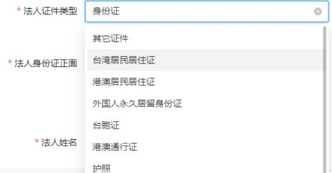

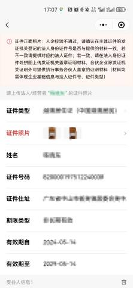

**3、在使用过程中出现如下提示“此商家涉嫌违规，收款功能已被限制，暂无法支付。商家可以登录微信....”**

答：可让当时操作认证人登录微信支付商家查看具体原因，进行申诉。如果我们等了拉卡拉平台看到此商户状态正常时，可询问客户此商户的绑定的微信之前是否被投诉过。但商户账号申诉流程走下来周期较长，可建议客户更换收款账户，重新申请支付账号。

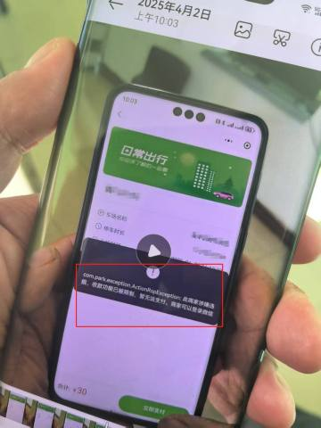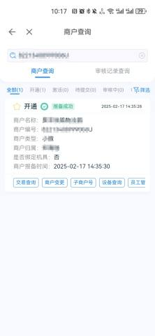

4**、同一个收款账户多个车场同时使用，应该如何处理？**

答：在拉卡拉平台中，应该收款账户只需要申请一个商户，当有多个车场使用这个商户时，只需要在对应商户开门店即可。

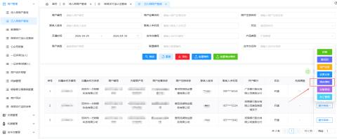

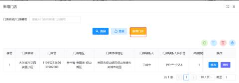

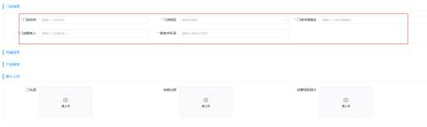

增加门店后，点击门店旁边的增终按钮，增加属于这个门店的终端号。

注：每个门店都有专属的终端号，配置支付参数的是，需要填入对应的门店终端号

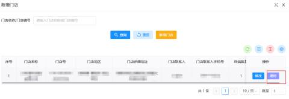

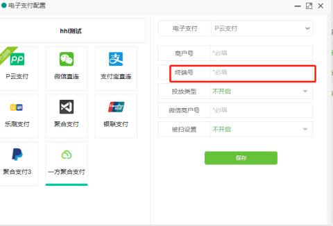

