# **一、登录系统**
1、打开网页岗亭收费网址：https://b.qcyuns.com/#/login

2、输入登陆账号、密码，如下图所示：

**注：初次登陆需要输入车场的通讯码**

3、选择登陆的值班岗亭，如下图所示：

**4、图片插件安装说明**  
首次使用本系统时，需下载并安装“图片插件安装包”，否则系统中将无法显示抓拍的图片。

**下载方法**  
点击页面右侧的【图片服务器】按钮，即可下载图片插件安装包。

**安装注意事项**

请勿将插件安装在C盘，建议选择其他磁盘分区进行安装，以避免占用系统盘空间，影响系统运行速度。

若页面显示红色提示“未连接到图片服务”，请检查是否已下载并正确安装图片插件，同时确认插件是否已启动。若插件已安装但仍未连接成功，可尝试重新启动插件或联系技术支持获取帮助。

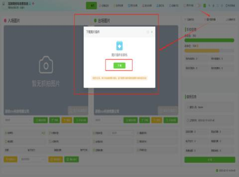

解压插件，找到“岗亭视频播放插件”，双击打开

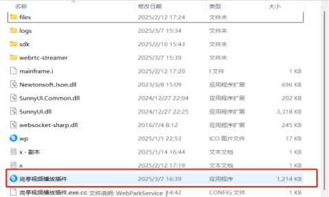

双击打开后是以下页面，打开之后最小化即可

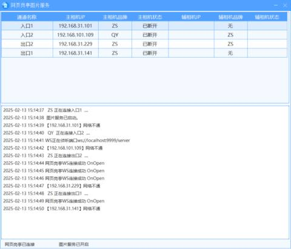

# **二、****岗亭界面及功能**
## 1、通道车辆抓拍图片展示
  
 当前通道的进出场车辆抓拍图片如下图所示，清晰记录车辆进出瞬间，便于实时查看与后续查询

## 2、**车辆出入场信息**
系统将实时展示最近出入场车辆信息，并支持以下操作：

**车牌号纠正**：快速修正车牌号码错误。

**切换车型**：根据实际车辆类型进行调整。

**免费放行**：对符合条件的车辆执行免费出场操作。

**取消出场**：撤销已发起但未完成的出场操作。

**确认出场**：完成车辆出场流程。

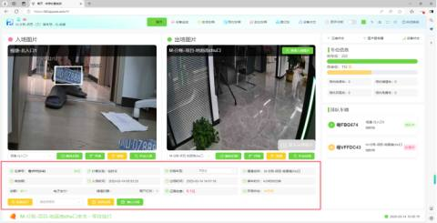

## 3、**值班信息**
实时显示当前值班员的详细信息，包括上班时间及收费统计情况。值班员可通过点击【交班】按钮完成交班操作，如下图所示：

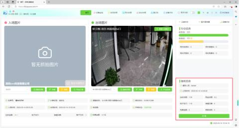

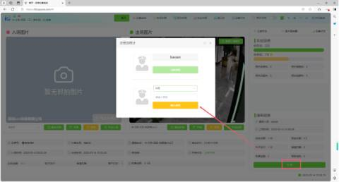

## 4、手动入场
选择对应通道后，点击【手动入场】按钮，即可手动输入车牌号完成入场操作。此功能适用于·车牌识别错误或无牌车辆入场的情况，确保所有车辆都能顺利进场

## 5、**手动出场**
选择对应通道后，点击【手动出场】按钮，可手动输入车牌号完成出场操作。此功能专为车牌识别错误或无牌车辆出场设计，确保车辆顺利离场，如下图所示：

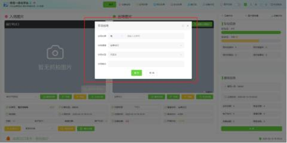

## 6、**车辆排队**
当多辆车同时出场时，若前一辆车尚未完成出场处理，后续车辆将显示“排队中”提示，并自动等待前一辆车处理完成。为提高效率，您也可在排队列表中点击需要优先处理的车牌，切换至该车辆进行操作。

## 7、**车位信息**
实时显示停车场的总车位数和剩余车位数，方便管理人员和车主了解车位使用情况。同时，支持对车位数量进行纠正操作，确保系统数据与实际车位情况一致

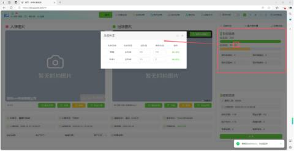

## 8、**设备监控**
点击【设备监控】，可查询当前设备监控实时视频，如下图所示：

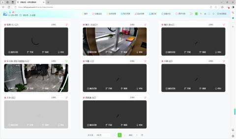

每个通道都可以进行触发识别、开闸、落闸、呼叫以及切换主辅助相机操作

## 9、**在场车辆**
点击【在场车辆】可查询当前场内所有车辆，如下图所示：

支持以下多种查询方式：

**车牌号搜索**：输入车牌号，快速定位指定车辆。

**计费类型筛选**：根据计费类型（如临时车、月租车等）直接选择查询。

**时间节点查询**：按入场时间范围筛选在场车辆。  
通过灵活的查询方式，快速获取所需车辆信息。

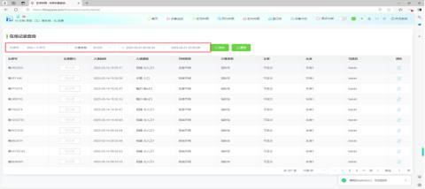

若需要对车辆进行车牌纠正，点击【编辑】按钮即

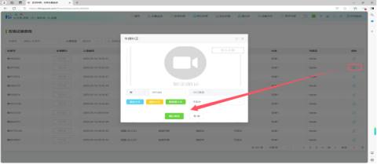

## 10、**预约车辆**
点击【预约车辆】可查询当前所有进出车辆，如下图所示：

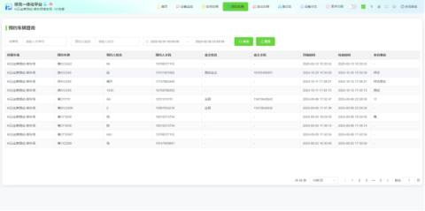

## 11、**进出车辆**
点击【进出车辆】可查询当前所有进出车辆，如下图所示：

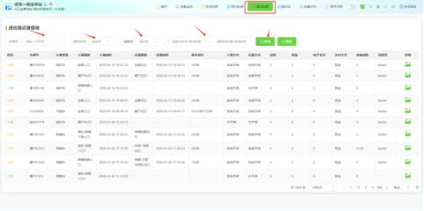

用户可以根据所需，按照车牌号、支付方式、值班人员进行模糊查询。

可点击【图片】按钮，查看该车辆的抓拍情况

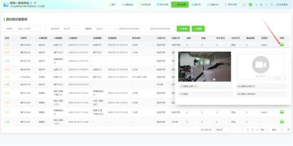

## 12、登记车
  
点击【登记车】可查询所有登记车辆信息，如下图所示：

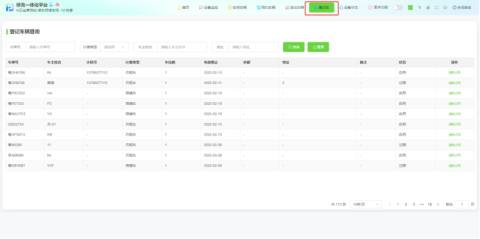

## 13、**设备状态**
点击【设备状态】可查询当前设备状态信息，若需要更新状态，点击右上方【更新状态】按钮即可，如下图所示：

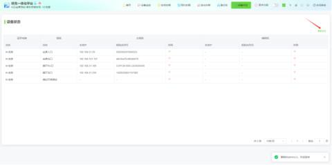

14、更多功能

点击【更多功能】可操作（切换岗亭、修改密码、切换停车场、公告历史、高级配置），如下图所示：

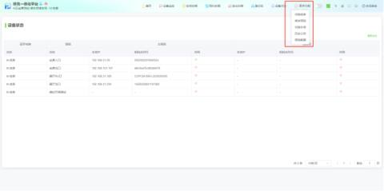

（1）切换岗亭：

（2）修改密码：

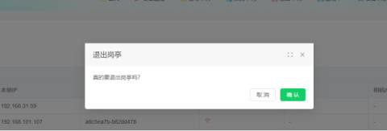

（3）切换停车场：

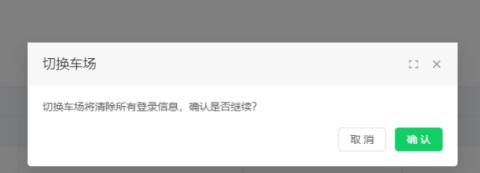

（4）高级配置：可以根据所需选择车队模式进行设置

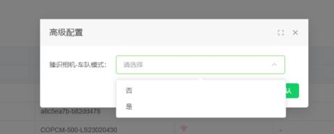

## 15、**切换模式**
点击夜晚按钮，可开启夜晚模式

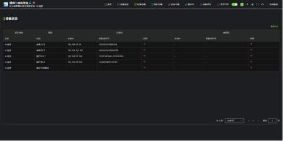

## 16、**锁屏、解屏**
点击屏锁按钮，即可锁定屏幕，如需解锁，点击解锁即可

## **17****、设置字体大小**
可以根据所需选择字体大小尺寸

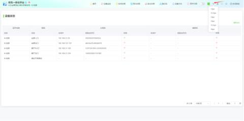

