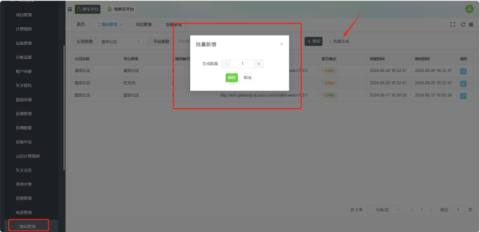
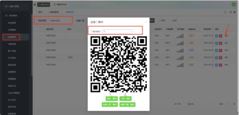
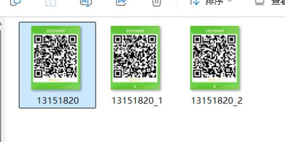
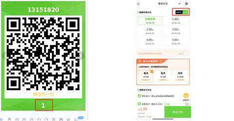

1、进入项目管理菜单，点击“二维码管理”进入管理页面，点击“批量生成”，选择生成数量。

确认之后会生成一个唯一的二维码编号

2、在设备管理页面，找到对应项目后，依次点击【更多】-【二维码】，将刚刚添加的二维码编号进行绑定，绑定完成后点击“下发二维码”，将二维码信息发送至设备

3、当设备存在两个或多个端口时，依次点击【批量上传二维码】和【批量下载二维码】

4、不同二维码对应的界面各不相同

设备码：扫码后需选择对应端口，才能开始充电

端口码：扫码后直接进入充电启动界面，可立即开始充电。

例如：1号端口

