#### 1.添加消息接收人
首先，需要在停车管理平台中配置具备接收权限的人员信息。

+ 操作路径：登录【停车管理平台】 -> 进入【车场信息】 -> 【我的车场】 -> 【消息接收人】 -> 点击【新增接收人】。

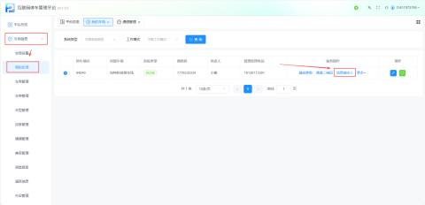

+ 填写信息：
    - 接收人姓名：输入负责人名称（如“小谢”）。
    - 接收人手机：填写对应的手机号码（如`18126173381`）。
    - 提醒方式：选择“微信公众号推送提醒”。
    - 关键勾选：务必勾选 “特殊车推送” 选项（该选项关联付费服务权限）。
+ 保存：确认信息无误后，点击【保存】按钮。

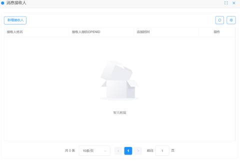

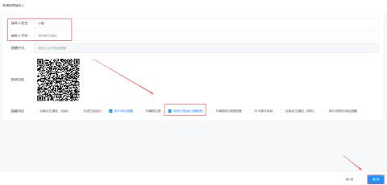

#### 2. 关注并绑定公众号
接收人需完成微信端的绑定操作，以确保消息能准确送达。

+ 关注公众号：微信搜索并关注 “壹家社区” 服务号。
+ 绑定车辆：
    1. 进入公众号菜单，点击【我的车辆】。
    2. 选择【绑定车辆】，输入车牌号等信息。
    3. 点击【获取验证码】，输入收到的短信验证码完成绑定

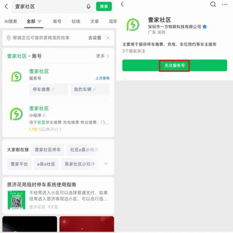

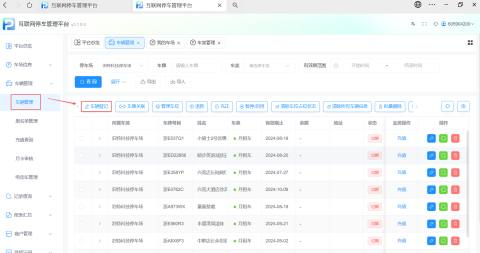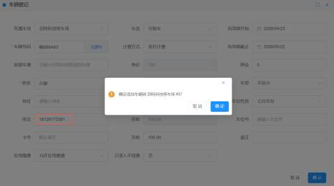

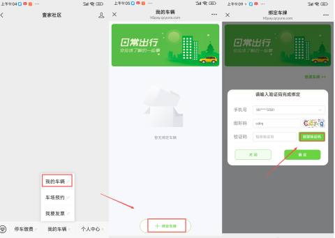

#### 3.购买与激活推送服务
配置的核心步骤是购买并激活“车辆进出场推送”商品。

+ 登录小程序：打开微信小程序 “壹家云助手”。
+ 购买服务：
    1. 进入【商品列表】。
    2. 找到 “车辆进出场推送服务”，点击购买并完成支付。
+ 激活服务：
    1. 购买完成后，进入【我的库存】 -> 【已购服务】。
    2. 找到该服务，点击【激活】。
    3. 在弹窗中输入 车场名称 进行查询。
    4. 点击【去激活】，再次确认即可。

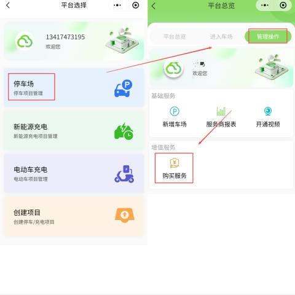

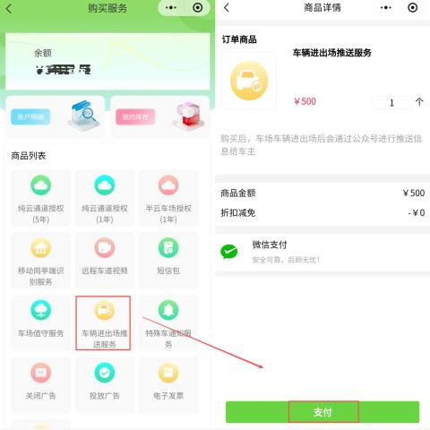

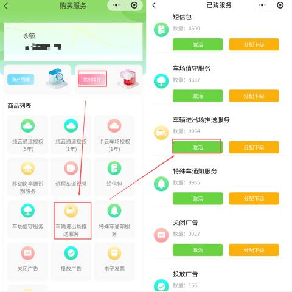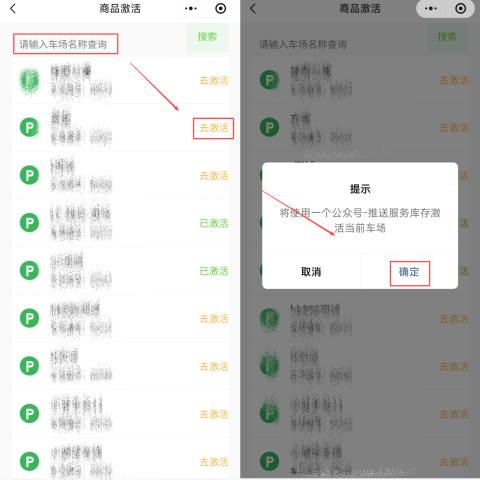

