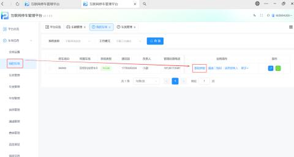
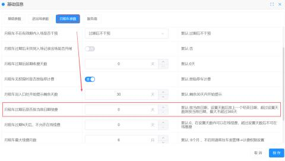
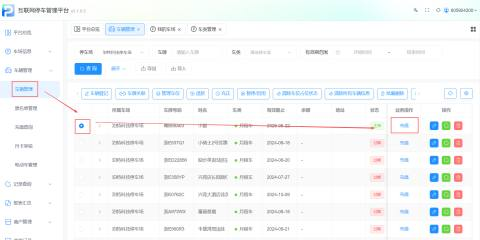
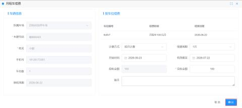
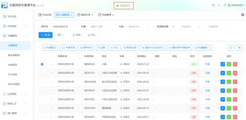
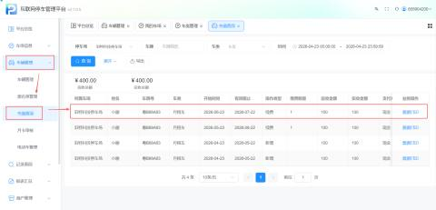
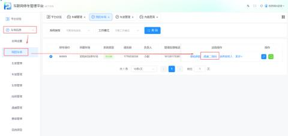
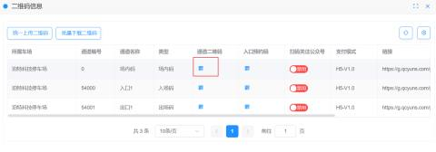
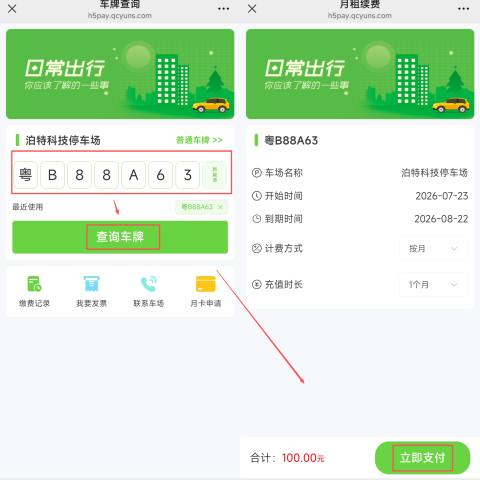

#### 1.功能设置
路径：【车场信息】 -> 【我的车场】 -> 【基础参数】

在“基础参数”页面中，找到 “月租车过期后是否按当前日期续费” 选项，根据需求设置天数（最大365天）。

+ 设置为 0（默认）：按当前日期续费。新租期从续费当天开始计算。
+ 设置天数（如7天）：
+ 在7天内续费：按上一个租期的结束日期计算。
+ 超过7天续费：按当前日期续费（即从续费当天重新开始）。

#### 2.续费方式
#### 2.1 平台后台续费
路径：【车辆管理】 -> 【充值】

1. 在列表中找到需要续费的车辆，点击 【充值】。
2. 确认车辆信息（车牌、姓名、手机号）。
3. 选择续费周期（如1个月）及收费标准。
4. 确认金额并点击 【确认】，支付成功后即完成续费。

充值成功后可查看车辆的详细记录和充值信息

+ 路径：【车辆管理】->【充值查询】

#### 2.2扫码自助续费
用户可通过扫描场内二维码自助完成续费。

1. 获取二维码：路径【车场信息】->【我的车场】->【通道二维码】->【场内码】。
2. 用户操作：微信/支付宝扫描场内码 -> 输入车牌号 -> 查询 -> 确认支付。
3. 完成：支付成功后，系统自动更新有效期。

#### 3.月租车过期后续费方式类型
| #### 1 | #### 默认为0时 | #### 按当前日期。续费时将直接按续费当天作为新租期的开始日期。 |
| --- | --- | --- |
| #### 2 | #### 在设定天数内续费（设定天数最大不超过365天） | #### 按上一个结束日期。情况描述  ：如果设定的天数为"7天 ", 在设定的7天内进行续费， 系统会将新的租期从上一个租期的结束日期开始计算。 |
| #### 3 | #### 超过设定天数后续费 | #### 按当前日期。情况描述  ： 如果用户在月租车过期后，超过了设定的天数（例如7天），那么新的租期将从用户续费当天开始计算，而不是从上一个租期结束的日期开始。 |

