#### 1.设置步骤（配合节假日使用，否则无效）
1.1.新增费率：在【费率管理】中创建新的收费规则。

#### 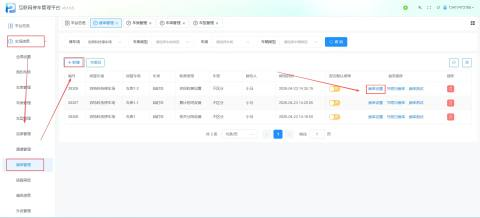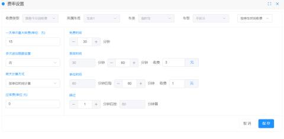
1.2.添加节假日

+ 法定假日：手动添加具体日期（如“五一”劳动节）。
+ 固定假日：设置每周的“周六/日”为节假日。

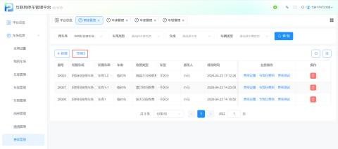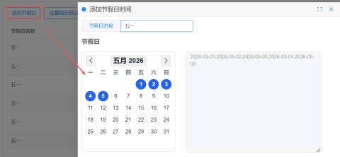

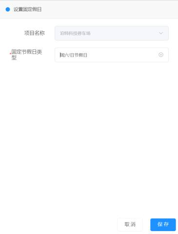

1.3.开启开关：在费率设置页面，将“是否开启节假日”选项设置为开启。

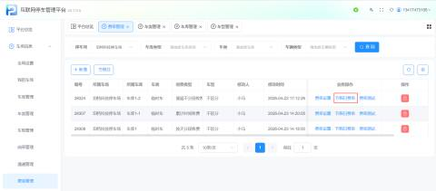

#### 2.跨天收费类型
2.1 节假日跨天按出场时间计算

车辆在工作日进场，在工作日出场，超过一天最大收费按照非工作日一天单次最大收费计算费用，未超过则按照费率正常计费

+ 跨天计算方式按单位时间计算

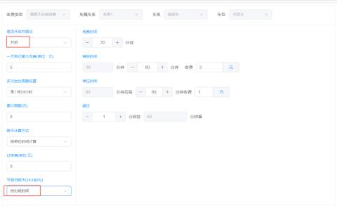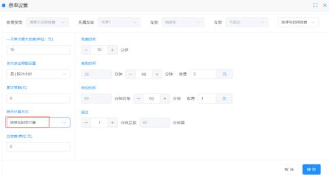

一辆车从11.22   22:20  入场，11.23   03:50  出场，那么按照计费规则应收停车费为：（11.23-11.24非工作日）

11.22  22:20--11.22  23:59 收费 3元

11.23  00:00--11.23  03:50 收费 8元

共计收费：11元

+ 跨天计算方式按首段时间计算

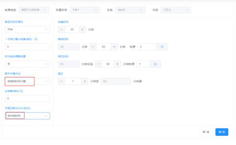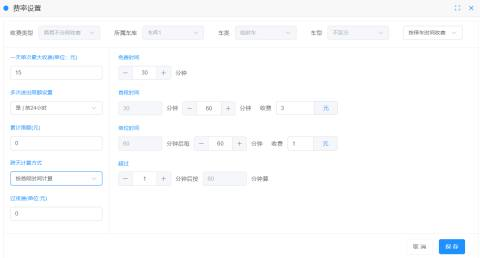

一辆车从11.22   22:20  入场，11.23   03:50  出场，那么按照计费规则应收停车费为：（11.23-11.24非工作日）

11.22  22:20--11.22  23:59 收费 3元

11.23  00:00--11.23  03:50 收费 9元

共计收费：12元

2.2 节假日按按最大收费

车辆按照工作日或非工作日的一天单次最大收费进行计算（工作日一天单次最大收费比非工作日一天单次最大收费小，则按照非工作日一天单次最大收费计算费用）

+ 跨天计算方式按单位时间计算

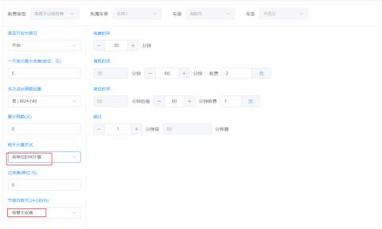

一辆车从11.22   19:15  入场，11.23   03:20  出场，那么按照计费规则应收停车费为：（11.23-11.24非工作日）

11.22  19:15--11.22  23:59 收费 5元（超过一天最大收费）

11.23  00:00--11.23  03:20 收费 7元（超过一天最大收费）

共计：12元，在节假日出场按照节假日一天单次最大收费计算，所以应收费 7元

+ 跨天计算方式按首段时间计算

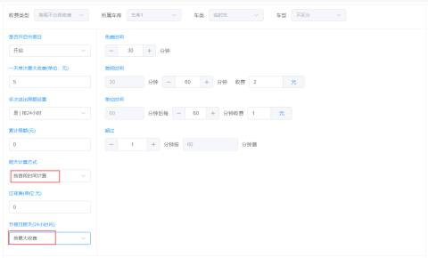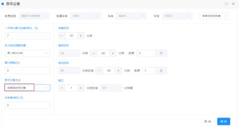

一辆车从11.22   22:50  入场，11.23   00:36  出场，那么按照计费规则应收停车费为：

11.22  22:48--11.22  23:59 收费 3元

11.24  00:00--11.24  00:36 收费 3元

共计收费：6元

2.3 节假日按停车占比收费

**车辆在工作日停车时长短，在非工作日停车时长长，则按照非工作日一天单次最大收费计算费用；  
**车辆在工作日停车时长长，在非工作日停车时长短，则按照工作日一天单次最大收费计算费用；

+ 跨天计算方式按单位时间计算

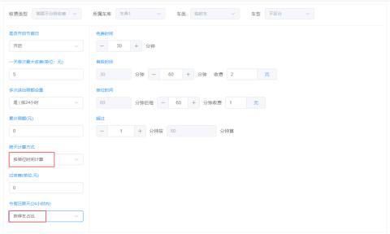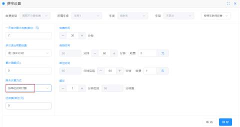

一辆车从11.22   23:05  入场，11.23   02:25  出场，那么按照计费规则应收停车费为：（11.23-11.24非工作日）

11.22  23:05--11.22  23:59 收费 2元

11.23  00:00--11.23  02:25 收费 6元

共计：8元，停车占比在节假日时长久，则按照节假日一天单次最大收费计算，所以应收费 7元

+ 跨天计算方式按首段时间计算

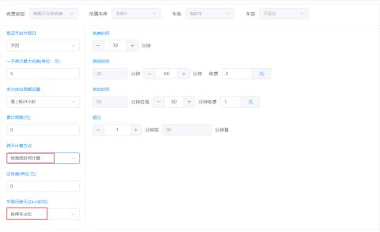

一辆车从11.22   23:15  入场，11.23   00:55  出场，那么按照计费规则应收停车费为：（11.23-11.24非工作日）

11.22  23:15--11.22  23:59 收费 2元

11.23  00:00--11.23  00:55 收费 3元

共计收费：5元

2.4 节假日按两天之和收费

车辆在工作日停车产生的费用与在非工作日产生的费用之和，超过一天最大单次收费则按照最大收费计算，未超过则按费率正常计算

+ 跨天计算方式按单位时间计算

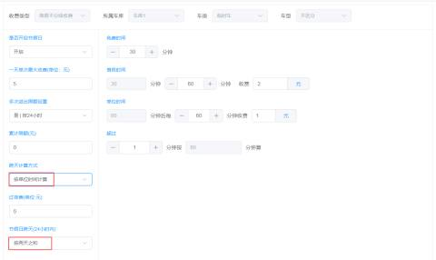

一辆车从11.22   19:00  入场，11.23   05:00  出场，那么按照计费规则应收停车费为：（11.23-11.24非工作日）

11.22  19:00--11.22  23:59 收费 5元（超过一天最大收费）

11.23  00:00--11.23  05:00 收费 7元（超过一天最大收费）

共计收费：12元

+ 跨天计算方式按首段时间计算

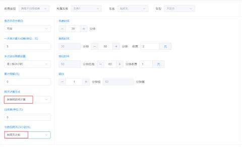

辆车从11.22   22:50  入场，11.23   02:25  出场，那么按照计费规则应收停车费为：（11.23-11.24非工作日）

11.22  22:50--11.22  23:59 收费 3元

11.23  00:00--11.23  02:25 收费 3元

共计收费：10元

