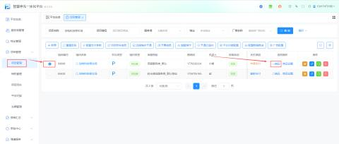
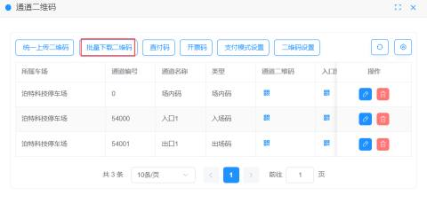
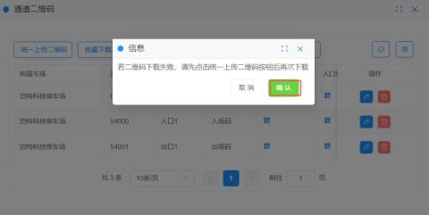

#### 1.二维码下载核心流程
a.进入项目管理：登录停车平台，点击【项目管理】。

b.选择车场：在列表中找到目标车场（如“泊特科技停车场”）。

c.点击二维码：在操作栏找到“二维码”按钮，点击【批量下载】。

d.确认下载：在弹出的提示框中点击【确定】即可。

| #### 二维码下载 | #### 点击二维码→批量下载二维码即可下载本车场所有的二维码，二维码可以提现生成下载给现场制作物料（注：二维码生成后正常是不会改变，但改变通道类型会改变二维码，详情查看平台说明书） |
| --- | --- |
| #### 场内码 | #### 临时车可扫码预先支付停车费用，平台默认15分钟内出场不再计费（这个时间可在基本参数设置，详细的设置可以查看平台说明书），月租车和储值车可扫码月租续费，但不可缴临停费用；也可以用于月租车申请（需要在平台配置消息接收人，详细的设置可以查看平台说明书）；（每个车场仅有一个场内二维码） |
| #### 入口码 | #### 无牌车可扫码入场；（每个入口通道对应一个入口码） |
| #### 出口码 | #### 所有车辆类型都可扫码缴临停费用出场，但不可用于月租车和储值车扫码续费；（每个出口通道对应一个出口码） |
| #### 注：创建车场后平台默认生成场内码，出口码，入口码各一个，如多通道车场可先创建通道后再进行批量下载 | |

