#### 1、登录系统
首先，通过指定地址访问登录页面并完成身份验证。

+ 登录地址：[https://duty.qcyuns.com/#/park](https://duty.qcyuns.com/#/park)
+ 账号获取：登录账号与密码需在“值守平台”的【值守管理】 -> 【值守人员管理】模块中创建。
+ 验证流程：输入账号密码后，需将滑块拖动至右侧完成人机验证，勾选“记住密码”可避免重复输入。

#### 2、值班状态与在线状态
登录后，首页会展示个人中心及实时数据，此时必须检查并设置正确的值班状态。

+ 状态关联：
    - 上班（在线）：主页显示“在线”，系统可正常接收车主的求助呼叫与报警信息。
    - 下班（不在线）：主页显示“不在线”，系统将无法接收任何现场呼叫或报警信息。
+ 设置路径：点击【个人信息】 -> 【配置信息】 -> 修改【值班状态】。

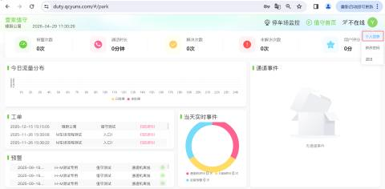

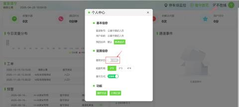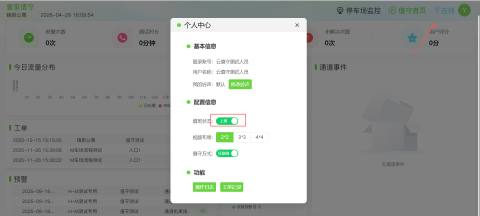

#### 3.监控布局与画面查看
根据现场通道数量，可灵活调整监控画面布局。

+ 布局设置：在【配置信息】中选择 2x2、3x3 或 4x4 布局，最多支持16个通道画面同时展示。
+ 画面切换：
    - 主相机：展示车牌特写信息。
    - 场景相机：展示车道整体环境画面。
+ 操作路径：点击【停车场监控】 -> 【进入通道】 -> 选择具体通道及相机类型。

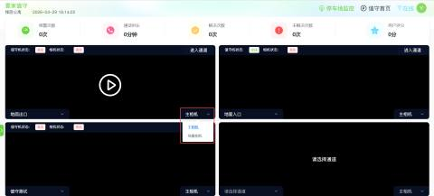

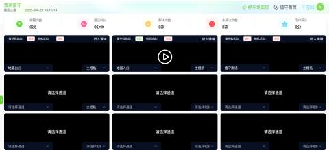

#### 4.事件处理与工单记录
当车主点击现场求助按钮时，系统会触发报警，需及时处理。

+ 报警接收：通道事件列表会实时展示求助信息（如“扫码呼叫”或“通道机离线”）。
+ 处理流程：
    1. 点击【马上处理】进入操作页面。
    2. 核对信息：查看车牌图片、环境画面及车辆详情（入场时间、性质等）。
    3. 执行操作：根据需求点击【入场开闸】、【重新抓拍】或【免费放行】。
    4. 完结：操作完成后点击【处理完成】，并选择对应的处理原因。

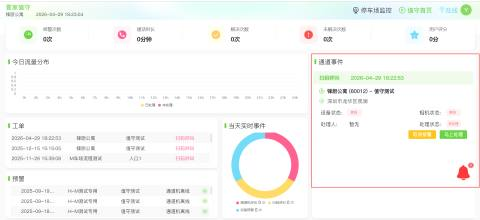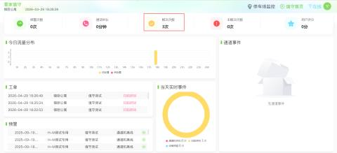

+ 记录查询：
    - 工单记录：查询历史处理记录，包含车场、通道、处理人及时间。
    - 操作日志：查询值班期间的具体操作轨迹。

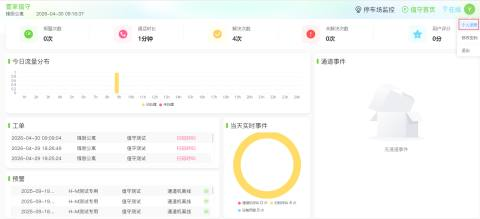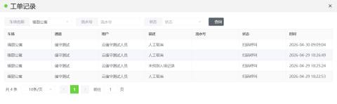

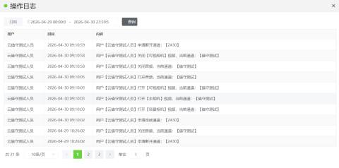

+ 点击马上处理，进入页面可对通道进行开闸、关闸、获取通道最新记录等操作，也可查询在场车辆、进出车辆以及登记车；点击【处理完成】，可以根据车主现场需求选择处理事件的原因

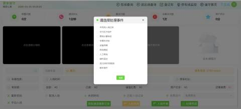

+ 该页面展示四个相机，从左往右分别是：相机图片--环境相机--可视对讲--车牌图片

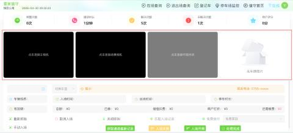

+ 该车牌图片展示的就是该车牌号的详细信息，（抓拍到车牌时，当图片显示抓拍的车牌号码不一致时）可以点击修改按钮进行修改车牌号

+ 查看值班员基本信息，以及设置值班人员上下班情况：值班状态分上班和下班，值班人员为上班状态时才能收到值守机呼叫的报警信息；视频布局可根据车场实际通道数设置，最多可设置为4X4；值守方式分别为互联网与局域网；

#### 5.个人设置与维护
+ 修改密码：点击【个人信息】 -> 【修改密码】，输入原密码及新密码即可更新。
+ 铃声设置：可在【配置信息】中修改呼叫提醒铃声，确保及时响应。

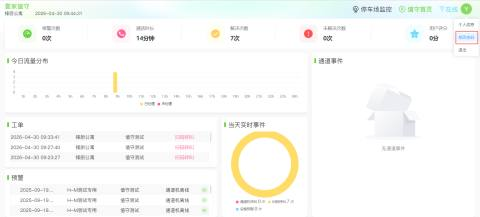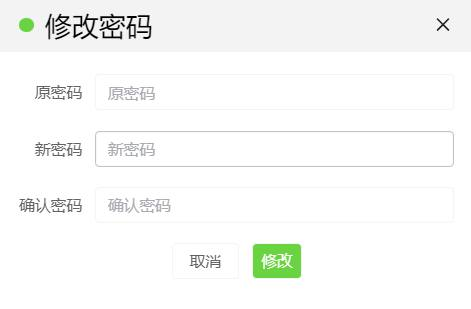

