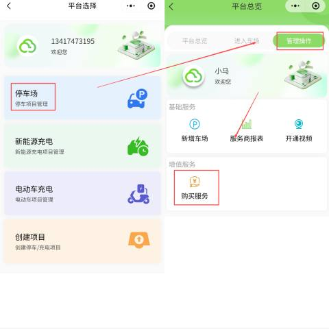
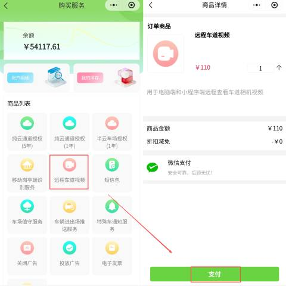
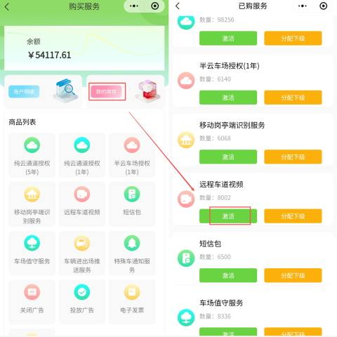
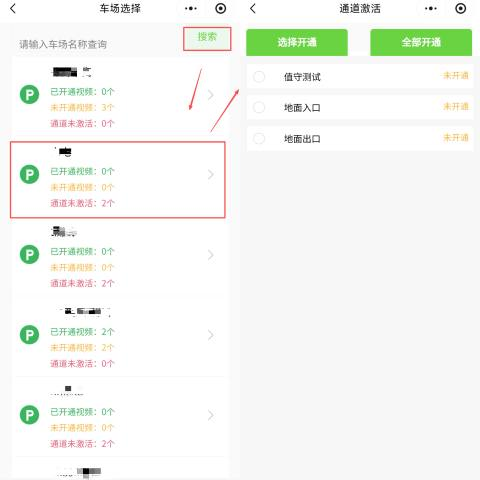

#### 1.进入购买服务页面
首先，登录“壹家云助手”微信小程序，进入停车项目管理界面。

+ 操作路径：登录小程序 -> 点击【停车场】 -> 进入【停车项目管理】。
+ 关键操作：在管理操作列表中，找到并点击 【购买服务】 按钮。

#### 2.购买“远程车道视频”服务
在商品列表中找到对应的视频服务商品并完成购买。

+ 查找商品：在增值服务或商品列表中，找到 “远程车道视频” 商品。
+ 确认购买：点击商品进入详情页，确认商品金额（如 `￥110` /个），选择购买数量。
+ 完成支付：点击【支付】按钮，使用微信支付完成订单。

#### 3.激活服务
购买成功后，需要在库存中激活该服务才能生效。

+ 进入库存：支付完成后，返回【我的库存】页面。
+ 查找服务：在已购服务列表中，找到 “远程车道视频”。
+ 执行激活：点击该服务条目，选择 【激活】 按钮。

#### 4.绑定车场与通道
最后一步是将激活的服务与具体的车场通道进行绑定。

+ 搜索车场：在激活弹窗中，输入 车场名称 进行查询。
+ 选择通道：
    - 指定开通：勾选需要开通视频的特定出入口（如“地面入口”）。
    - 全部开通：点击 【全部开通】 按钮，为该车场所有通道统一开通。
+ 完成：确认选择后，系统显示开通成功，即可在电脑端或小程序端远程查看视频。

