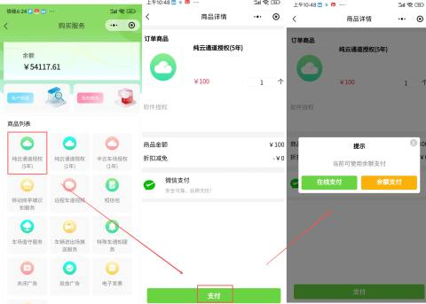
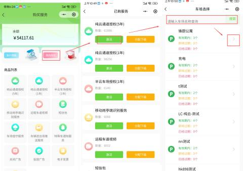
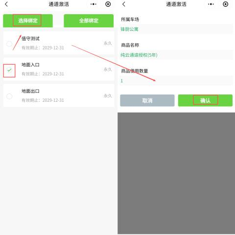
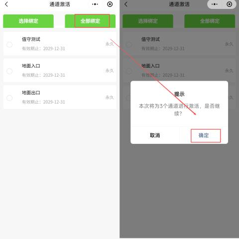

#### 1.进入购买服务页面
首先，登录“壹家云助手”微信小程序，进入停车项目管理界面。

+ 操作路径：登录小程序 -> 点击【停车场】 -> 进入【停车项目管理】。
+ 关键操作：在管理操作列表中，找到并点击 【购买服务】 按钮。

#### 2.购买“纯云通道授权”服务
在商品列表中找到对应的授权服务并完成购买。

+ 查找商品：在增值服务或商品列表中，找到 “纯-云通道授权（5年）” 或 “纯云通道授权（1年）”。
+ 确认购买：点击商品进入详情页，确认商品金额及购买数量。
+ 完成支付：点击【支付】按钮，可选择 在线支付 或使用账户 余额支付 完成订单。

#### 3.激活服务
购买成功后，需要在库存中激活该服务才能生效。

+ 进入库存：支付完成后，返回【我的库存】页面。
+ 查找服务：在已购服务列表中，找到已购买的 “纯云通道授权” 商品。
+ 执行激活：点击该服务条目，选择 【激活】 按钮。

#### 
#### 4.绑定车场与通道
最后一步是将激活的服务与具体的车场通道进行关联。

+ 搜索车场：在激活弹窗中，输入 车场名称 进行查询。
+ 选择通道：
    - 选择绑定：勾选需要激活的特定通道（如“地面入口”），点击确认。
    - 全部绑定：点击 【全部绑定】 按钮，为该车场所有通道统一激活。
+ 完成：确认操作后，系统提示激活成功，所选通道即已开通纯云服务。

+ 选择绑定可将所有通道进行激活

