#### 1.停车券管理
首先，需要在系统中预设各种类型的优惠券，供后续绑定给商户使用。

+ 核心券种配置：
    - 时间券：按设定的单位（小时/分钟/天）减免时长。例如：额度2，单位小时，即优惠2小时。
    - 金额券：按设定的金额直接减免。例如：额度5，即优惠5元。
    - 折扣券：按比例打折。例如：额度2折，即车主享受2折优惠。
    - 特定收费券：绑定特定车类及费率，车辆使用该券时按绑定的费率计算。
    - 多次进出减免券：在设定的时间额度内（如3小时），车辆可免费多次进出。
    - 停车全额减免券：在设定的最大减免金额内全免，超出部分按规则由车主或车场承担。
    - 动态折扣：结合“剩余费用车主承担”或“车场承担”参数，实现灵活的折扣优惠。

1.1.新增停车券

+ 路径：【商户管理】 -> 【停车券管理】 -> 【新增】

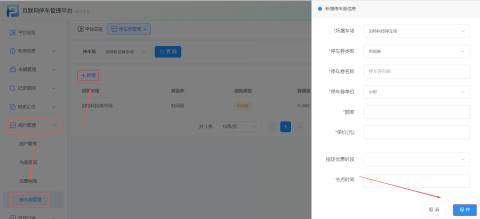

| 停车券名称 | 输入优惠券名称 |
| --- | --- |
| 额度 | 输入优惠券的额度 |
| 停车券类型 | 选择优惠券的类型：时间减免、金额减免、折扣减免、特定收费券、多次进出减免券、停车金额减免 |
| 停车券单位 | 选择好优惠券优惠的时间单位（有小时、分钟、天这三个时间单位选择） |
| 单价 | 输入优惠券的单价 |

+ 时间券

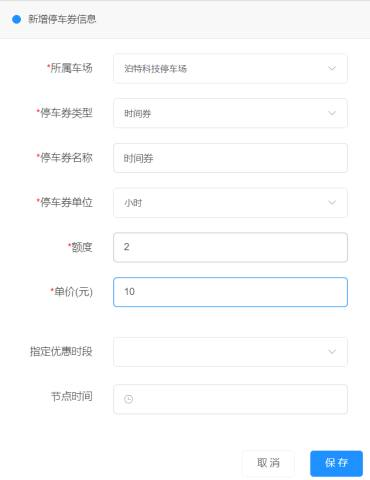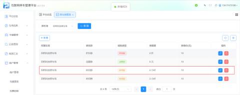

| 1 | 停车券类型 | 选择好停车券类型为时间券 |
| --- | --- | --- |
| 2 | 停车券名称 | 用户根据所需写好停车券的名称 |
| 3 | 停车券单位 | 单位有小时、分钟、天可供选择（此处以小时为例） |
| 4 | 额度 | 额度是跟随着单位走      举例：这里选择的停车券单位是小时，额度为2，也就是时间减免的额度是2小时，就是优惠2个小时。如果选择的停车券单位是天，额度为2，那就是优惠2天，若选择的停车券单位是分钟，额度为2，那就是优惠2分钟。 |
| 5 | 单价 | 单价就是扣除商家多少钱   举例：设置为10元，就是扣除商家10元，优惠两个小时从商家余额扣除10元，发这张券扣除商家10元 |

+ 金额券

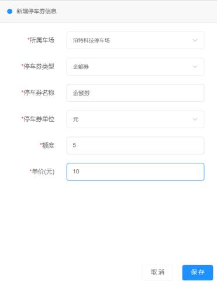

| 1 | 停车券类型 | 选择好停车券类型为金额券，即按照设定的金额进行优惠 |
| --- | --- | --- |
| 2 | 停车券名称 | 用户根据所需写好停车券的名称 |
| 3 | 停车券单位 | 单位为元 |
| 4 | 额度 | 额度是跟随着单位走    举例：这里选择的停车券单位是元，也就是金额减免的额度为5元，也就是给车主优惠5元 |
| 5 | 单价 | 单价就是扣除商家多少钱   举例：设置为10元，就是扣除商家10元，发一张券扣商家10元 |

+ 折扣券

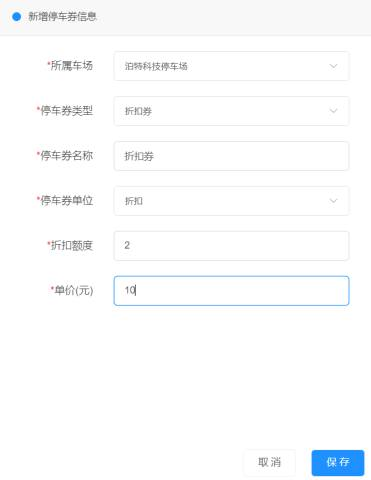

| 1 | 停车券类型 | 选择好停车券类型为折扣减免（折扣减免就是停车金额打折优惠，使用折扣优惠券之后，出场时就是折扣后的金额） |
| --- | --- | --- |
| 2 | 停车券名称 | 用户根据所需写好停车券的名称 |
| 3 | 停车券单位 | 单位为折扣 |
| 4 | 额度 | 额度是跟随着单位走  【配合第3条使用】   举例：这里选择的停车券单位是折扣，也就是减免的额度为2折，也就是给车主优惠打折，优惠2折 |
| 5 | 单价 | 单价就是扣除商家多少钱   举例：设置为10元，就是扣除商家10元，发一张券扣商家10元 |

+ 特定收费券

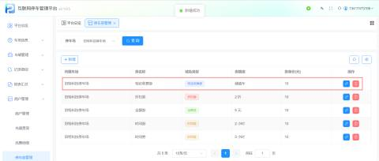

| 1 | 停车券类型 | 选择好停车券类型为特定收费券（使用特定收费券的车牌，则按照设置好的特定收费规则计算费用） |
| --- | --- | --- |
| 2 | 停车券名称 | 用户根据所需写好停车券的名称（但减免类型为特定收费券时，券名称和券的额度相同） |
| 3 | 停车券单位 | 单位为特定收费规则 |
| 4 | 收费车类 | 收费车类在车类管理进行选择 |
| 5 | 单价 | 单价就是扣除商家多少钱   举例：设置为10元，就是扣除商家10元，发一张券扣商家10元 |
| 注意：特定收费券的使用方法需要创建车类，再给车类进行费率设置，然后再使用特定收费券进行绑定车类，特定收费券在商户选择时间减免、金额减免、折扣减免这三种类型的情况下，都可以进行绑定 | | |

+ 多次进出减免券

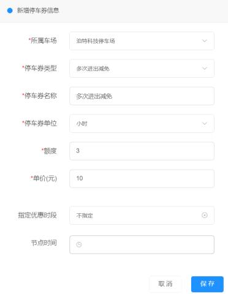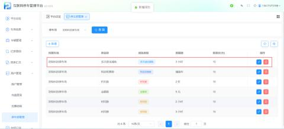

| 1 | 停车券类型 | 选择好停车券类型为多次进出减免（多次进出减免就是设置减免额度（天、小时、分钟），使用优惠券的车牌可以在设定的时间额度内免费进出） |
| --- | --- | --- |
| 2 | 停车券名称 | 用户根据所需写好停车券的名称 |
| 3 | 停车券单位 | 单位为小时，天，分钟，可以自行选择 |
| 4 | 额度 | 额度是跟随着单位走     举例：这里选择的停车券单位是小时，也就是减免的额度为3小时，也就是车主在3小时多次进出都免费 |
| 5 | 单价 | 单价就是扣除商家多少钱   举例：设置为10元，就是扣除商家10元，发一张券扣商家10元 |
| 6 | 指定优惠时段 | 商家可以不指定，也可以指定优惠时段或自定义优惠时段 |

+ 停车全额减免券

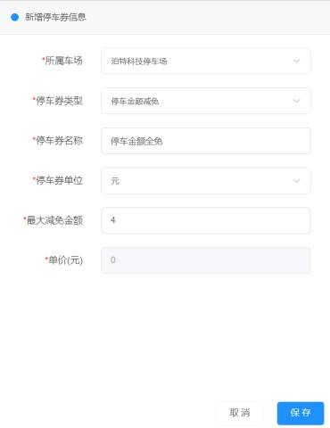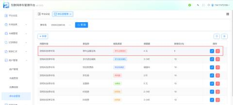

| 1 | 停车券类型 | 选择好停车券类型为停车金额减免（优惠车辆在车场内产生的停车费用（有优惠限额），在额度内的费用全免（直接从商户余额内扣除），超出则按超出的费用缴费） |
| --- | --- | --- |
| 2 | 停车券名称 | 用户根据所需写好停车券的名称 |
| 3 | 停车券单位 | 单位为元 |
| 4 | 最大减免金额 | 最大减免金额是跟随着单位走     举例：这里选择的停车券单位是元，也就是最大金额减免的额度为4元 |

+ 动态折扣

a.新增参数

路径：【我的车场】->【更多】->【高级参数】

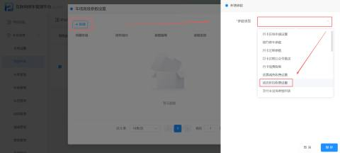

| 剩余费用车主承担 | 商家优惠后，若还需缴费，则由车主进行缴费 |
| --- | --- |
| 剩余费用车场承担 | 商家优惠后，若还需缴费，则由车场承担，车主直接出场不在进行缴费 |

b.新增动态折扣券

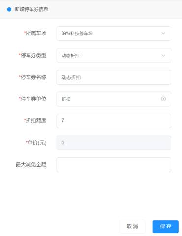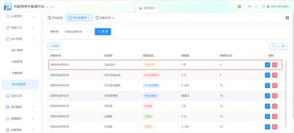

| 1 | 停车券类型 | 选择好停车券类型为动态折扣减免（动态折扣减免就是在最大抵扣额度范围内，对车辆进行折扣） |
| --- | --- | --- |
| 2 | 停车券名称 | 用户根据所需写好停车券的名称 |
| 3 | 停车券单位 | 单位为折扣 |
| 4 | 额度 | 额度是跟随着单位走     举例：这里选择的停车券单位是折扣，券的额度为7折，当停车费为5元时，扣除商家余额“3.5元”，若参数设置为剩余费用车主自行承担，则车主缴纳1.5元即可出场；若参数设置为剩余费用车场承担，则车主可以直接出场 |
| 5 | 最大减免金额 | 最大抵扣的额度   举例：最大减免金额是3元，当停车费为5元时，券额度为7折，此时商家需减免的金额为“3.5元”，超出最大减免金额，所以只能扣除商家余额“3元”，剩余2元需车主或车场承担 |

1.2修改停车券

可对已经添加设置好的停车券进行修改

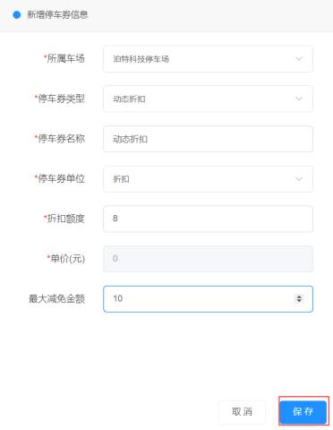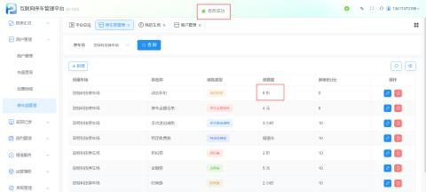

1.3 删除停车券

可删除已有停车券，点击删除并确认，相应停车券被删除成功

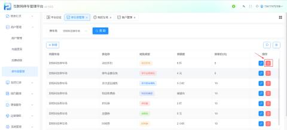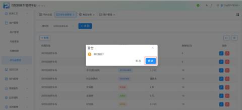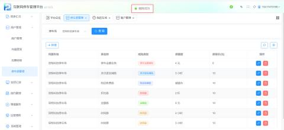

