#### 操作员管理
对已入驻的商户进行日常运营维护。

+ 操作员管理：
    - 路径：【商户管理】 -> 【操作员管理】
    - 功能：为商户添加子账号，分配操作权限，支持重置密码。

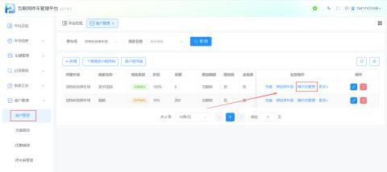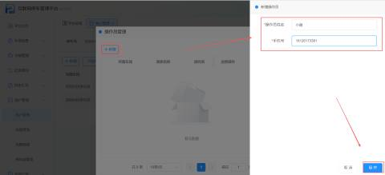

| 操作员姓名 | 输入管理商场的操作员的姓名 |
| --- | --- |
| 手机号 | 输入手机号 （该手机号也可以用于停车商户平台的账号） |


+ 添加操作员成功之后，可以进行查看账号信息

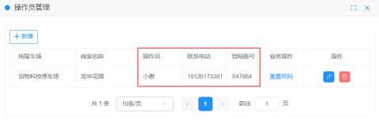

| 1 | 联系电话 | 该电话号码时操作管理员的联系方式（该手机号也可以用于停车商户平台的账号） |
| --- | --- | --- |
| 2 | 登录账号 | 登录停车商户平台的账号，初始密码为123456   举例：初次登入停车商户平台，账号可以为手机号，在此例中为13428329149，密码为123456 |
| 3 | 重置密码 | 操作员可以根据所需对自己的账号进行重置密码 |


+ 修改信息

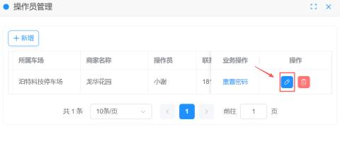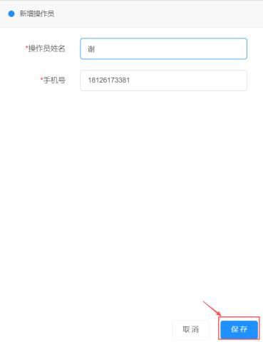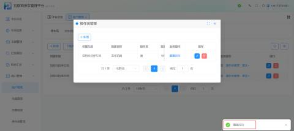

+ 删除操作员

商户需要更换操作员时，需要把原来的操作员删除，再添加新的操作员

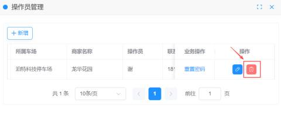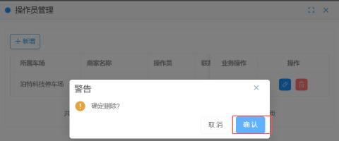

+ 退款：
    - 路径：【商户管理】 -> 【更多】 -> 【退款】
    - 功能：为商户办理余额退款，需输入应退金额与实退金额。

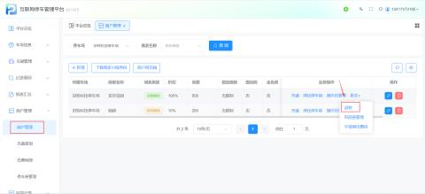

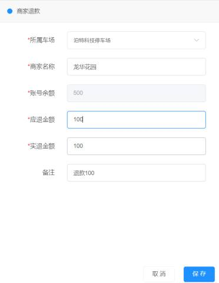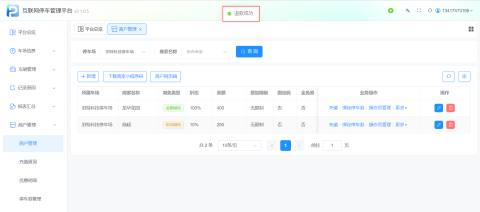

| 1 | 商家名称 | 选择好要进行退款操作的商家 |
| --- | --- | --- |
| 2 | 余额（账户余额） | 现实该商户的余额所剩多少 |
| 3 | 应退金额 | 输入要退的金额   举例：输入100，则要退的金额就是100 |
| 4 | 实退金额 | 实退的金额就是应退的金额输入100那么实退的金额就是100 |
| 5 | 备注 | 退款备注，可以不填 |


在商家网页端查看余额，还有400元

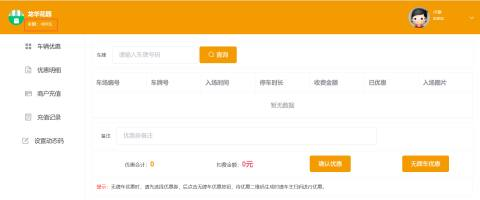

+ 编辑/删除：支持修改商户信息或删除不再合作的商户。
    - 编辑

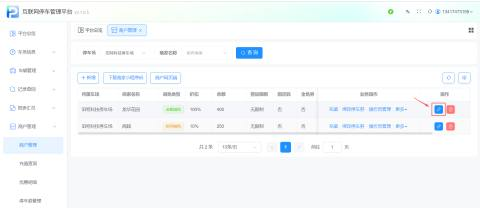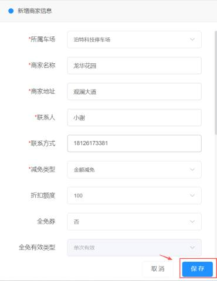

```plain
- 删除
```

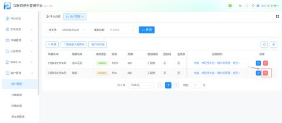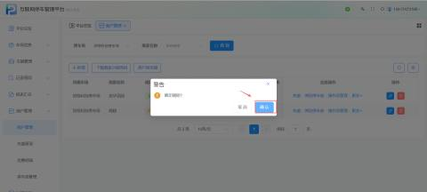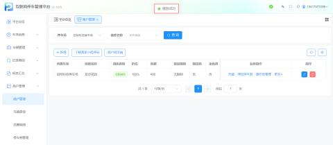


