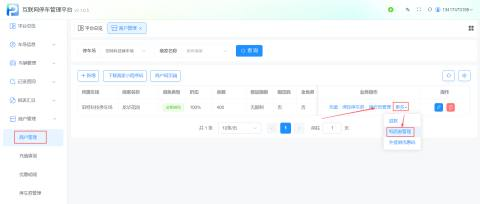
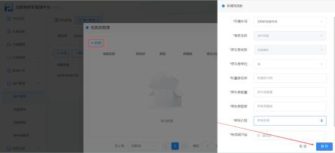
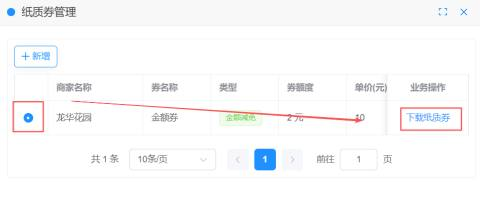
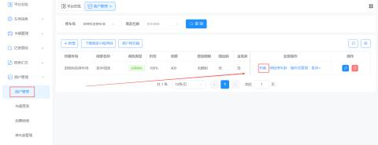
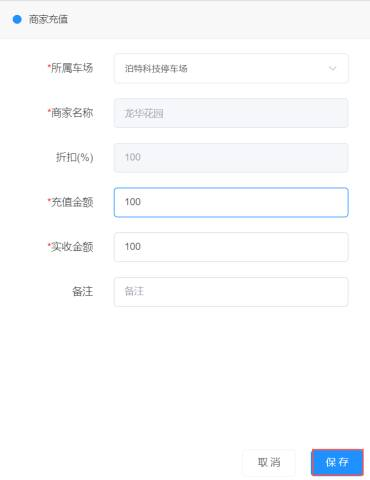
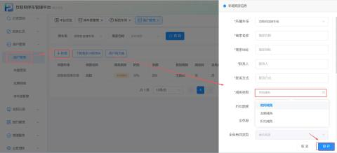
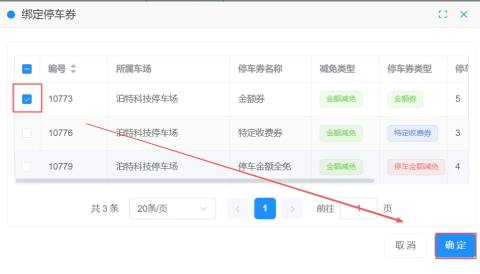

#### 优惠券管理
管理商户拥有的优惠券库存及纸质券。

+ 纸质券管理：
+ 路径：【商户管理】 -> 【更多】 -> 【纸质券管理】
+ 功能：生成可打印的PDF纸质券，设置单张额度、价格及有效期。

点击新增，填写所需参数后保存即可。勾选商户，可下载纸质券，下载格式为PDF，可以打印裁剪

| 1 | 所属车场 | 默认当前车场 |
| --- | --- | --- |
| 2 | 商家名称 | 默认当前商家名称 |
| 3 | 停车券类型 | 默认当前商户可使用券的类型 |
| 4 | 停车券单位 | 设置纸质券的单位，可设置分钟、小时、天做为单位 |
| 5 | 批量券名称 | 自定义纸质券的名称 |
| 6 | 停车券数量 | 设置需要生成纸质券的张数   举例:输入100，那么就是生成100张纸质券 |
| 7 | 单张券额度 | 设置单张纸质券可以减免的额度   举例:输入2，单位选择小时，那么车主扫码领券后可以减免2个小时 |
| 8 | 单张价格 | 设置一张纸质券的价格，单位:元   举例:输入10时，每生成一张纸质券扣除商家余额10元 |
| 9 | 有效期开始 | 设置纸质券可以使用的开始时间 |
| 10 | 有效期结束 | 设置纸质券可以使用的结束时间 |

+ 充值
+ 为商户账户进行余额充值，支持记录充值金额与实收金额的差异。

| 1 | 所属车场 | 默认当前车场 |
| --- | --- | --- |
| 2 | 商家名称 | 默认当前商家名称 |
| 3 | 折扣(%) | 默认当前商家设置的充值折扣 |
| 4 | 充值金额 | 输入需要为商家充值的金额   举例:输入100，即商家余额到账100元 |
| 5 | 实收金额 | 输入实际收取商家金额   举例:输入50，根据第4条充值金额平台记账为:应收100元，实收50元 |
| 6 | 备注 | 可备注充值原因 |

+ 绑定停车券
+ 路径：在商户列表点击【绑定停车券】
+ 逻辑：根据商户的“减免类型”，筛选并绑定对应的停车券。例如，金额减免类型的商户，只能绑定金额券或特定收费券。

| 1 | 减免类型 | 在添加商户的时候是选好减免类型（不可更改）   举例：当商家的减免类型是金额减免 |
| --- | --- | --- |
| 2 | 绑定停车券 | 为商户绑定停车券，停车券的类型需要在“停车券管理”进行添加   举例：当商户选择的减免类型是金额减免，当点击【绑定停车券】按钮时，那么绑定停车券的类型都是与金额减免相关的停车券 |
| 3 | 停车券类型 | 停车券类型与减免类型相关联   注意：特定收费券在金额减免、时间减免、折扣减免这三种类型都可以使用 |

