**外接余位屏能够实时显示停车场的剩余车位信息，确保车主获取到最新、最准确的车位状况。**

#### **1、安装余位屏设备，使设备连接局域网**
#### **2、下载余位屏工具**
#### **3、打开release\LED_Designer.exe**
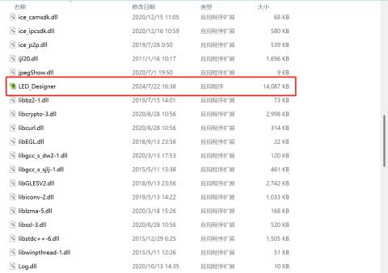

#### 4、搜索控制卡设备
**通讯方式选择****TCP/UDP****，模式选择****TCP****，点击网络配置工具按钮**

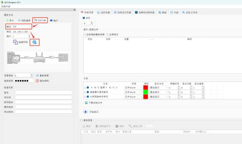

#### 5、修改MQTT配置
**在网络配置工具中点击【搜索设备】，选择搜索出来的设备，需手动修改MQTT透传配置，填写完成后点击【写入配置】--【确定】**

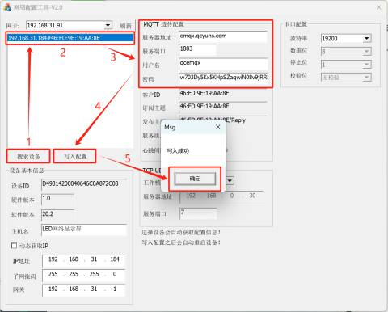

| 服务器地址 | emqx.qcyuns.com |
| ---: | --- |
| 服务器端口 | 1883 |
| 用户名 | qcemqx |
| 密码 | w703Dy5Kx5KHpSZaqwiN08v9jRRDrD |

#### 6、配置MQTT信息
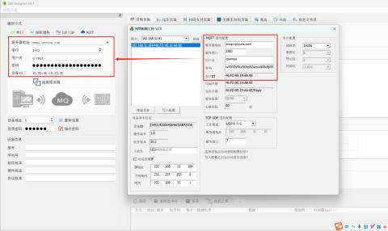

| 服务器地址 | emqx.qcyuns.com |
| ---: | --- |
| 服务器端口 | 1883 |
| 用户名 | qcemqx |
| 密码 | w703Dy5Kx5KHpSZaqwiN08v9jRRDrD |
| 设备ID | 根据自动匹配的客户ID填写 |

**填写完成后点击【连接服务器】**

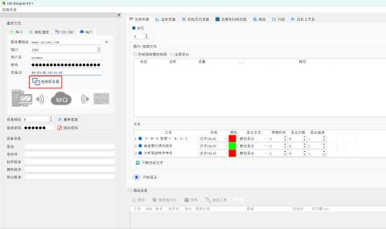

**弹框点击【OK】**

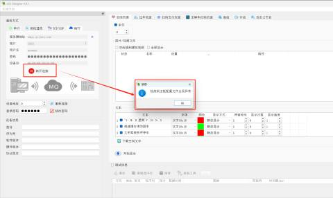

**出现控制板信息表示配置成功**

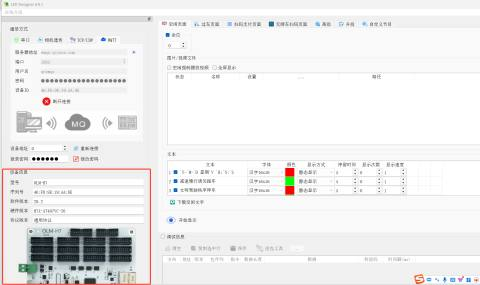

#### 7、配置余位屏信息
**配置成功后打开停车平台【车场信息】--【车库管理】--【外接余位屏】--【确认】（****填写完相应信息****）**

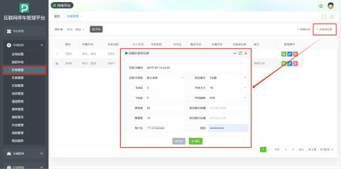

| 控制卡编号 | 输入控制卡的编号，多个设备请用逗号（英文逗号）隔开，例如：46:FD:9E:A1:A9:X2,46:FD:9E:A1:A9:X1 控制卡编号为设备序列号 |
| ---: | --- |
| 控制卡类型 | 默认类型 |
| X坐标 | 默认0，可选填 |
| Y坐标 | 默认0，可选填 |
| 屏宽度 | 根据需要调整屏幕显示的宽度 |
| 余位展示 | 根据需要选择显示余位的位数 |
| 字体大小 | 根据需要选择字体大小 |
| 字体颜色 | 根据需要选择字体颜色（多种颜色可选） |
| 余位展示的前缀 | 可选填 |
| 余位展示的后缀 | 可选填 |
| 用户名 | 用户自定义（选填） |
| 密码 | 用户自定义（选填） |

**若余位屏无反应则重新保存一下车库即可**

#### 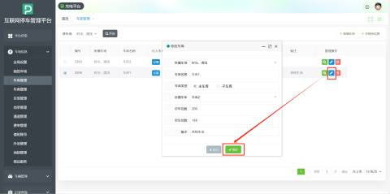
#### 举例：
**场景1：一行显示余位**

**余位展示选择【4位数】，字体颜色选择【绿色】**

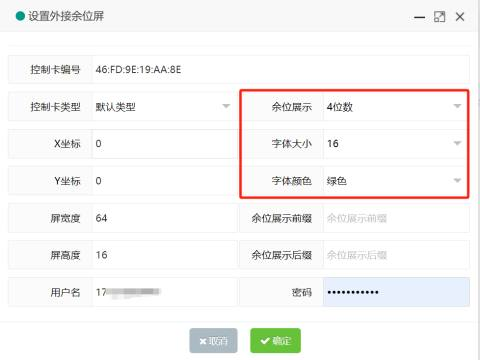

**场景2：一行显示自定义内容+余位**

**余位展示选择【4位数】，字体颜色选择【红色】，余位屏显示前缀【剩余车位：】**

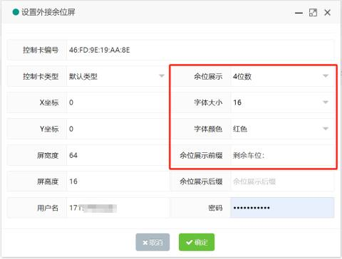

**场景3：两行显示自定义内容+余位**

**余位展示选择【4位数】，字体颜色选择【红色】，余位屏显示前缀【泊特科技】，余位屏显示后缀【剩余车位：】**

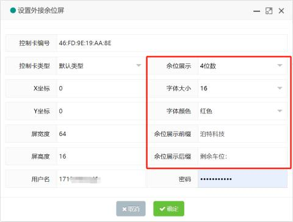

#### 其他说明
**如需有更多场景，请联系服务商！**

