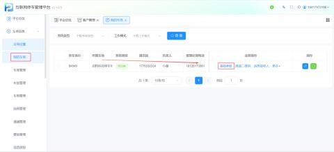
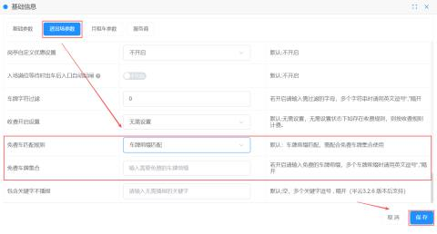
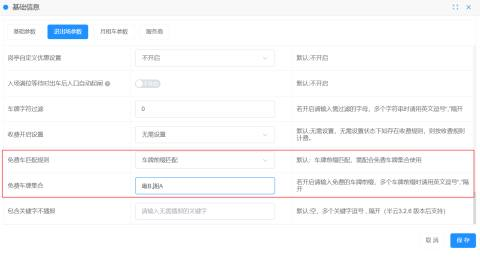
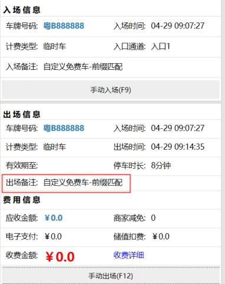
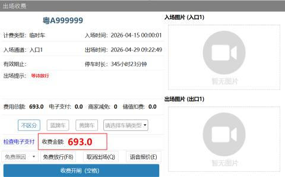
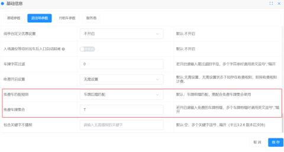
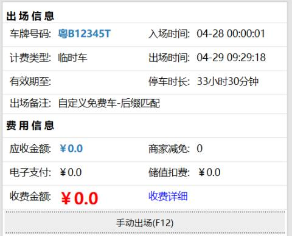
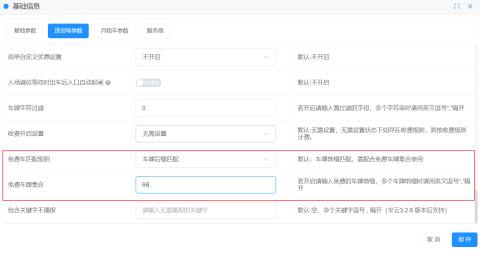
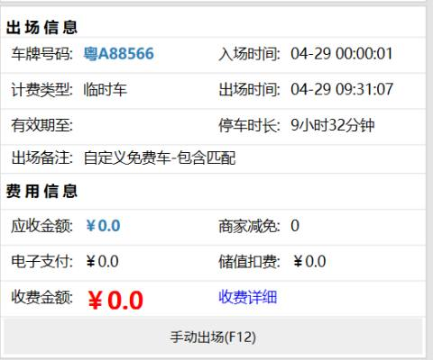

自定义免费车可通过车牌前缀匹配、车牌后缀匹配、车牌包含匹配三种方式实现对符合的车进行免费出场

#### 1.功能路径
路径：【我的车场】 -> 【基础参数】 -> 【进出场参数】

#### 2. 核心匹配规则
系统支持三种车牌匹配方式，需与“免费车牌集合”配合使用。

| 免费车匹配规则 | 选择车牌前缀匹配、车牌后缀匹配、车牌包含匹配   车牌前缀匹配：选择车牌前缀，则在免费车牌集合输入【粤】，那么粤字开头的车牌即可实现免费放行   车牌后缀匹配：选择车牌后缀，则在免费车牌集合输入【新】，那么新字结尾的车牌即可实现免费放行；   车牌包含匹配：选择车牌包含匹配，则在免费车牌集合输入【T】，那么车牌中包含有字母T的车即可实现免费放行； |
| --- | --- |
| 免费车牌集合 | 输入需要免费的车牌前缀，后缀，或包含文字、数字、字母等   车牌前缀匹配：前缀可匹配一位数或多位数，如输入【粤B】，那么车牌前缀为【粤B】的车可免费放行；多个车牌前缀时请用英文逗号“,”隔开，如需要粤A、粤B的车牌进行免费，那么需要输入【粤A,粤B】;   车牌前缀匹配：后缀可匹配一位数或多位数，如输入【66】，那么车牌后缀为【66】的车可免费放行；   车牌包含匹配：可包含一位数及多位数；若包含多位数，则需要同时包含，如输入【999】，那么粤B123999可以免费放行 ，粤B192909则需要收费放行； |
| 免费车匹配规则需与免费车牌集合联动使用，任设置其一则无法实现此功能 | |

+ 车牌前缀匹配

在进出场参数中设置了【车牌前缀匹配】，免费车牌集合为【粤B,湘A】。当车辆出场时，识别到前缀为 粤B，湘A 的车牌就会自动开闸出场，无需收费，岗亭会显示出场备注为：自定义免费车-前缀匹配；若出场的车牌不符合前缀设置，则正常收费出场

+ 车牌后缀匹配

在进出场参数中设置了【车牌后缀匹配】，免费车牌集合为【T】。当车辆出场时，识别到后缀为 T 的车牌就会自动开闸出场，无需收费，岗亭会显示出场备注为：自定义免费车-后缀匹配；若出场的车牌不符合后缀设置，则正常收费出场

+ 车牌包含匹配

在我的车场设置了【车牌包含匹配】，免费车牌集合为【66】。当车辆出场时，识别到车牌包含 66 的车牌就会自动开闸出场，无需收费，岗亭会显示出场备注为：自定义免费车-包含匹配；若出场的车牌不符合包含设置，则正常收费出场

