**云端坐席系统能够实时监控停车场状况，实现对停车场的全面管理。**

### **1、服务商云值守开通**
**首先在【服务商管理】--【新增服务商】新增一个服务商（或选择已有的服务商直接开通）**

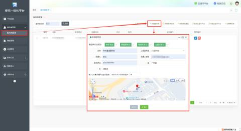**2、开通步骤：【服务商管理】--选择需要开通的服务商--【开通云值守】--【确定】**

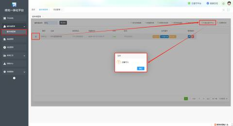

**开通成功后点击【登录云值守平台】即跳转到云值守平台界面。**

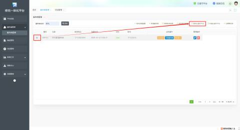

**商户可在云值守平台查看车场实时情况**

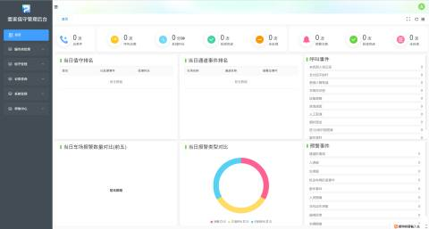

### 2、车场开通云值守
**首先在【项目管理】--【新增项目】里新增一个停车场（或选择已有的停车场直接开通）**

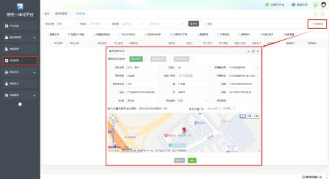

**开通步骤：【项目管理】--选择需要开通的车场--【开通云值守】--确定**

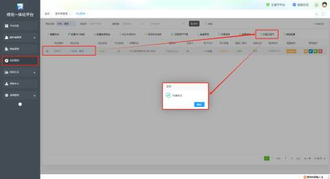

注：车场开通云值守条件为：当前车场所属服务商已经开通过值守平台；若所属服务商未开通需先开通服务商的值守权限才能开通车场的值守平台。

**服务商和车场开通成功后进入值守平台，车场信息会自动同步到该服务商的值守管理后台**

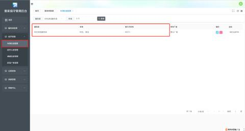

### 3、绑定设备呼叫（若未创建项目设备组则不能使用）
**绑定设备呼叫，即可在微信里接收报警和预警提醒**

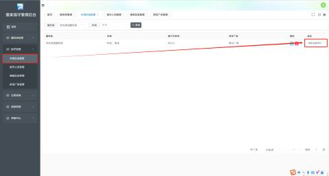

**若未设置微信呼叫，则提示【该项目通道未配置微信呼叫】**

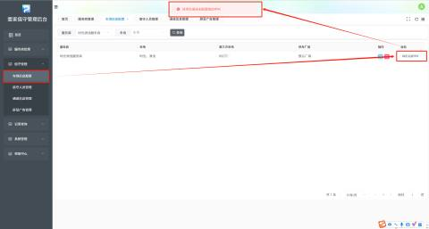

**在【通道信息管理】--选择要绑定的通道--编辑--【音视频方案】选择【微信呼叫设置】，通道配置完成后再进行绑定**

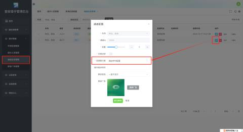

### 4、绑定无人值守机
**在【通道信息管理】点击已从车场同步过来的通道**

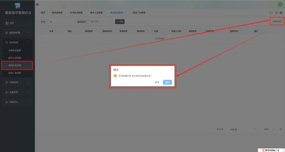

**若同步车场提示【****项目配置为空****】**

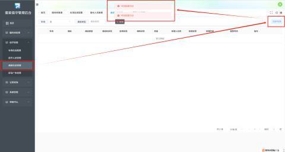

**则在【车场信息配置】--编辑--点击【修改】后再点击同步车场就会同步通道信息**

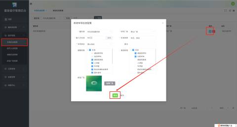

**同步通道成功后，点击修改把值守机序列号填入【值守机序列号】项，提交修改即绑定成功（若通道机状态显示无通道机，点击同步即可）**

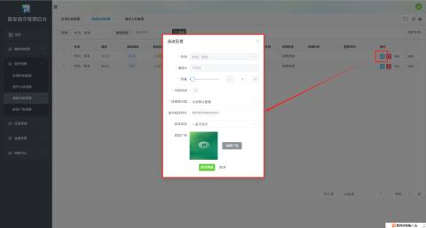

| 车场 | 默认当前车场 |
| ---: | --- |
| 通道Id | 默认车场通道Id |
| 音量 | 根据需求调节音量大小 此处音量大小为无人值守机对讲的音量大小，例如在车主报警与值班人员通话时，音量太小会导致车主听不到值班人员的声音，所以建议音量调大； |
| 可视对讲 | 根据需求开启 |
| 音视频方案 | 目前仅支持云目和芊熠 |
| 值守机序列号 | 填写正确的值守机序列号 |
| 屏显状态 | 根据需求选择屏显状态 |
| 屏显广告 | 根据需求选择屏显广告，与【屏显广告管理】连用 |

**可视对讲：**

**首先在打开【可视对讲】**

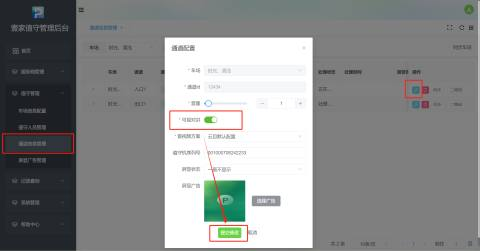

**开启后可在PC端可与通道进行可视对讲**

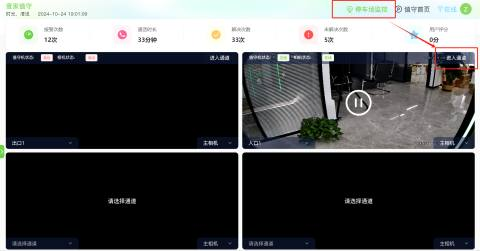

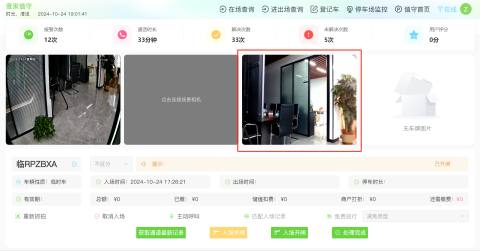

**或者在值守小程序可与通道进行可视对讲**

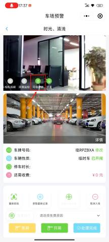

**注：进入值守平台的方式有两种：  
****1、直接从停车平台跳转；**

**2、网址登录**[**https://c.qcyuns.com/#/dutyLogin**](https://c.qcyuns.com/#/dutyLogin)** **

**登录账号【服务商管理】里查看，默认密码为【****888888****】**

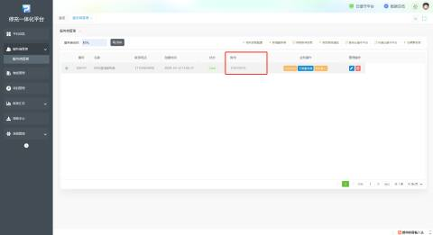

### 5、激活云坐席
**开通好云坐席后需要在小程序激活才能正常使用**

**云坐席激活步骤如下：**

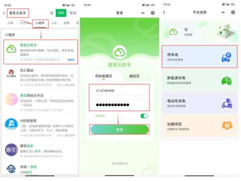

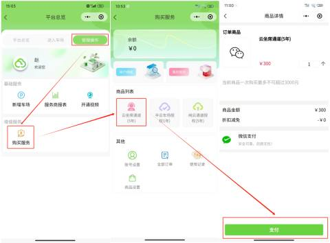

注：单次购买总价不能超过3000元；

### 6、激活通道
**购买完云坐席通道后，激活通道，壹家云助手回到购买服务页面**

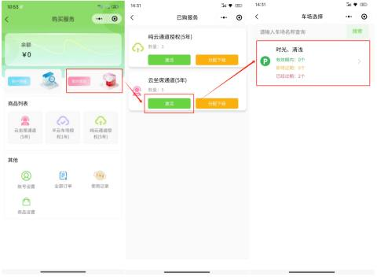

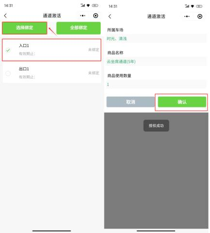

**在小程序激活通道后登录云值守后台【值守管理】--【通道信息管理】--【同步】后启用状态显示【已激活】；**

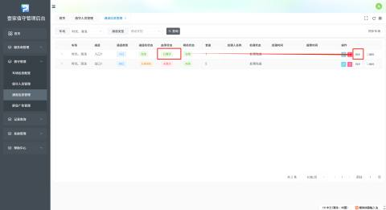

### 7、添加值守人员
**添加值守人员步骤如下：【值守管理】--【值守人员管理】--【添加】--【确认】（填写完相应信息）**

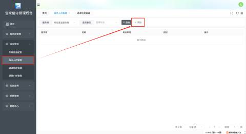

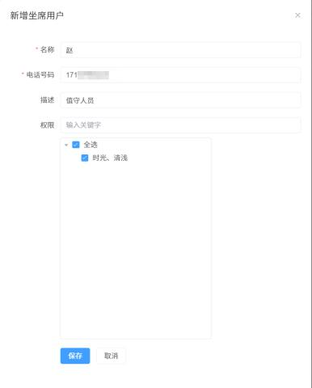

| 名称 | 输入值守人员名称 |
| ---: | --- |
| 电话号码 | 输入值守人员电话号码 |
| 描述 | 可选填 |
| 权限 | 根据需求选择值守人员可值守的停车场 |

**添加完值守人员后点击【获取账号默认信息】，即可查看云值守平台的登录地址、登录账号和初始密码。**

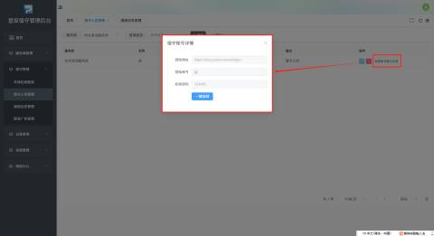

### 8、配置相机环境（可根据现场情况，没有安装环境相机可不用配置）
**登录停车平台--【车场信息】--【通道管理】--【环境监控】--【确认】（填写完相应信息后）**  
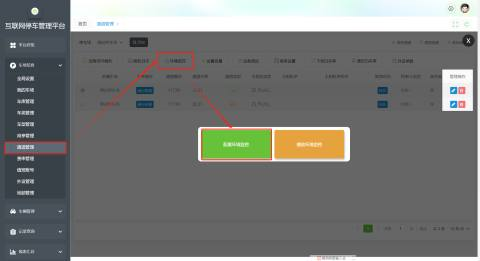

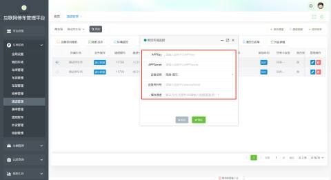

注：1、可支持海康-萤石、大华-乐橙、臻识-RG；

       2、臻识-RG预警推送至云值守平台时，还需在通道管理-外设参数增加一项设备类型为“云目方案”，参数3数据可在已添加的方案进行复制填写，如图下图所示：

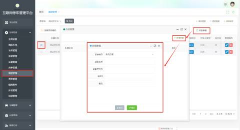

注：以上填写参数均可在萤石获取；

**以上配置操作完成后，值守人员可在云值守平台和小程序进入系统对停车场进行实时监控管理**

**云值守平台（PC端）  
****登录地址：**[https://duty.qcyuns.com/#/park](https://duty.qcyuns.com/#/park)

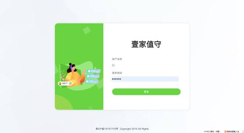

**值守首页可查看车场基本情况**

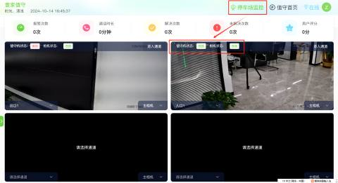

**停车场监控可查看值守机与相机的在线状态**

**值班状态为【下班】时平台显示【不在线】**

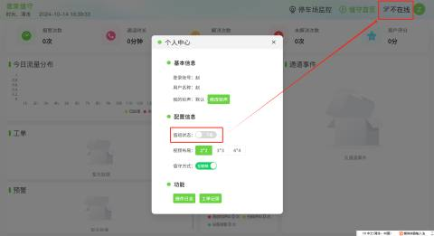

**值班状态为【上班】时，平台显示【在线】**

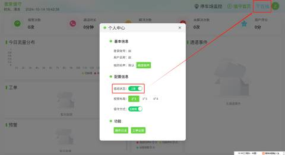

**小程序：**

**在微信小程序搜索“壹家云值守”或者是扫二维码登录。**

**登录云值守**

**【报警】可以看到报警信息**

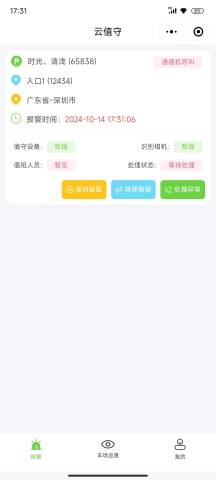

**【车场巡查】可查看通道口在线状态，进入通道可对通道进行开闸、落闸等操作**

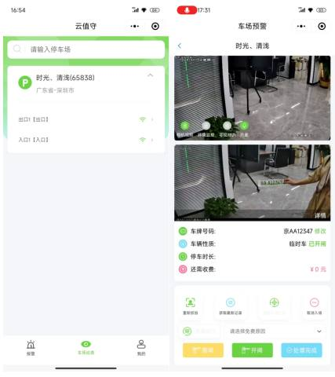

**【我的】可查看通道基本信息和选择值班在线状态等**

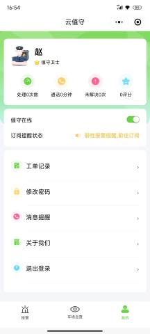

