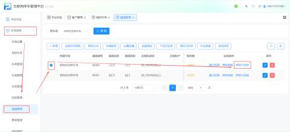
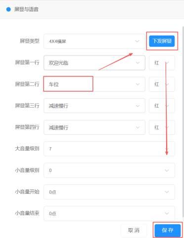
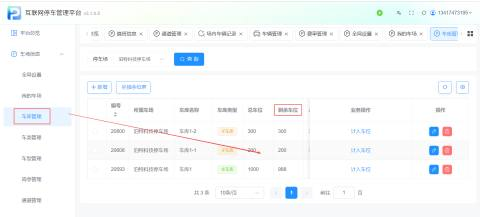
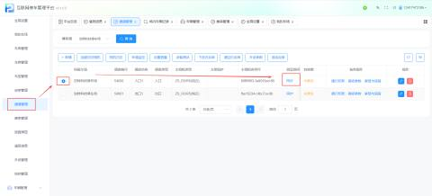

设置时间、余位显示后可在显示屏上实时显示当前时间和车场剩余车位数量。

#### 1.功能路径
路径：【车场信息】 -> 【通道管理】 -> 【屏显与语音】

#### 2.配置时间显示
在屏显设置的第一行输入特定字段，即可控制时间的显示格式与内容。

+ 默认逻辑：屏显第一行默认显示当前时间。
+ 自定义前缀：若在第一行输入【欢迎使用】，屏幕将显示为“欢迎使用 [具体时间]”。
+ 操作步骤：
    1. 在【屏显第一行】输入框中输入“时间”或自定义文本（如“欢迎”）。
    2. 选择需要的字体颜色（如红色）。
    3. 点击【保存】。

| 屏显第一行 | 在屏显第一行输入【时间】两个字，可根据需求选择时间屏显颜色   注：第一行默认显示时间，可在第一行输入需要的字段，例如：输入【欢迎使用】，屏幕上会先显示【欢迎使用】，后显示具体时间 |
| --- | --- |
| 屏显第二行 | 在屏显第二行输入【车位】两个字即可，可根据需求选择屏显颜色   根据本车场总车位数减去已在场车位数自动统计剩余可停车位数，若当前车场没有车辆进入，则输入【车位】无变化； |
| 余位显示只设置在入口通道，请勿进出口都设置 | |

#### 3.配置余位显示
在屏显设置的第二行输入特定字段，即可展示车场的剩余车位数。

+ 核心逻辑：系统会自动统计“车场总车位数”减去“已在场车位数”，实时计算并展示剩余可停车位。
+ 配置要点：
    1. 在【屏显第二行】输入框中输入“车位”两个字。
    2. 选择需要的字体颜色。
    3. 注意：余位显示逻辑只需在入口通道进行设置，出口通道无需配置。
+ 数据来源：剩余车位数据来源于【我的车场】 -> 【车库管理】中的统计信息。

#### 4.同步与生效
完成配置后，需手动触发同步操作，使设置生效。

+ 同步路径：返回【通道管理】列表 -> 找到目标通道 -> 点击【同步】按钮。
+ 效果：同步成功后，显示屏将实时更新并展示当前时间与剩余车位数量。

