#### **核心功能原理**
当车辆发生**跟车逃费**（即未缴费成功出场）后，系统会自动记录该车辆的逃费信息。当该车再次进入车场时，系统会自动触发追缴逻辑，强制要求车主补缴上一次的欠费，否则无法正常通行。

#### **设置步骤如下：**
#### **基础配置步骤**
管理员需在后台进行开启和参数设定。

+ **开启路径**：
    - 【全局设置】 -> 【基本参数】 -> 找到【车辆跟车逃费追缴】。
+ **关键参数设置**：
    - **追缴天数**：设置需要追缴的历史逃费记录时间范围。
        * 默认：`0`（不开启）。
        * 范围：最大可设置为 **365天**。
    - **追缴模式**（**非常重要**）：系统提供了两种不同的拦截策略。

| 追缴模式 | 触发时机 | 逻辑说明 | 适用场景 |
| :--- | :--- | :--- | :--- |
| 出场追缴 (建议) | 车辆出场时 | 逃费车辆可以正常入场，但在出场时，系统会合并计算“本次费用+上次逃费”，需一并结清方可出场。 | 大多数常规车场，提升入场通行效率。 |
| 入场追缴 | 车辆入场时 | 逃费车辆在入场环节即被拦截，必须先补缴完历史欠费才能入场；否则闸机不开。 | 对逃费行为零容忍的封闭式或严管车场。 |

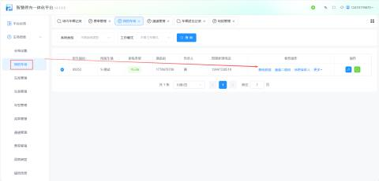

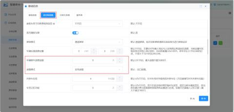

| 车辆跟车逃费追缴 | 默认不开启 根据需求填写需要追缴的时限，可追缴最大天数为365天 |
| --- | --- |
| 追缴模式 | 建议使用出场追缴模式 出场追缴：逃费车辆可入场，但出场时需把逃缴费用一并结清后方可出场 入场追缴：逃费车辆需把逃缴费用结清后方可入场。 |

#### 举例1：
在我的车场里设置了车辆跟车逃费追缴天数为【**5**】天，追缴模式为【**出场追缴**】

**一辆临时车  辽A87459  00:00:01入场，在停车平台【记录查询】--【场内车辆记录】或【车辆进出记录】里查看该进场记录**

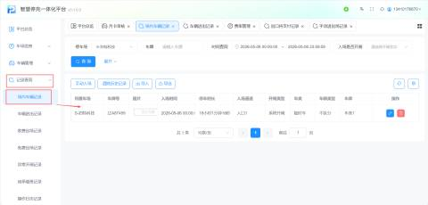

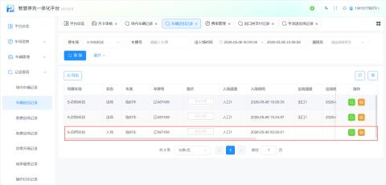

**该车在17：59：40跟车出场，之后在18：00：33再次入场形成在场记录**   

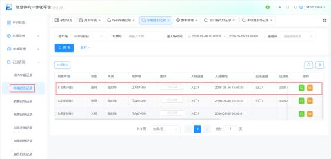

然后再次出场时，系统会检测该车为逃费车辆，计费入场时间显示为上一次的入场时间（00：00：01），在停车平台**【记录查询】--【出口待支付记录】**里查看

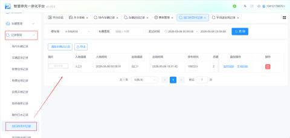

**或在微信壹家云助手小程序【停车场】--【进入车场】--选择需要查看的停车场--进入通道，在通道视频下方有提示上次的欠费金额2元**

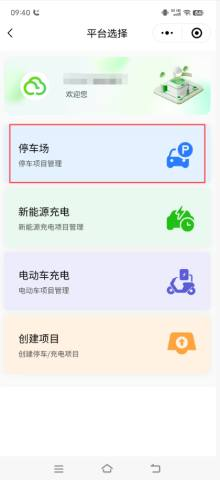

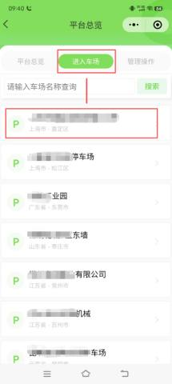

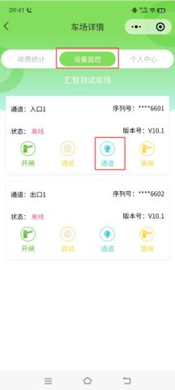

车主扫入场码进行缴费成功后方可入场，平台上会形成逃费追缴记录，在**【追缴管理】--【待确认记录】**查看

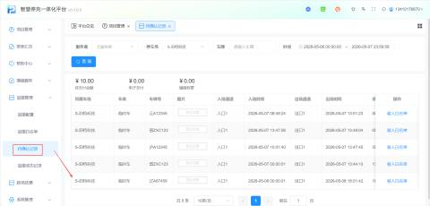

举例2：

在我的车场里设置了车辆跟车逃费追缴天数为**【****5****】**天，追缴模式为**【****入场追缴****】**

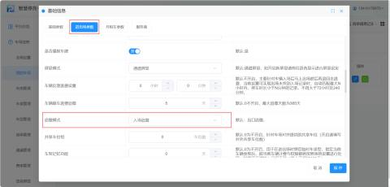

**一辆临时车  云A12345  在08:49:24入场，在停车平台【记录查询】--【场内车辆记录】或【车辆进出记录】里查看该进场记录**

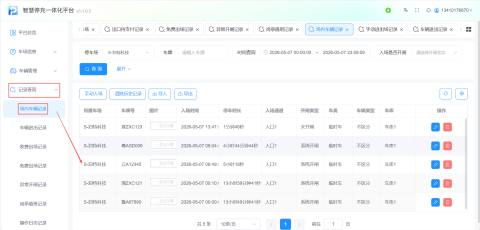

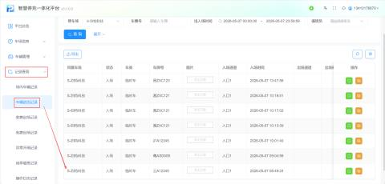

**该车在09：58：11跟车出场，之后在13:51:59再次入场则提示禁止通行**

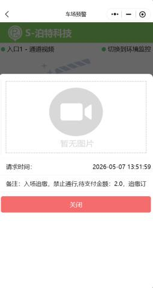

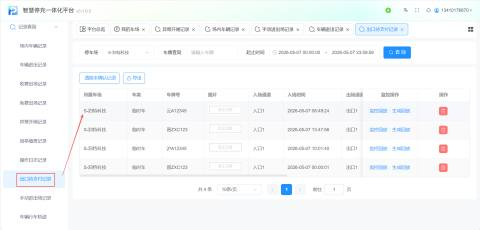

车主扫入场码进行缴费成功后方可入场，平台上会形成逃费追缴记录，在**【追缴管理】--【待确认记录】**查看

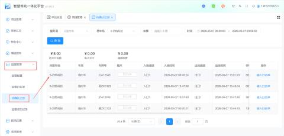  

****

