**线上申请月卡的审核会在此处展示：整个步骤流程如下：**

**首先应需要线上申请月卡**

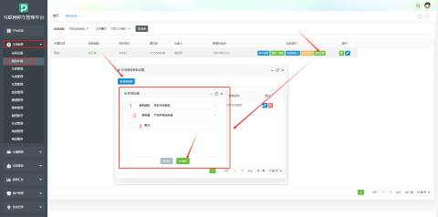

| 1 | 参数类型 | 下拉框，选择自助注册参数 |
| :---: | :---: | :--- |
| 2 | 参数值 | 下拉框，选择开启并推送申请 |
| 3 | 备注 | 用户根据所需进行填写 选填 |

**（2）登录停车平台，依次点击：车场信息(左侧列表)--我的车场--消息接收人--新增接收人**

**进行二维码扫码关注绑定消息接收人**

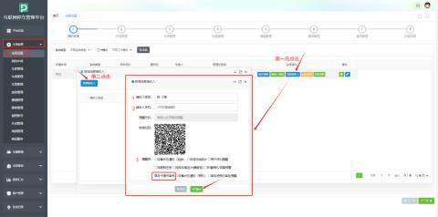

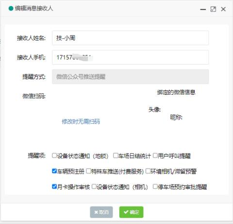

| 1 | 接收人姓名 | 输入接收人姓名，比如技-小周， |
| :---: | :---: | :--- |
| 2 | 接收人手机 | 输入接收人手机号码 |
| 3 | 提醒项 | 勾选“车辆预注册”“月卡操作审核” |

**（3）消息接收人绑定完毕之后，****依次点击--通道二维码--场内码**

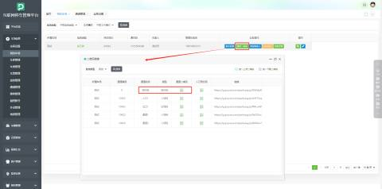

**注意：在车类的设置中只有允许这类车辆在线注册，车主才能进行线上申请月卡：**

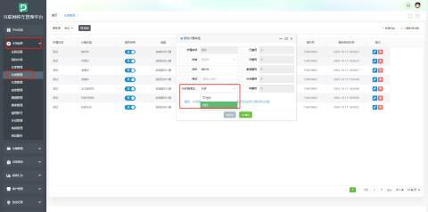

**（4）进行扫码**

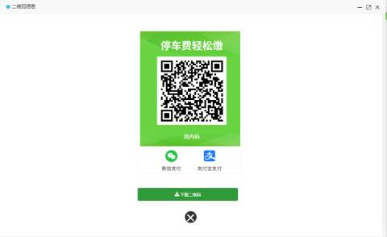

**（5）扫码进入此页面，点击【月卡车申请】**

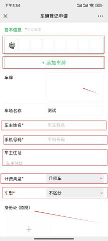

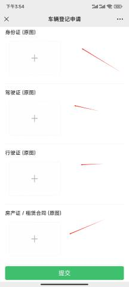

| **车牌** | **输入要是申请月卡的车牌号** 举例：“粤D34567”此车辆要申请月卡 |
| ---: | --- |
| **添加车牌** | **用户在输入车牌后可以点击添加车牌后会自动加入到车牌列表中** |
| **车场名称** | **默认当前该车所属的车场** |
| **车主姓名** | **车主输入姓名，（**必填**）** |
| **手机号码** | **车主输入手机号码，（**必填**）** |
| **车主地址** | **车主地址，选填** |
| **计费类型** | **下拉框，根据需求进行设置，（**必填**） ** 举例：此处选择“月租车” |
| **车型** | **下拉框，根据需求进行设置，（**必填**）** 举例：此处选择“不区分” |
| **身份证** | **根据现场需求进行设置，选填   ****客户可以点击“+”上传身份证图片** |
| **驾驶证** | **根据现场需求进行设置，选填** **客户可以点击“+”上传身份证图片** |
| **行驶证** | **根据现场需求进行设置，选填** **客户可以点击“+”上传行驶证证图片** |
| **房产证/租赁合同** | **根据现场需求进行设置，选填** **客户可以点击“+”上传房产证/租赁合同图片** |

**最后点击【提交】即可。点击提交之后等待接收人进行审核**

**消息接收人接收到车主“月租车线上申请”**

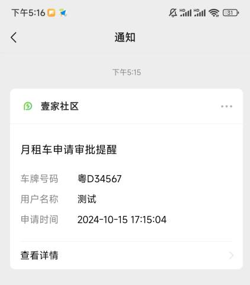

**消息接收人检查完毕点击【审核通过】**

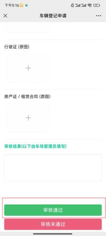

**车主审核通过提醒：点击【查看详情】**

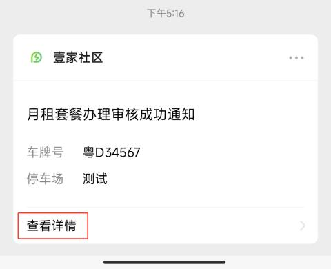

**进行月租申请确认后点击【确认办理】**

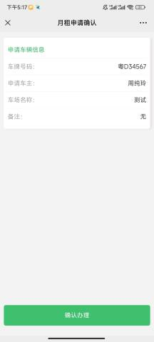

**最后进行支付即可**

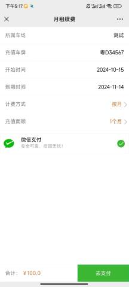

**操作完毕可在平台进行查看，依次点击--车辆管理--月卡审核**

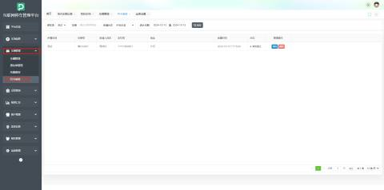

**（6）车主可以在【壹家社区】小程序进行申请月卡，进入小程序，点击【申请月卡】**

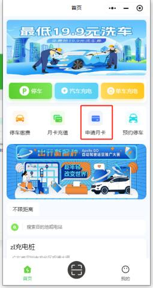

**车主选择在当属的车场后点击【月卡申请】：**

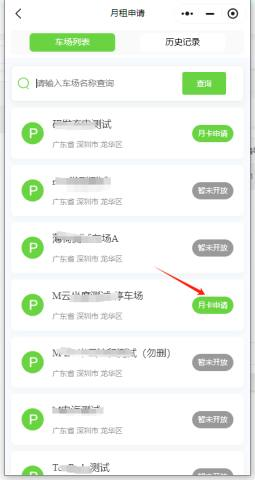

**车主进行填写资料，最后点击【确认办理】即可**

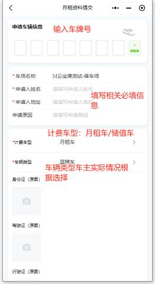

**补充完信息后点击【确认办理】**

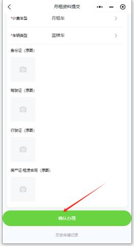

**申请后等待审核：**

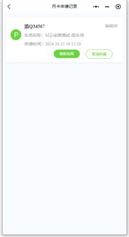

**平台接收到车主申请，点击【审核】进行检查,，点击【审核】按钮：**

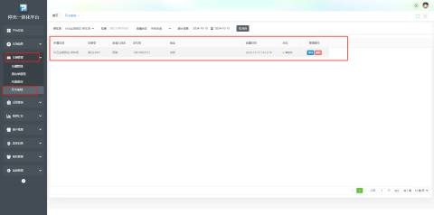

**点击【审核通过】即可：**

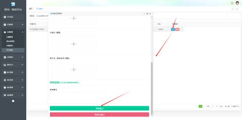

