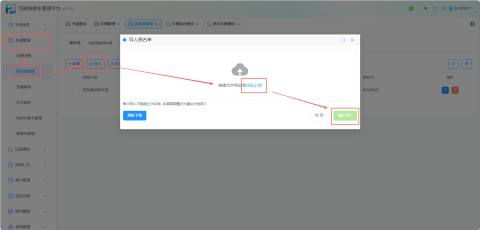
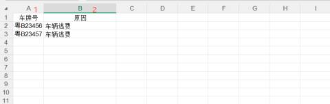
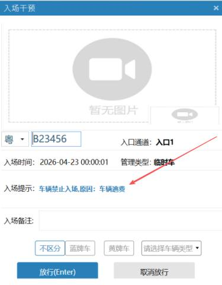

#### **1. 功能入口与定位**
首先，登录互联网停车管理平台（v3.1.0.5），按照以下路径进入功能页面：

+ **路径**：【车辆管理】 -> **【黑名单管理】**。

#### **2. 添加黑名单的两种方式**
系统支持通过“单条新增”和“批量导入”两种方式管理黑名单。

+ **方式一：单条新增**
    - 点击页面左上角的【+ 新增】按钮。
    - 在弹窗中输入**车牌号**，选择或填写**原因**（如“车辆逃费”）。
    - 点击【确认】保存。
+ **方式二：批量导入（推荐）**
    - **下载模板**：点击【导入】按钮，在弹窗中点击【模板下载】，获取标准Excel格式。
    - **填写数据**：在模板中按行填写车牌号和原因（如图所示，A列为序号，B列为车牌号，C列为原因）。
    - **上传文件**：回到导入页面，拖拽或点击上传填写好的文件。
    - **注意**：单次导入数据量**不能超过 1500 条**，若数据量过大，建议分批进行。

| 1 | 车牌号 | 输入车牌号 |
| --- | --- | --- |
| 2 | 原因 | 输入原因 举例：”车辆逃费“ |

导入数据成功后：

注意：在黑名单管理上的车牌是进不了车场的，在岗亭端会显示该车辆禁止入场，原因是该车辆逃费

